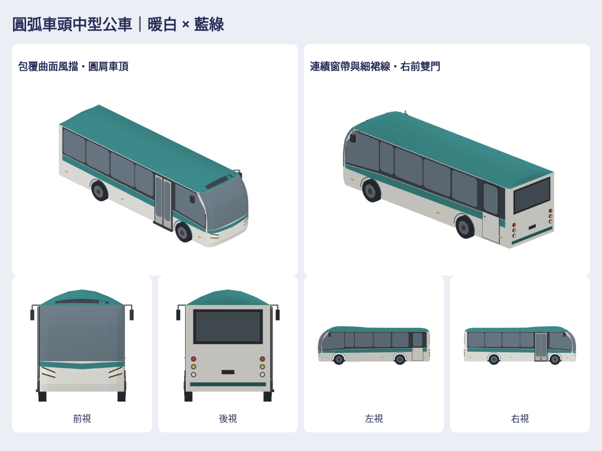

# 暖白藍綠圓弧中型公車

依作者4張綠白兩軸圓頭公車圖，保留短車身、大風擋、抬高車頂、右前雙門與左後高門的辨識點。改遊戲暖白／藍綠霧面頂點色，重新組合前臉弧面、窗片、鏡架、車頂與圓尾燈；左後門作緊急／設備門，非左側乘客上下車。沒有真實品牌或原始mesh／貼圖。

依作者「不夠流線」回饋，本版收圓車頂肩線、讓風擋沿前角包覆並逐段彎入頂蓋、收細連續窗帶與上揚頭燈，移除平頂方蓋。私有成品保留同角度修整前後對照，色票／門／軸距／其餘四車與車流不變。

新增1款life-midiBus，2627三角形；原小巴／低地板／三軸遊覽車／既有大型只是4款對照，native與GLB皆與上一批ZIP逐位元相同。共5native／5GLB／35張上、下、左、右、前、後、立體透明PNG，另900px前後底、同尺度五車車隊、風格檢查與可旋轉viewer。車隊用原生頂點平移與單一相機，不用各自縮放的圖片冒充同尺度。

Map3DMidiBus.model()／Map3DStreetModel.midiBus追加到standard，App既有Map3DCityBus.pack也保留新型。約9.15m長、車身寬2.38m、含鏡2.91m、高3.16m，屬圖片推估造型尺寸，非品牌工程實測。輪底0，兩個真輪拱、封閉鼻殼、沿平面與高度分段、各有實體支持的包覆風擋、相連鏡架與圓肩縱向曲面車頂；薄設備門保留車身原色與細接縫，不用厚灰箱蓋。

原5%總公車池內分配30%小巴／35%低地板／20%遊覽車／10%中巴／5%原大型，前三款seed選型不變。總車量、密度、上限、道路資格與17m保守間距不增。這是街景車型，沒有新增GameCore購車、路線營運或存檔規則。

VERIFIED（Linux／Swift6.4／Node／Chromium）：native所有position/color/glow讀回與法線容差、全量GLB重建／SHA、35PNG實際渲染與獨立RGBA解碼／alpha／像素數／不裁邊、viewer桌面與390px互動、對照車bytes不變；實際七向／底面／四底色／車隊已人工看過。最終本機55個相關XCTest與4個Node測試通過，warnings-as-errors乾淨。UNVERIFIED：真機Metal外觀／效能、車門輪子動畫與物理碰撞、原始圖逐像素相似度；CI以PR當時實際狀態為準。

本批初跑發現舊低地板測試的比例僅計3種bus，漏掉coach／midi；改成全isBus聚合與獨立道路seed，保留5%比例及無bus／有bus總車量相同的要求，並同步coach五型可達斷言。沒有改交通總量來遷就測試。

[完整可複製接手prompt](../VEHICLE_ASSET_HANDOFF_PROMPT.md) · [重建工具](../../../tools/midi-bus/README.md) · [skill](../../../.claude/skills/midi-bus/SKILL.md) · [驗證](verification.json) · [私有完整成品](https://github.com/a91453/railway-reference-private/tree/codex/midi-bus-assets-2026-10-21/Railway/game-art-previews/docs/art/midi-bus-2026-10-21)

本批基於未合併#945（它依#942、#941）的stacked draft；下一位先讀#231與merged狀態，不能假定helper已在main。不推main、不自動合併。
