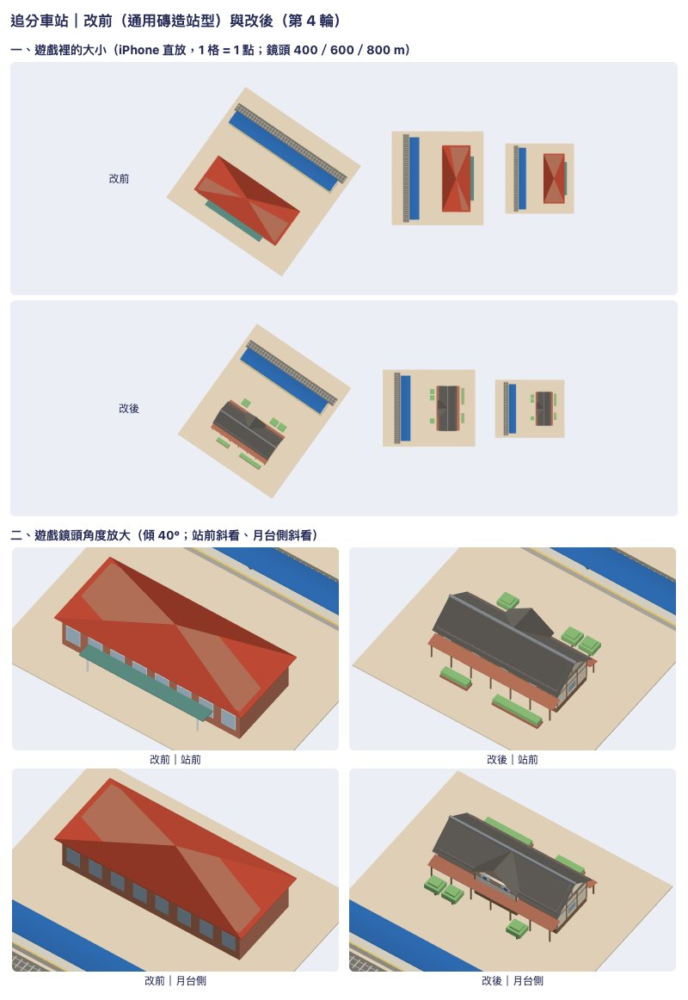

# 看圖再改：追分車站試做與考題（決策 685，2026-11-11）

規矩在 [model-look skill](../../../.claude/skills/model-look/SKILL.md)，工具在 [`tools/model-look/`](../../../tools/model-look/README.md)。這裡只放一張總覽圖；含真實照片的各輪並排圖、照片來源表與模型檔在私有素材庫 `a91453/railway-assets-private` 的 `game-art-previews/docs/art/model-look-2026-11-11/`。

## 為什麼挑追分

- 遊戲裡它由車站套件的通用 `heritage` 站型畫：紅磚牆、紅色四坡頂、綠色雨庇。真的追分是 1922 年的木造站房：灰瓦兩坡頂、米色牆與深色木構、兩側鏽紅披簷、月台側有山牆與圓窗。屋頂的形狀與顏色都相反，是 35 個代表站裡最認不出來的一類。
- 其他代表站多半已有站房研究（決策 625、665）或地標（決策 370、431），不是套件在畫。
- Wikimedia Commons 有站前、月台側、斜角的照片，授權清楚（CC BY-SA 與公有領域）。
- 站房小，三輪以上做得完。

憑什麼認出它：灰瓦的長屋頂；簷下一排窗與白色站名牌；兩長邊的鏽紅披簷與斜撐；月台側到屋脊高的山牆、圓窗與「追分」兩塊白牌。

## 每一輪

| 輪 | 看圖找到的毛病 | 改了什麼 |
|---|---|---|
| 改前 | 紅磚盒子加紅四坡頂；沒有一項特徵 | — |
| 1 | — | 新配方：兩坡灰瓦頂、米牆深色基座、兩側披簷與柱、簷下窗帶與站名牌、月台側山牆 |
| 2 | 太矮太扁（屋頂佔比不夠）；披簷太寬、搶過屋頂；山牆太小、不到屋脊；屋頂一片平；兩端山牆是白板；廣場空 | 簷高 4.6→5.3 m、屋頂升高 2.5→3.1 m；披簷 2.6→2.0 m；山牆加寬到 8.4 m、到脊高、牆面凸出 0.5 m；加屋脊；兩端山牆加木構與窗；站前綠籬 |
| 3 | 站名牌上的深色記號太大，遠看像窗；屋脊和屋面同色；站前沒有通道口；月台側少了照片裡那排修剪的樹 | 站名牌放大、記號縮小改藍；屋脊改淺灰；通道口；月台側三棵樹 |
| 4 | 樹是菱形樹冠加細樹幹，遊戲角度看像浮在半空 | 樹改成平頂修剪型：粗樹幹、兩層樹冠 |

清單現況（事實，不是評分）：屋頂與量體不是盒子；比例照照片推估；屋頂、山牆、披簷都接在牆上，柱子落地；牆、屋頂、披簷、綠籬明度分得開；遊戲大小 400 m、600 m 看得出灰瓦長屋頂、鏽紅披簷與山牆。

## 還有哪裡不好

1. **800 m 遠看只剩灰色長方形加一圈鏽紅邊**，山牆看不出來，和鐵皮屋分得不夠開。
2. **屋面是一整片平的灰**，沒有瓦的分段；近看單調。
3. **窗只凸出 10 cm**，披簷下的門窗近看仍然偏平。
4. 披簷用的是調色盤的磚色，比真的鏽鐵皮橘、鮮；月台側真的是灰紅色。
5. 站名牌上是藍色方塊，不是字。
6. 尺寸全部是照片推估，不是測繪。
7. 圖是套件預覽的畫法（正投影、平光）。**沒有放進真實地圖的場景裡拍，Metal 與實機未驗證（UNVERIFIED）**；套件預覽裡的藍色月台雨棚會擋住月台側，遊戲裡月台是遊戲自己畫的。
8. 日南、談文、大山、新埔是同型式的站房，這次沒有動，仍是通用站型。

及不及格請作者或遊戲規劃看總覽圖決定。

## 考題：有這條規矩與沒有

照 skill-creator 的做法，兩題（`.claude/skills/model-look/evals/`），各由一個子代理在自己的 worktree 做一次：一個讀了 model-look，一個沒有（`main` 的樣子：只有 station-kit 與 art-style）。兩邊拿到的任務文字、環境說明相同。做完後由本 session 用同一支 `shoot.mjs`、同樣的鏡頭把四個結果各拍一張。

| 檢查項目（`evals/*/graders/`） | 保安 有 | 保安 沒有 | 集集 有 | 集集 沒有 |
|---|---|---|---|---|
| 1 列出真實照片、來源與授權 | ✓ | ✓ | ✓ | ✓ |
| 2 至少三輪，每輪寫看圖找到的毛病與改動 | ✓（4 輪） | ✗（一次做完） | ✓（4 輪） | ✗（一次做完） |
| 3 有遊戲鏡頭角度、遊戲大小的圖 | ✓ | ✗（只有放大的各方向圖） | ✓ | ✗（有一張俯視，沒有遊戲大小） |
| 4 模型和同方向的照片並排 | ✓ | ✗ | ✓ | ✗ |
| 5 報告最後列出模型還不好的地方（至少兩點） | ✓（6 點） | 部分（列的多是沒驗證的事） | ✓（7 點） | 部分（同左） |
| 6 不自己打分 | ✓ | ✓ | ✓ | ✓ |
| 7 交一張寬 800 px 內的總覽圖 | ✓ | ✗ | ✓ | ✗ |
| 8 只動這一站 | ✓ | ✓ | ✓ | ✓ |
| 用量（子代理的 token／時間） | 21.1 萬／26 分 | 19.4 萬／31 分 | 21.2 萬／17 分 | 20.0 萬／13 分 |

評分是本 session 對著報告、圖與 diff 做的，不是另一個人；保安「沒有」那一次的時間含它等一個很慢的測試。

**做出來的模型差多少（照實寫）**：差距比預期小。沒有規矩的兩次也自己去找了 Commons 的照片，屋頂的型與顏色都做對了，都比 `main` 的紅磚盒子好得多。同鏡頭並排（私有素材庫 `evals/baoan-compare.jpg`、`evals/jiji-compare.jpg`）看得到的差別：

- 保安：有規矩的那次在遊戲大小還認得出站前那棵高過屋頂的棕櫚（沒有規矩的那次明寫「不畫，會把遠景盒撐高」），月台側有白底藍色站名牌、欄杆與盆花；沒有規矩的那次月台側是一面灰牆配小窗。
- 集集：有規矩的那次把披簷改成比主屋頂淺的灰（第 1 輪看圖發現兩層屋頂糊成一片），站前多了蒸汽機車碑與樹；主體的形狀兩邊差不多。
- 兩邊都還有的毛病：800 m 遠看只剩一塊灰屋頂；站名牌是色塊不是字。

所以這條規矩確定帶來的是**過程與交付**（遊戲大小的圖、照片並排、各輪紀錄、一張總覽圖、老實的弱點清單），模型本身是「略好、在遊戲大小多留住一兩個特徵」，不是差一個等級。每題只跑了一次，沒有重複，也沒有請不知情的人盲評；模型好壞請作者看並排圖判。

考題跑完後依子代理的經驗在清單第 8 條補了一句（站前的樹、紀念物會改變模型外框，遠景方盒與擴建側翼照外框算），沒有再跑第二回合。四次試做的 diff（`changes.patch`）、報告與圖都在私有素材庫，**沒有進這個 PR**：保安與集集的新站型要不要採用，另外決定。
