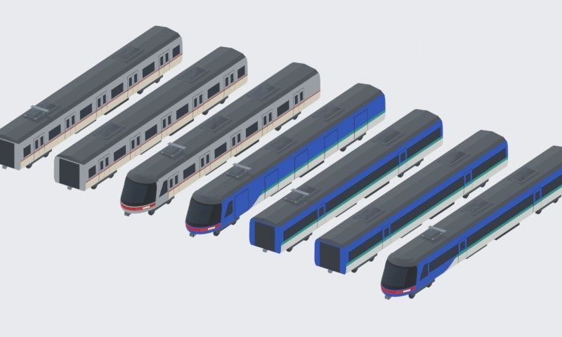

# 香港機場鐵路列車（決策 780）

由左至右：東涌綫駕駛室車、無集電弓中間車、集電弓車（銀灰、米色下半、紅線）；機場快綫駕駛室車、行李車、中間車、集電弓車（寶藍、青綠帶、珍珠白下半）。遊戲角度、平光、色票平塗，不畫公司標誌。

- 做的：本地工作室（Blender 建模、另一個 AI 對照片審），四輪，第 4 輪是第 1 次審查退回（面朝內、門板埋進車身、缺連結器）後的定稿，第 2 次審查通過。
- 重檔（14 個 GLB、七向圖、各輪紀錄、比對用照片與來源）：`a91453/railway-assets-private`，`game-art-previews/docs/art/mtr-airport-line-2026-11/`。照片只在那裡，不進這個 repo。
- 轉進遊戲：`tools/train-models/glb_to_swift.py`，指令寫在 `Sources/GamePresentation/Map3DMTRAirportLine.swift` 與那支工具的開頭。

## 還有哪裡不好

1. 門窗四角是直角，實車是圓角；遊戲大小看不出，近看看得出。
2. 機場快綫車尾的白色斜紋圖案沒畫，只有青綠與珍珠白的斜切色塊。
3. 還沒在 iPhone 上看過放在香港地圖上的樣子（只看過工作室的遊戲角度圖與遊戲大小圖）。
