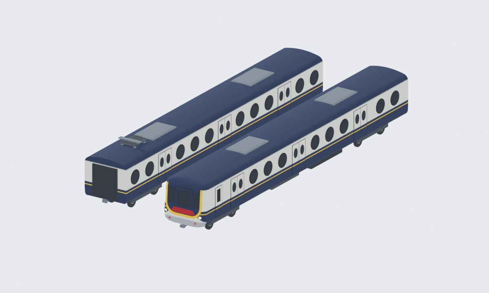

# 香港迪士尼綫列車（決策 852）

左：集電弓車（C）；右：駕駛室車（A）斜前。白車身、深藍下半藍帶與整片車頂，藍帶裡一條細金線；車頭深藍面罩、金色 U 弧帶、紅帶，保險桿銀灰；每側 3 組門，客室窗是圓窗與橢圓窗。遊戲角度、平光、色票平塗，不畫港鐵或迪士尼的標誌、角色圖樣與文字（照片裡的米奇形窗也不做）。

- 做的：本地工作室（Claude 做、Codex 對照片審）。Codex 第 1 輪退回四點（車頭藍頂蓋的弧、保險桿下緣、金線位置、集電弓懸空），第 5 輪修好後通過（素材庫 `a91453/railway-assets-private-2` #8）。
- 重檔（4 個 GLB、七向圖、各輪紀錄、比對用照片與來源）：`a91453/railway-assets-private-2`，`game-art-previews/docs/art/mtr-disneyland-line-2026-11/`（revision-5）。照片只在那裡，不進這個 repo。
- 轉進遊戲：`tools/train-models/glb_to_swift.py`，材質順序寫在 `Sources/GamePresentation/Map3DMTRDisneylandLine.swift`。

## 還有哪裡不好

1. 藍色用遊戲已有的 `playerRim`（#26385C），比照片暗、少一點紫；遊戲大小看起來略暗，協調者已決定先接受、不改模型。
2. 金線高度（軌面上 1.64–1.70 m）是照斜拍照片比例目測的。
3. 駕駛室車近景 11,862 面，離工作室的上限 12,000 只剩 138 面；要加細節得先省面。
4. 照片的客室窗有一半是米奇形，這裡全用圓窗，所以圓窗比照片多；車端通道是一整塊深灰。
5. 還沒在 iPhone 上看過放在香港地圖上的樣子。
