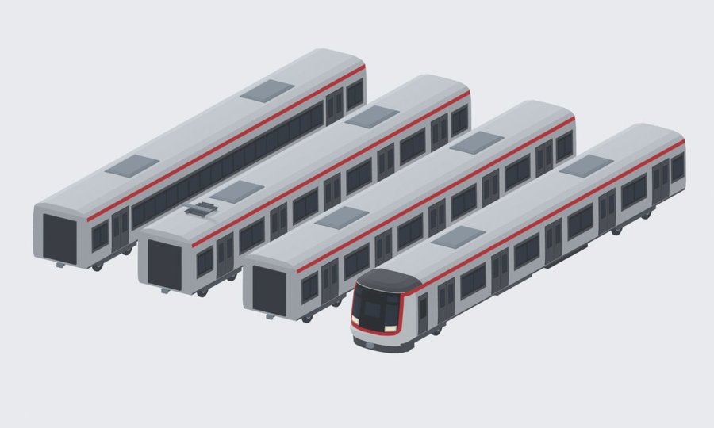

# 香港東鐵綫列車（決策 843）

由左至右：頭等車、集電弓車、中間車、駕駛室車（斜前俯視）。圓弧車頭、高的黑面罩、紅色 U 形描邊沿屋簷延伸到整列，銀色不鏽鋼車身，門與窗區是深灰色塊，一般車每側 5 組雙開門、頭等車 2 組。遊戲角度、平光、色票平塗，不畫公司標誌與文字。

- 做的：本地工作室（Claude 做、Codex 對照片審，作者 2026-11-18 指定）。作者看第 3 輪說「人家是圓弧，你變成方形」，派工單更正後改成圓弧車頭（第 5 輪）；Codex 退回車頭貼面被車殼蓋過、亮窗要只認玻璃，第 6 輪修好後通過。
- 重檔（8 個 GLB、七向圖、亮窗圖、各輪紀錄、比對用照片與來源）：`a91453/railway-assets-private`，`game-art-previews/docs/art/mtr-east-rail-line-2026-11/`（revision-6）。照片只在那裡，不進這個 repo。
- 轉進遊戲：`tools/train-models/glb_to_swift.py`，材質順序寫在 `Sources/GamePresentation/Map3DMTREastRailLine.swift`。

## 還有哪裡不好

1. 車頭正面中段比照片平、上緣圓角較小；紅 U 在圓角處離車殼較近（約 1.2 cm，其他地方約 1.6 cm）。
2. 遠景客門沒有小窗：遠景真玻璃面積是近景的 67–70 %（rolling-stock §4 建議 85 %），清晨遠看時窗會暗一點。
3. 車高（約 3.98 m，加集電弓 4.25 m）照照片量，規格表寫 4.18 m；頭等車排第 4 節是推估。
4. 逃生門分界淡；窗區分兩片；車端通道是深灰方塊。
5. 還沒在 iPhone 上看過放在香港地圖上的樣子。
