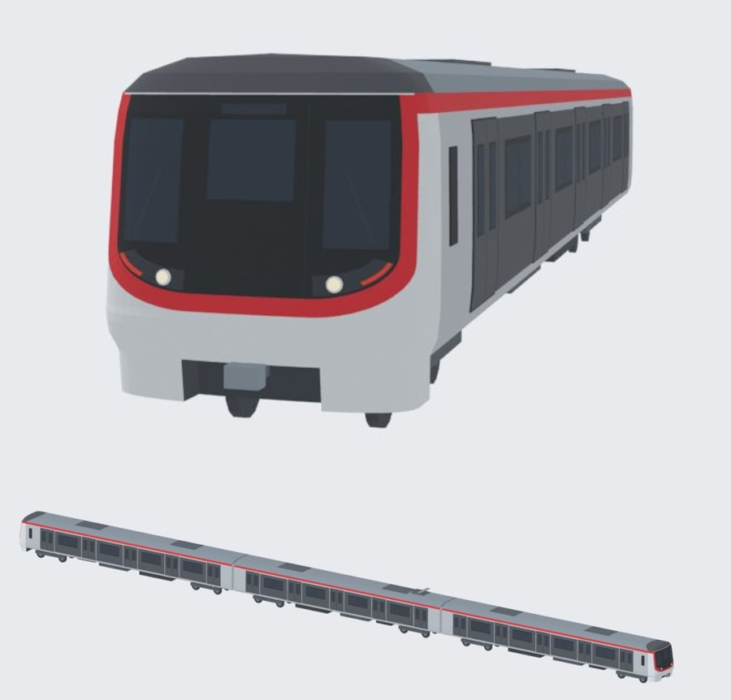

# 香港南港島綫列車（決策 848）

上：駕駛室車斜前；下：三節整列 A B A。較平的車頭、黑面罩加紅 U 描邊，紅線沿屋簷延伸到每一節，深色燈座裡的小圓頭燈，銀色不鏽鋼車身，門窗區幾乎全是深灰，每側 5 組雙開門，車頂中深灰。遊戲角度、平光、色票平塗，不畫公司標誌與文字。

- 做的：本地工作室（Claude 做、Codex 對照片審，作者 2026-11-18 指定）。Codex 第 1 次退回三點（紅 U 下緣與燈座、車頂顏色、側窗中柱與遠景門窗），第 4 輪修好後通過（素材庫 #166）。
- 重檔（4 個 GLB、七向圖、各輪紀錄、比對用照片與來源）：`a91453/railway-assets-private`，`game-art-previews/docs/art/mtr-south-island-line-2026-11/`（revision-4）。照片只在那裡，不進這個 repo。
- 轉進遊戲：`tools/train-models/glb_to_swift.py`，材質順序寫在 `Sources/GamePresentation/Map3DMTRSouthIslandLine.swift`。

## 還有哪裡不好

1. 車長（駕駛室車 23.0 m、中間車 22.0 m）是推估：規格頁沒寫，門距比例由照片量出。
2. 紅 U 在兩燈之間留了一段直的，照片看起來更圓一點。
3. 排障裙中間的凹口是方的，照片的裙角往內斜；遊戲距離看不出。
4. 集電弓的樣子照派工單推估，照片看不清。
5. 還沒在 iPhone 上看過放在香港地圖上的樣子。
