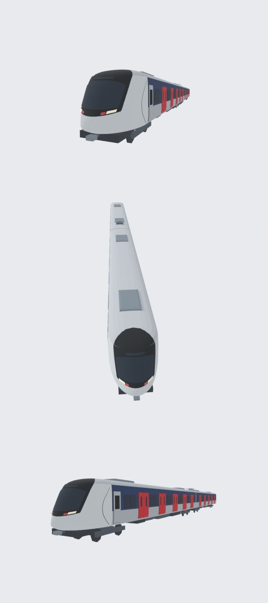

# 香港屯馬綫列車（決策 839）

由上至下：駕駛室車斜前、俯視、側斜前（整列）。子彈形圓鼻子與大片擋風玻璃，銀色不鏽鋼車身，窗區一條深藍帶，紅色車門，每側 5 組雙開門。遊戲角度、平光、色票平塗，不畫公司標誌與文字。

- 做的：本地工作室（Claude 做、Codex 對照片審，作者 2026-11-18 指定）。做的人自看三輪；Codex 第 1 次退回三點（亮窗要只亮真玻璃、遠景補門窗、背對背共面），第 4 輪修好後通過。
- 重檔（6 個 GLB、七向圖、各輪紀錄、比對用照片與來源）：`a91453/railway-assets-private`，`game-art-previews/docs/art/mtr-tuen-ma-line-2026-11/`（revision-4）。照片只在那裡，不進這個 repo。
- 轉進遊戲：`tools/train-models/glb_to_swift.py`，材質順序寫在 `Sources/GamePresentation/Map3DMTRTuenMaLine.swift`。

## 還有哪裡不好

1. 擋風玻璃是一整塊深色，照片的玻璃下緣有弧線與層次；排障裙外角偏直，面罩下緣的 U 形比照片淺。
2. 門寬（1.70 m）、門距、車高（3.85 m，加冷氣 3.99 m）是照片量的，和規格表不同；量法在素材庫 revision-1 README。
3. 窗沒有照片上的藍色圓角外框；門窗斜框比照片細。
4. 深藍帶用遊戲已有的 `playerRim`，比照片暗一點。
5. 還沒在 iPhone 上看過放在香港地圖上的樣子。
