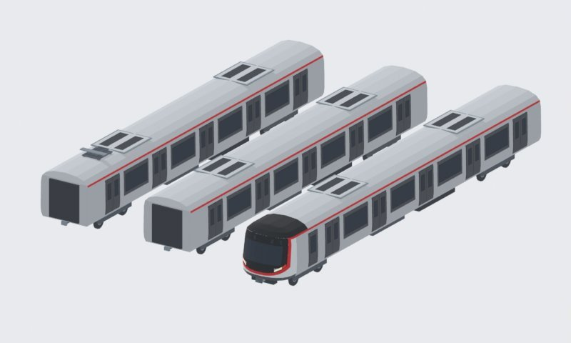

# 香港市區綫列車（決策 786）

由左至右：中間車（無集電弓）、集電弓車、駕駛室車。黑色車頭外圍一條紅色 U 形描邊，同一條紅線沿屋簷貫穿每節；銀色不鏽鋼車身，門與窗區是深灰色塊，每側 5 組雙開門。遊戲角度、平光、色票平塗，不畫公司標誌與文字。

- 做的：本地工作室（Blender 建模、另一個 AI 對照片審）。做的人自看三輪；審查第 1 次退回三點（車輪面朝內、遠景門板太凸、集電弓懸空），第 2 次剩一點（遠景集電弓支柱離車頂），第 3 次通過（revision-5）。
- 重檔（6 個 GLB、七向圖、各輪紀錄、比對用照片與來源）：`a91453/railway-assets-private`，`game-art-previews/docs/art/mtr-urban-line-2026-11/`。照片只在那裡，不進這個 repo。
- 轉進遊戲：`tools/train-models/glb_to_swift.py`，材質順序寫在 `Sources/GamePresentation/Map3DMTRUrbanLine.swift`。

## 還有哪裡不好

1. 頭燈偏扁小；門窗四角是直角。
2. 遊戲大小下中間車和集電弓車幾乎看不出差別。
3. 集電弓放在 C 車是推估（同系列前一代的 C 車是集電弓車），照片看不清。
4. 還沒在 iPhone 上看過放在香港地圖上的樣子。
