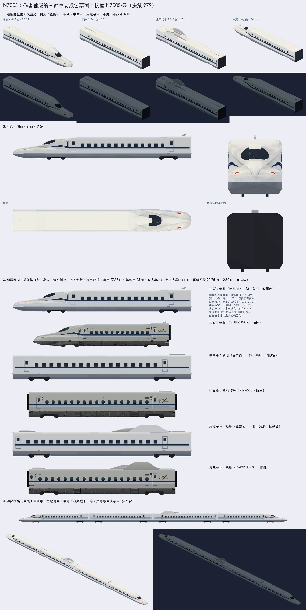

# N700S：作者舊版的三節車（決策 979）



總覽（遊戲的匯出與模型光，`tools/train-models/run.sh`、`render.mjs`；版面是另外排的）：

1. 車頭、中間車、集電弓車、車尾（車頭轉 180°）的斜看，上排白天、下排夜晚。
2. 車頭的側面、正面、俯視，中間車的連結端。
3. 和舊版同一節並排，每一對同一個比例尺：上是新版（色票面，真車尺寸：頭車 27.35 m、其他車 25 m，寬 3.36 m、車頂 3.60 m），下是舊版原樣（20.75 m × 2.80 m，有貼圖；這一排用簡單的貼圖繪圖器畫，不是遊戲的光）。
4. 四節相接的側面與斜看（`--assembly-spec`；遊戲裡十二節，集電弓車在第 4、第 9 節）。

白色車身、窗下兩道藍線（上寬下細）、灰裙板、深色轉向架；車端的全周幌（車身色，口是深灰）；車頭一片前窗、鼻端兩肩各一組燈（白頭燈、紅尾燈）。色票平塗，不畫文字與標誌。

- 來源：作者舊版 SwiftRailMac 的模型（作者自己的內容），舊版型錄的 N700S「のぞみ」：頭車 `c264b30b`、中間車 `2cf2255b`、集電弓車 `8d903762`。原始 GLB 與貼圖不進這個公開庫。
- 轉換：`tools/texture-palette/n700s.py` 把貼圖切成色票面（頭車 4,865 面、中間車 2,664 面、集電弓車 2,898 面），再由 `tools/train-models/glb_to_swift.py` 寫成 `Sources/GamePresentation/Map3DN700SMesh.swift`。材質順序寫在 `Map3DN700S.swift`。
- 用在：列車包的第二款高鐵車（原來的 N700S-G），十二節；車庫在「高鐵」類。
- 決策：`docs/decisions/979.md`。

## 重做

```sh
M=~/SwiftRailMac/assets/models
uv run --with pillow --with numpy python tools/texture-palette/n700s.py \
    --cab $M/item_c264b30bdcd2d6c06bd11a45.glb --middle $M/item_2cf2255b345e32868908de7e.glb \
    --pantograph $M/item_8d903762bac47c2b84da2a0f.glb --out-dir OUT
python3 -I tools/train-models/glb_to_swift.py --enum Map3DN700S \
    --materials white,navy,grey,glass,dark,headlamp,taillamp \
    --out Sources/GamePresentation/Map3DN700SMesh.swift \
    OUT/n700s-cab.glb OUT/n700s-middle.glb OUT/n700s-pantograph.glb
```

每扇門（門板連門框、門窗、門上那一段藍線）照外框從牆面切開：GLB 裡各是一個 mesh 與 node（`n700s-cab-door-left-1`…，由車頭端往後編號；頭車每側 3 扇，第 1 扇是乘務員門，其他車每側 2 扇），`report.json` 的 `doors` 列出範圍與每扇門從第幾個面起（`first`、`triangles`）。寫成 Swift 時各 node 照順序接在車身後面，遊戲裡 `Map3DN700S.doors(_:)` 記每扇門左右兩側是模型的第幾個到第幾個三角形；之後要做開門動畫，照這些範圍把門的面挑出來就可以，不用再切，也不用框選。拿掉一扇門，牆上剛好是門框外緣的開口。

存成毫米以前先把 T 形接點補上（`mend`），頂點放到毫米的格點上，沒有面積或翻了面的細條拿掉：不同顏色的面不會疊在同一平面上，也沒有朝內的碎面。車鼻兩肩的燈切成一樣多面（舊版兩側的網格排法不同，右肩頭燈多一條細條，`even_lamps` 把它收掉）。送審前跑 `tools/texture-palette/port_check.py OUT --old <頭車原檔> --nose-scale 1.19036,0.99310,1.2 --nose-from 4.9` 到全過。

材質名 `navy` 是轉檔工具裡的格位名，遊戲裡這一格是 `Map3DPalette.shinkansenBlue`。

## 接回時比的四樣

1. 顏色：7 格裡 6 格是遊戲既有的色票；藍線是新增的 `shinkansenBlue` #203552（舊版貼圖的藍，落在實車照片量到的 #0D2852 到 #30426C 之間）。
2. 窗格的主方向：側窗是一排小方窗，中間車與集電弓車的數目和舊版一樣（中間車 17 扇、集電弓車 18 扇，另加門上的小窗），頭車照真車的 1 號車是 13 扇（舊版 12 扇，窗距被壓短）；舊版窗角是圓的，這裡是方的。門有一圈灰色的門框與門檻，位置照舊版貼圖。
3. 每個面的特徵：窗帶在上、兩道藍線在窗下、灰裙板在底；車頭長鼻、藍線在鼻側收尖、一片前窗、兩肩的燈；集電弓車後半的罩與遮音板。
4. 各段高度比：輪子到軌面、灰裙板到 0.9 m、白車身、藍線 1.62 到 1.95 m、窗、車頂 3.60 m。

## 還有哪裡不好

1. 頭車 27.35 m：車鼻是舊版原本的比例（和其他車同一個倍率，不拉長，是擁有者的定案），客室照真車排成 13 格窗、窗距 1.023 m，窗與門和中間車一樣寬。和真車還差：鼻尖到乘務員門 8.43 m（真車約 8.0 到 8.3 m）、前門到第一格窗近約 0.2 m；車尾那一節是同一個模型（真車的 16 號車是 15 格窗）。對照表在決策 979 第 5.1 節第 5 輪。
2. 門框是方角的細線（舊版是圓角）；乘務員門的框跟著車鼻的曲面有一點歪；扶手沒有畫。
3. 中間車只有一種。
4. 集電弓車沒有集電弓本體。
5. 轉向架整塊深灰；連結端外面一圈是工具加的全周幌（車體的白與裙板的灰，舊版模型沒有：車與車之間原本空 0.6 m，中間只有一條通道幌，現在整條在幌裡面、拿掉了），幌口從上面看是淺淺的 V、封成深灰，兩節相對轉 4.2° 以內不相碰，連結面上只有車鉤；床下只有一片灰裙板（舊版貼圖上是深灰的機器箱）。
6. 夜晚那一排的窗沒有亮，是繪圖工具沒開夜燈；遊戲裡窗會亮（玻璃面有標）。
7. 還沒在 iPhone 上看過。
