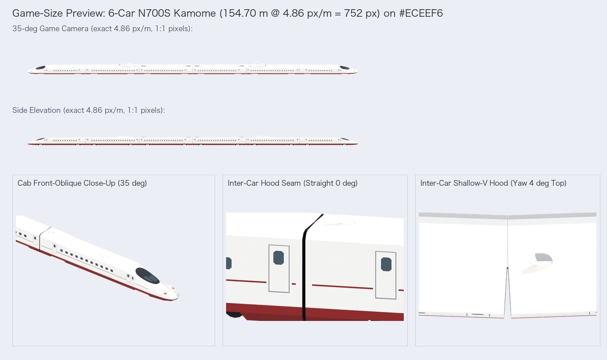

# 西九州新幹線 N700S「かもめ」（決策 998 續）

總覽（本地工作室 `n700s-kamome-r1` 的 `render.py` 拍）：上兩排是六節在遊戲大小（每公尺 4.86 像素，154.7 m）的 35° 斜看與側面；下面是車頭斜看、兩節之間的全周幌（直線、轉 4° 俯視）。

白車身、紅裙板與車鼻下緣、窗下一條細紅線（5.9 cm，到門就斷）、車鼻側面一條弧形細紅線、黑色駕駛室窗罩、鼻頰白頭燈與紅尾燈、兩節之間白身紅裙的全周幌；窗的四角切掉，像真車的圓角窗。色票平塗，不畫文字、燕子標誌、公司標誌與車號。

- 來源：作者舊版 SwiftRailMac 的模型（作者自己的內容），舊版型錄的「N700S『かもめ』」：頭車 `54c3717d`、中間車 `54d4d264`、集電弓車 `44c98270`。不用加資料來源頁。原始 GLB、貼圖與真車照片不進這個公開庫。
- 對照的真車照片與審查：私有素材庫 `railway-assets-private-2` `game-art-previews/docs/art/n700s-kamome-2026-11/`（`ref/`、`SOURCE.md`、`revision-1/README.md`）；做的是 Antigravity，審的是 Codex，舊版轉新版審一輪過。
- 轉換：工作室的 `revision-1/tools/build.py` 把舊版貼圖切成色票面（頭車 3,448 面、中間車 3,447 面、集電弓車 3,567 面；每扇門在 GLB 裡自己一個 node），`tools/texture-palette/port_check.py` 全過；再由 `tools/train-models/glb_to_swift.py` 寫成 `Sources/GamePresentation/Map3DN700SKamomeMesh.swift`。材質順序寫在 `Map3DN700SKamome.swift`。
- 用在：西九州新幹線（`kyushushinkansen` 的 `NK`），六節：頭車、集電弓車、中間車、中間車、集電弓車（轉過來）、頭車（轉過來）；車庫在「日本」類。
- 決策：`docs/decisions/998.md` 的「續：かもめ塗裝」。
- 舊版與新版並排的對照圖帶舊貼圖的文字與標誌，只放在私有素材庫，不放進這個公開庫。

## 這台車憑什麼被認出來

1. 白車身下整條紅裙板（東海道 N700S 是灰裙、窗下兩條藍線）。
2. 窗下一條細紅線、車鼻側面一條弧線。
3. N700S 的長鼻與黑色駕駛室窗罩。
4. 六節，第 2、5 節車頂有集電弓的大導流罩。
