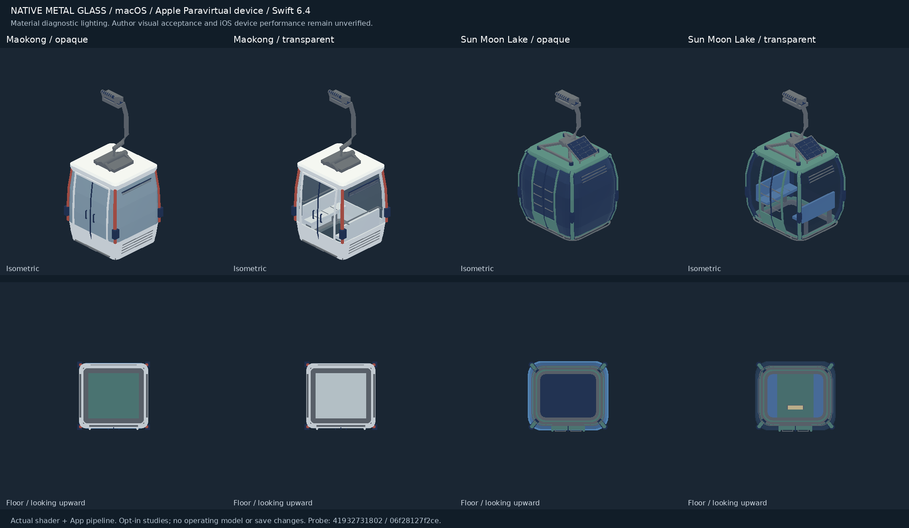

# 原生吊廂透明玻璃

只新增可明確啟用的材質與繪製流程。既有trainGlass／trainGlassLit仍是原來的不透明反光材質；沒有修改任何吊廂配方、模型pack的standard、營運映射、GameCore、存檔、golden或fixtures。

```swift
let source = try Map3DModelFile(decoding: bytes, named: "cabin").model
let pack = Map3DTransparentGlass.studyPack([source])
// 由已有的study host明確呼叫 renderer.useModels(pack) 並提供實例。
// 本PR不把pack接到地圖或營運。
```

只有已標成trainGlass／trainGlassLit的三角會轉換，鋼材、框架、椅及一般塗裝不變。不憑顏色猜玻璃。原生模型+z朝上，|normal.z|>0.8的水平玻璃用地板設定；其他玻璃用窗設定。預設每表面opacity窗0.14、水平玻璃0.06，封閉薄板有內外兩面，效果會累積。可用Style調整，不是真實光學厚度／折射模型。M3DM v1原檔與格式不變，讀回後才opt-in。

材質新增layer −16／−17（後者夜間發光）。頂點u為透明度，v保存原反光遮蔽值，color alpha仍是線色替換比例，40-byte ABI不變。Opaque pass丟棄新材質片段；之後在sky／ground shadows都畫完後，依所有實例的各三角視深度遠到近做source-alpha混色，使用既有reversed-Z測不透明深度，不寫depth。雙面繪製可從廂內、廂外或地板下方看；新材質不寫太陽深度圖，不投整塊不透明影子。既有材質走原分支。

這是常規三角中心排序，沒有宣稱order-independent transparency；相交／交織透明曲面仍可能需要切分。透明pass支援這批model實例，不支援把材質直接丟進city chunk或靜態prop run。沒有啟用中的模型時，不建立每幀玻璃batch。

現行main的貓空Swift配方把部分玻璃當plain色塊；這輪不去改它。後續接入時須由配方以語意標記玻璃、再明確套材質，不能拿色碼認玻璃。本輪以真正貓空與日月潭M3DM studies（含玻璃旗標）核對原生流程，不把GLB／WebGL畫面當Metal證據。




## 驗證

**VERIFIED（Linux）**：Swift6.4 `swift build --build-tests -Xswiftc -warnings-as-errors`，`swift test --skip-build --filter 'Map3D(TransparentGlass|ModelFile|TrainMaterial|TrainLights|Reflection|CableCar)Tests'`，52個相關測試通過（其中9個新材質測試）。另以 `tools/native-glass/check-cabins.sh FIXTURES REPORT.json` 真正讀回貓空／日月潭8個近遠景M3DM，驗玻璃／水平玻璃設定、opaque全屬性保持、雙實例world normals與全局排序；見native-cabin-cpu-verification.json。驗材質選擇、水平玻璃／夜燈、有限值、跨實例及模型內三角視深排序、鏡頭反向、同深穩定順序、非等比變換法線、塗裝alpha不冒充透明、零透明與非法輸入、standard沒有opt-in。

macOS：`tools/native-glass/run-metal.sh OUTPUT FIXTURES`。腳本抽出Map3DMetalView真正使用的pipeline工廠，編譯同份Map3DShaders.metal及Swift，沒有另造一個近似shader。Metal可用時做真offscreen blending／透明地板／不透明遮擋／depth不寫入／跨實例排序／1x與4xMSAA，以及關閉blend、錯depth write、倒序三種故障反例；再畫真吊廂日夜／斜面／底面及不透明基準。runner若沒有MTLDevice，JSON明寫GPU UNVERIFIED，不會拿編譯當出圖。

[Native glass Metal probe workflow](../../../.github/workflows/native-glass-metal.yml) 只用read權限與暫存輸出；從本repo固定producer恢復公開配方產生M3DM，不存取私庫／密鑰。貓空producer5cfec2954、日月潭074b085c；來源與尺寸限制承接各study SOURCE。原模型無改，不重新分發原照片／品牌／人物。

真機效能、作者外觀接受、平台間隙、載重與營運接入仍UNVERIFIED。macOS offscreen不是iOS裝置。未合併、不auto-merge、不TestFlight。下一步：作者看原生證據後，再另派是否接入特定studies；沒有自動變更已上線吊廂。

### CI 核對補記

`a6a9587` 的 [Swift CI](https://github.com/a91453/railway-game-ios/actions/runs/41844401938) 與 [iOS build／Simulator smoke](https://github.com/a91453/railway-game-ios/actions/runs/41844401425) 已成功（VERIFIED；iOS 使用 runner 的 Apple SDK，不等於真機或透明玻璃出圖）。官方 Swift 6.4 在 macOS 亦已完成實際 Metal shader 與 GamePresentation WAE 編譯；獨立 harness／GPU 狀態以最新 probe 為準。

此獨立 job 安裝並檢查 swift.org 官方 Swift 6.4.0 pkg 簽章，保留 6.4 版本要求（Xcode 26.6 預設 Apple Swift 6.3.3）。共用 build-inputs.sh 支援 classic SwiftPM 與 SwiftBuild：實際 Mac 的模組位於 `Objects-normal/arm64/GameCore.swiftmodule`，亦接受 Modules/ 子目錄與檔案／目錄型 swiftmodule，不假設套件或 target 中間目錄名、不重複連結 object。目錄定位測試與8個真吊廂CPU檢查均在Linux Swift6.4通過。

從 swift.org 安裝的獨立 swiftc 另明確傳入 Xcode macOS SDK 與 macOS14 最低版本（對齊 Package.swift）；完整建置前先 typecheck 五個必要系統框架的 imports，避免到最後連結才發現 SDK 不可見。配方以 depth=1 取得固定版本，不抓完整歷史。這些設定不改渲染程式；GPU及外觀未實跑前仍 UNVERIFIED。

### 實際 Metal 結果

**VERIFIED（macOS offscreen Metal）**：[run 41932731802](https://github.com/a91453/railway-game-ios/actions/runs/41932731802)，來源 head `06f28127f2ce7f2767f723362cc974a432cc7424`，官方 Swift6.4，裝置回報 `Apple Paravirtual device`。實際 source-alpha 混色、opaque depth不寫入、前景遮擋、水晶底板opacity、跨實例排序、1x／4x MSAA、三種故障反例都通過；8個真吊廂產生32個視角，每個視角各有透明與opaque對照，共64張原生PNG。真8模型CPU檢查亦在同一Mac job完成。原始GPU報告保存在 [metal-verification.json](metal-verification.json)；完整PNG在該run的 `native-glass-metal` artifact（14日保留，可用上述producer和腳本重現）。公開repo只保留一張89KB總覽與小型報告。

自檢：已看8款近／LOD的斜視與底視、日／夜旗標，以及代表性的opaque對照。窗後座椅／對側框架可見，水晶底板能透視；普通底板保持不透明。尚未由作者確認外觀。這是固定ambient／背景的材質診斷：night參數只切換發光旗標，沒有重現完整遊戲夜間照明，不能當完整夜景確認；也沒有量iOS真機幀時或透明曲面相交案例。

最後只更正CPU報告的執行平台標籤（Mac／Linux），並保存以上已完成的證據；renderer、shader、adapter與材質測試內容均與該已通過的head相同。
