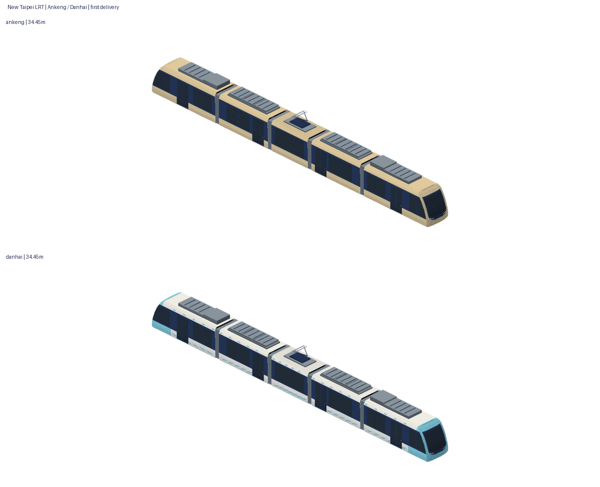

# 新北安坑與淡海輕軌：兩款獨立原生 studies

本輪首次交付，**兩款都沒有已接受的真正前版**。greenTram／fiveSectionLRT 是既有共用示意車，不冒充這兩款的已接受前版。

## 車型查證

正式名稱為「安坑輕軌列車」與「淡海輕軌列車」，製造商台灣車輛（TRSC），設計技術合作 Voith Engineering Services；中鋼為系統統包、非把車型改叫中鋼製造。淡海「行武者號／Warrior」是票選名稱；安坑「光耀金」是一般塗裝名稱。官方工程型號代碼與商業產品系列代碼 **UNVERIFIED**，沒有將車號首碼冒稱官方1000／2000型，也沒有套用CAF Urbos或Skoda Artic。

兩者屬同一主要設計家族、不同採購批次。**不只是換塗裝**：捷運局／台車的2020年工程文章記錄安坑新增國產化空調、屋頂板、外板、玻璃、地板、燈具、電纜等，國產化21.8%增至41.9%，座椅改良亦回饋淡海。外殼主要比例與走行配置相同，不代表全部零件相同或可互換。詳細逐項比較、證據／日期／授權／下載SHA及推估均在 [sources.json](sources.json)。

主要依據：[新北捷運列車介紹](https://www.ntmetro.com.tw/basic/?node=10012)、[台車淡海列車](https://www.trsc.com.tw/train/tran-58ad2b69be798)、[捷運局2018工程論文](https://www.dorts.ntpc.gov.tw/cdn/file/20211117/88edc200-ffce-4f1d-8101-1f49bc01773e.pdf)、[2020國產化比較](https://www.dorts.ntpc.gov.tw/cdn/file/20230426/f2a40d86-3a14-4188-ba68-e42dea1fb334.pdf)、[Voith原始公告](https://www.voith.com/corp-en/Voith_Engineering_Services_PM_TRSC_ENG.pdf)。

| 項目 | 安坑 | 淡海 | 判定／共用範圍 |
| --- | --- | --- | --- |
| 正式車輛／批次 | 安坑輕軌列車，15列後續擴充；2021首到廠、2022-04-08全到齊、2023-02-10營運 | 淡海輕軌列車，初期15列；2016首亮相／到工地，2017量產計畫，2018-12-23通車 | 批次不同；淡海最後實交日期未取得正式驗收表 |
| 車號 | 201–215編組，尾碼1–5模組 | 101–115編組，尾碼1–5模組 | 次級名冊慣例；完整官方逐車名冊不足，不作配車規則 |
| 一般塗裝 | 光耀金，選官方2011與2101照片代表 | 水藍／白波紋，選1011原一般塗裝 | 已確認不同；各獨立入口與ID，未混活動彩繪 |
| 官方整列尺寸 | 34.45×2.65×3.75m，降弓；地板0.35m | 同左 | 已確認相同；新家族外包絡共用 |
| 模組／走行 | M1–M2–M3–M4–M5；三台車，M2／M4懸浮 | 同左 | 已確認主要架構；各自單元／組裝表 |
| 車頭／風擋／門窗／關節主配置 | 同主要設計 | 原設計 | 照片與官方支持相同主要輪廓；精密模具／零件版號不足 |
| 空調／板件／玻璃／照明等供應與國產化 | 後續國產化／精進 | 初期供應鏈 | 已確認不同；未虛構外形差異，精密外形差異不足 |
| 集電／儲能 | 750V架空線＋鋰電池，中央單弓雙舟 | 同左 | 主要配置相同；隱藏線路與裝配尺寸不足 |

## 完整車組契約（兩款各有獨立 assembly JSON）

+X車頭／+Y左／+Z上；公尺、共同軌面Z0。單元在中心原點，M5仍為+X駕駛端，組裝僅旋轉一次180°。

| 角色 | 殼長（推估m） | 平移X | 旋轉 | 門／走行／設備 |
| --- | ---: | ---: | ---: | --- |
| M1 | 8.00 | 13.225 | 0 | 每側一雙門；動力台車；空調與推進設備外殼簡化 |
| M2 | 6.00 | 5.725 | 0 | 每側一雙門；無輪；儲能箱外殼 |
| M3 | 4.45 | 0 | 0 | 無門；非動力台車；單臂集電弓雙舟 |
| M4 | 6.00 | -5.725 | 0 | 每側一雙門，與M2前後不同；無輪；儲能外殼 |
| M5 | 8.00 | -13.225 | 180 | 反向駕駛端；每側一雙門；動力台車 |

每款5角色×近遠＝10獨立合法M3DM，另近遠完整M3DAssembly／GLB。四道0.5m關節隙由中空風琴袖橋接，沒有通用客車連結器、內端牆或懸浮段補輪。8／6／4.45為符合34.45m總長的顯示拆分，**不是取得精密模組工程圖**。輪徑、軸距、箱體分段、 raised弓高度與隱藏機構均為簡化推估。A／B關節內部自由度不模擬，未新增關節動畫或轉彎控制。

## 配方與幾何來源

獨立 [安坑入口](../../../Sources/GamePresentation/Map3DAnkengLRT.swift)、[淡海入口](../../../Sources/GamePresentation/Map3DDanhaiLRT.swift)，獨立ID與assembly。新 [家族幾何](../../../Sources/GamePresentation/Map3DNewTaipeiLRTGeometry.swift) 只這兩款使用：經確認的同設計主比例建立顯示外殼，不為同家族刻意捏出不存在的車頭差異。無尺寸表面裁切演算法沿用本專案Codex高雄輕軌producer `cfeed799260b609b6765ab44404d9ab095c48f94`，**沒有沿用其車殼、尺寸、門窗與塗裝**。原PR保持OPEN且未改其分支。

使用既有色票：淡海water＋暖白、安坑schoolWalls與containers金色混合、深色玻璃與霧面平塗。海浪與肩部點紋直接裁切殼面，沒有照片貼圖、品牌、字樣、商標或第三方幾何。原始照片只留本機，不轉送外部服務。

## 營運界線與保護

目前 `ntdlrt`／`ntalrt`在`Map3DRealTrains`都回傳greenTram(2)，與krtc/C共用。解鎖時`set(forKey:count:)`再轉fiveSectionLRT；列車包鎖定時回原greenTram；articulated以切分的完整車體對應遊戲兩car，長度會照既有car／路徑契約縮放。其近遠景與900m方塊回退沿用原實作。

本輪**只有studies**，合併後兩款都不會出現在遊戲，也沒有玩家選用入口。現有機制沒有這兩款逐模組動態路徑與當班配車契約；尤其金車曾支援淡海的次級資料不能直接變隨機／奇偶配車。本輪不改RealTrains、TrainSets、Showcase、GameCore、存檔、fixtures、購車／解鎖、班表、控制或動畫。

保護全部既有735模型實際M3DM bytes與全頂點欄位FNV，包括安坑／淡海scene-kit示意、greenTram、five／seven／blue輕軌、共用車、高雄紅橘線與原set／回退。最新main不代表外觀已接受：舊greenTram producer `2a947503`、five-section `25cb20fa`／配色`21a5b7ba`，明確本款接受證據不足，均UNVERIFIED；高雄紅橘線accepted producer `bd57e163`依既有交接保護，本輪未重設其狀態。高雄輕軌公開#1506 `e00220ec`／素材#31 `d95bb0dd`均OPEN，專用分支與交付目錄不動。

## 外觀與驗證

製作者自檢、技術結果及四狀態另列在各素材包。已實際開啟下載照片，與最終原生正／側／俯／斜逐向旁置；配色、白模、剪影及共同公尺尺度均檢查。完整正俯實照、左右側每一單元的無遮擋工程視圖、精密硬體修訂資料仍不足，不能宣稱工程復刻。

重建與驗收：[tools/new-taipei-lrt/README.md](../../../tools/new-taipei-lrt/README.md)。來源、原生讀回、GLB獨立匯入、幾何與故障反例、Swift組裝、PNG完整解碼、viewer互動／下載SHA、producer獨立checkout重建證據均隨素材交付；公開總結見verification.json。

各款四態分開：素材技術依最終驗證；**使用者明確producer外觀接受、營運接入、裝置驗證均UNVERIFIED**。本prompt、CI、WebGL自檢不代表使用者接受；Metal、Safari、真機效能、彎道／坡度／關節動態與實際供電動作未驗。
