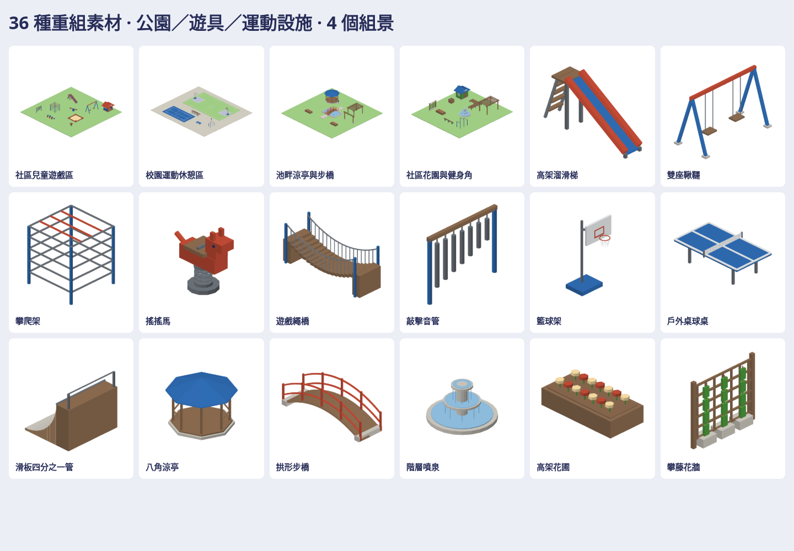

# 公園、遊具與運動設施

36件原生3D素材（三類各12），另有兒童遊戲區、校園運動區、池畔涼亭步橋、社區花園健身角4組景。共40 native、40 GLB、280張七向透明圖。

| 類別 | 素材 |
| --- | --- |
| 遊具 | 高架滑梯、雙座鞦韆、翹翹板、攀爬架、沙坑、旋轉盤、搖搖馬、遊戲屋、幼兒滑梯、繩橋、踏步樁、音管 |
| 運動 | 籃球架／地坪、網球地坪／網、足球門／迷你場、羽球地坪、桌球桌、單槓、平衡木、滑板坡、看台 |
| 庭園 | 八角涼亭、花架、拱橋、入口架、飲水台、階層噴泉、景觀池、花圃、堆肥箱、工具屋、轉角棧道、攀藤牆 |

入口Map3DParkKit.model(for:)／Map3DModelPack(parkKit:)按需建置，不加入常駐standard。native x前/y左/z上、公尺；ground底z=0。步橋端deck接點x±2.5/z=.12，球場球架接點含.08地坪高度。

私有參考實讀7個factory：Japan Slide／Swing／Drinking Fountain、Suburban Gazebo／Picnic Table／Portable Basketball Hoop、Tiny Cubes Arched Bridge。保留建模方法，重組新比例、輪廓、支架與霧面色票；野餐桌的A架／座面支撐方法用於看台，其餘素材由原生幾何補建，非36個直接factory移植。來源SHA、原尺寸與改造對照留私有庫；無原始factory／mesh／紋理打包。

[私有成品](https://github.com/a91453/railway-reference-private/tree/codex/park-assets-2026-10-21/Railway/game-art-previews/docs/art/park-kit-2026-10-21) · [重建工具](../../../tools/park-kit/README.md) · [Claude指引](../../../.claude/skills/park-kit/SKILL.md) · [驗證](verification.json)。靜態遊戲素材，未包含遊具安全、結構、物理或運動模擬；真機Metal與App地圖接入另驗。
