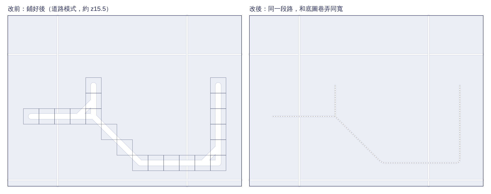

# 玩家的路：改前／改後（決策 476）

- 同一段路（往右、斜下、再往右、往上，加一段短支線），每格 40 點（實景地圖約 z15.5），淺底是底圖、白線是底圖的巷弄。
- **改前**：每兩個相鄰格子（含斜角）一段、寬度是格子的 35%，圓頭；道路模式時每格描方框。
- **改後**：沿格子中心一條線，轉角四分之一格開始彎，寬度同底圖巷弄；道路模式時自己的路中間一條細虛線。
- 這張是示意圖：`make_compare.py` 用和 `RoadCentreLines` 同樣的規則（Python 照抄）畫成 SVG，再用 Chromium 轉 PNG，不是 App 的截圖。App 上的樣子要等 iOS CI 與實機。

重建：`python3 -I make_compare.py`（寫出 `compare.svg`），再用任何瀏覽器把 SVG 存成 PNG。
