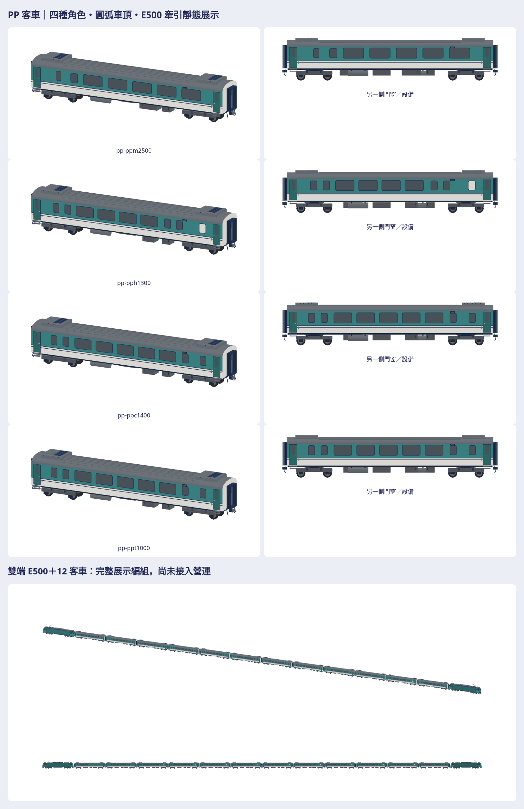

# PP 客車：獨立原生、E500 展示與專用營運接點

追蹤 [#1282](https://github.com/a91453/railway-game-ios/issues/1282)。本次製作四種 PP 客車；E500 固定使用已接受第三版 producer `85647d0a5e5eaaebdcdee1d5bc512fd931ee6c3a`，EMU3000 第五版只比較色票、霧面與細節密度。不借用它們的殼、門窗、底盤或設備站位。

開工取得最新遠端，公開 base `c005788c778d0743291f0c724d1336c668078385`，分支 `codex/pp-coaches-2026-10-26`、獨立 worktree；私庫另用 `codex/pp-coaches-assets-2026-10-26`。已確認公開 #1256、製程 #1269 與私庫 #84 均已合併，仍核固定來源和真正輸出。#1041 登記與 #1281 協調各自追加模型入口，保留 TEMU2000 增量。

重建入口：[工具 README](../../../tools/pp-coaches/README.md)。本頁的最終驗證數值以交付包 manifest／verification 及 PR 的同提交 CI 為準；不以既有車輛的綠燈替代本車驗證。

## 來源及建模前特徵表

使用者提供的 16 張圖逐張檢視：1–4 為 HO 模型客車照，5 為 E1000 模型，6／7 分別重複 4／5；8 為產品排列，9 為編組宣傳示意，10–13／15–16 為各角色 CAD 宣傳圖，14 為端部零件 CAD 局部。**不是實車工程圖，圖中的 E1000 也不是 E500。** 產品排列不證明實車節數。另取實車照片交叉檢查，來源 URL／SHA／逐張用途見 [來源記錄](reference-record.json)。未取圖素、原始 mesh 或貼圖，沒有將私有來源送外部生成服務。

| 角色 | 可見特徵與用途 | 未確認部分 |
|---|---|---|
| 35PPT1000 | 標準客車，兩側九窗，五大客窗與窄窗、端部廁所不透明窗，兩端門；長留白區有方向性 | 精確窗尺寸與站位 |
| 35PPH1300 | 無障礙客車；一側八窗（兩窄＋四大＋兩窄）、另一側另有隔開的不透明廁所窗，共九窗 | 無障礙廁所內部及隱藏設備 |
| 35PPC1400 | 車長室客車；兩側九窗，車長區留白與窄窗的排列不同 | 內裝與機櫃配置；不稱餐車 |
| 40PPM2500 | PPD 改造多功能客車；稀窗側四窗且半車長留白，另一側七窗；部分大窗較低，車下箱體與首代車不同 | PPM 專屬工程尺寸及改造後完整底部圖 |
| 共通 | 直側牆接圓弧肩／屋頂、中央縱向屋面、兩端低梯形冷氣殼及殼內格柵；雙端中央貫通門／風擋、低連結器、兩組雙軸轉向架 | 屋頂、車下細部與接線非完整工程重現 |

原始銀灰／橙帶屬 PP 自強號塗裝，來源含不同拍攝年代及 PPD→PPM 改造。模型改用遊戲暖白、綠松、藏青細線與霧面頂點色，不用紅色、真品牌、商標、車號或個資。原始資料的車種編碼只作配方與交接識別，不在模型印車號。

| 尺寸 | 可靠來源 | 本模型處理 |
|---|---|---|
| 長 20.300 m、寬 2.885 m、高 4.043 m | 運安會《0528臺鐵第177次車竹南站重大鐵道事故調查報告》表1.5-2，印刷頁9／PDF頁23 | 採作首代客車展示外包絡；原表沒有完整說明長度端點，不能稱車殼或連結器工程公差 |
| 原表「軸距」14.300 m | 同表；另列軌距1.067 m、TR-55空氣彈簧轉向架 | 解讀為轉向架中心距以安排展示；保留這是解讀，不叫轉向架內軸距 |
| 車殼長、輪徑、轉向架內軸距 | 未取得本車完整工程圖 | 配方明列比例推估，絕不把照片像素說成工程尺寸 |
| PPM2500 尺寸、門窗／設備精確站位、風擋與車鉤 | 多視角照片／模型圖只支持相對位置 | 共享展示尺寸屬建模假設；左右窗表和設備表獨立，不鏡像確認隱藏裝置 |

主要來源：

- [運安會事故報告](https://www.ttsb.gov.tw/media/7054/0528臺鐵第177次車竹南站重大鐵道事故調查報告.pdf)：尺寸表，屬官方資料。
- [鐵道局公開文件](https://www.rb.gov.tw/public/files/artsinfo/1622511915-m0.pdf)、[台灣車輛2019年報](https://www.csmc.com.tw/dist/uploads/report/2019.pdf)：角色、改造背景；不將各文件混稱本車完整工程圖。
- 實車多視角：[PPT](https://blair-train.blogspot.com/2020/08/35ppt1000.html)、[PPH](https://blair-train.blogspot.com/2013/07/35pph1300.html)、[PPC](https://blair-train.blogspot.com/2011/09/35ppc1400.html)、[PPD／後續改造照片](https://blair-train.blogspot.com/2011/04/40ppd2500.html)。最後一頁標題仍為 PPD，2021／2022 照片只用作改造外形證據，不因頁名確認現行車種。
- 私庫 `Railway/taiwan-rail-reference-clean/source/rail-3d/assets/garage-blender-v1/ppcoach.json`／`.webp`：實看簡化預覽與 metadata；工程尺寸為 null，長約9.788 m的Q比例、四窗與扁盒屋頂不能作標準PPT模板。未移植其 mesh。

## 原生契約與真正前版

原生公尺 +X前／+Y左／+Z上，輪底 Z=0；builder (x前,y上,z右) 只轉一次，GLB=(x,z,-y)。每種角色分近／遠原生，合法單件不超 M3DM v1 15,000 三角。完整編組使用自含單元與變換的 M3DAssembly JSON，不把超限編組假裝成可讀單一遊戲 M3DM。

先做車身長寬高、四向輪廓、橫向屋頂截面及車端，再做輪組、門窗、冷氣與車下設備，最後補格柵、端部踏階與細框。門葉和玻璃沿平側牆，圓角薄框避免遮玻璃；冷氣分清底部支承、連續殼、格柵與分格。近遠景各自查支持與可見性。

真前版是 base `c005788c` 的 **`set-pushPull-car` 既有營運通用客車**，不是事後製造的差模型，也不稱它為精確 PP 配方。新配方首次製作沒有更早的四角色版本。前後比較標明這個差異，以相同相機、中心、公尺尺度比較標準車；保存真正 baseline producer 與來源，不能以兩張各自 auto-fit 比比例。

完整 E500＋PP 展示由最終獨立單元和 manifest 變換重建。單元次序、旋轉、平移、殼隙、車鉤和風擋接面見 assembly；E500 原生從已接受第三版取得並核 payload。首車與 E500 的機車端沒有客車貫通道，因此不加虛構通道。展示排列不等於已核實某班次、推拉控制、摘掛換端或動畫。

## 遊戲實際使用範圍

現行 `pushPull` 是 E1000 兩端動力車、可變節數和通用客車的專用營運接點。本次只將該接點中間客車換為 **PPT1000 標準角色**，提供近遠景及原生長度布局；末車仍依原規則使用轉向 E1000 head，原 E1000 payload保持。PPC／PPH／PPM 雖有獨立模型與展示，**目前不在營運中逐車分配**，不新增玩法或編組車種。

公開 PR 合併並重建 App 後，解析為 `pushPull` 的列車在近景使用新 PPT、500–<900 m 使用遠景，≥900 m原盒形回退；其他包／classic／鎖定與 fallback 規則保持。已安裝 App 不會因素材包合併自行更新。E500CK／MINGRI／STAR 三組客車不替換，E500＋PP完整編組**只作獨立展示，尚未接入 E500 營運**。沒有用牽引機車相同推定客車相同。

## 外觀與驗證的交接方式

批次前查看八個PP近遠模型的側／正／俯／斜配色、白模與剪影，再看最終七向、編組接點和同尺度風格／前後。主要可見偏差先修幾何再全量重出。逐項結論保存在交付包 `visual-review.json`：已符合、仍不符合、資料不足分開；屬製作者自檢，沒有捏造相似度或使用者接受。

技術工具直接讀真正輸出：原生位置／顏色／標記／法線讀回、有向封閉與正體積、實際玻璃背襯／向外可見性、輪胎貼軌與輪頂淨空、設備支承取樣、完整組裝及保護模型 payload。刪面、反面、埋玻璃、浮玻璃、升輪和車間錯位須被拒收；抽樣射線不是全表面動態碰撞驗證。GLB 另由 Blender 匯入；PNG 全解碼與透明／留白；viewer 真載入、旋轉、縮放和下載；ZIP 完整解壓逐檔比對。source.json 記實際已提交 producer，各來源 bytes 核對，改配方後全量重出。

Swift 只用6.4、warnings-as-errors與相關測試；最新同提交 CI另列 PR，不拿 Linux WebGL 當 iPhone Metal。本輪不跑 TestFlight，真機 Metal／FPS／記憶體、人工 Simulator 外觀、車輪／車門／車鉤動畫、推拉控制與完整動態碰撞仍 UNVERIFIED。GameCore、存檔、golden／replay與解鎖玩法保持。

公開只配方、專用工具、必要測試、文件與本頁一張總覽；完整原生／GLB／七向／比較／viewer／來源／完整ZIP放私庫。本次使用者明確要求完整ZIP及真前版，依本次授權交付，不擴及清理其他車的歷史包。

## 本輪實測結果

Linux Swift6.4 warnings-as-errors build與46項相關測試已跑（1項既有成本skip，0失敗）。14件原生／組裝與GLB精確比對、八件PP有向封閉／正體積／法線、缺面反面反例、兩編組Swift/JS payload及車間錯位反例通過。近景PP 7,024–8,184三角，遠景3,328–3,944；展示全列近116,716／遠54,608三角，不宣稱真機成本已驗。八件每片玻璃向外射線與背襯、每車八胎貼軌與淨空、實體支承取樣及浮／埋玻璃、升輪／浮架反例已驗；窄窗原有橫分隔只排除實際薄零件，沒有排除車殼或寬框。修過側架空隙與遠景踏階／冷氣頂高後全量重出。

實際全pack捕獲比對：213個舊模型完整位置／法線／顏色／layer payload保持，僅`set-pushPull-car`預期改變，新增8獨立PP與2個far set單元。E1000原head及far複用head相同，E500CK/MINGRI/STAR全部舊組件保持；E500及EMU配方也分別同固定已接受producer。Blender4.3.2獨立匯入14件GLB通過。完整下載／PNG／ZIP逐檔結果存私包verification，最新同head CI及尚未完成的裝置驗證分列draft PR。

## 雙端編組更正

使用者指出上一版少了尾端E500，撤回上一版「完整展示編組」判定。新展示為E500—12節PP客車—E500，尾機為同一已接受原生單元旋轉180°，不改任何單車配方/payload。首尾車鉤都驗接面，兩機車端均不虛構貫通道；刪除尾機與尾機朝向錯誤反例須拒收。真正單端前版是公開11a70d3c／私庫cd225c3b（Git固定版本完整保留），不是重造差版。此修正是展示排列，不代表已查證特定實車班次之12客車角色順序或E500推拉控制；原型參考PP產品圖為兩端E1000。遊戲既有pushPull兩端E1000與全部營運分派保持。
