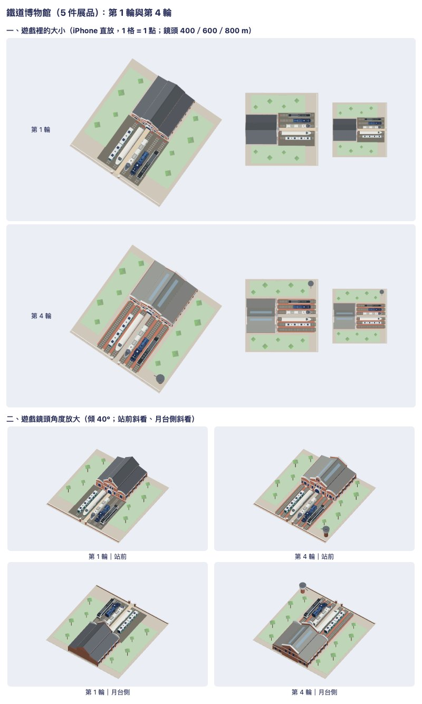

# 鐵道博物館的館舍：看圖四輪（決策 696，2026-11-12）



規矩在 [model-look skill](../../../.claude/skills/model-look/SKILL.md)。配方是 `Sources/GamePresentation/Map3DRailwayMuseum.swift`。這裡只放一張總覽圖；含真實照片的並排圖、七件與十二件的圖、模擬器截圖、TRELLIS 對照圖在私有素材庫 `a91453/railway-assets-private` 的 `game-art-previews/docs/art/railway-museum-2026-11-12/`。

重拍：

```sh
tools/model-look/export-museum.sh <資料夾> hall 0 5 7 12
node tools/model-look/shoot.mjs --model <資料夾>/railway-museum-5.m3dmodel --max-triangles 200000 --title 鐵道博物館 --out sheet.jpg
```

## 參考與特徵

真的那一座：鐵道部臺北工場（臺北市北門旁，1909 年；2006 年因捷運松山線整棟平移）。照片都來自 Wikimedia Commons，只拿來比對形狀與顏色：

| 照片 | 作者 | 授權 | 用來看 |
| --- | --- | --- | --- |
| [Old Taipei Railway Workshop 20240625.jpg](https://commons.wikimedia.org/wiki/File:Old_Taipei_Railway_Workshop_20240625.jpg) | Yu tptw | CC BY-SA 4.0 | 正面 |
| [Old Taipei Railway Workshop 20240518.jpg](https://commons.wikimedia.org/wiki/File:Old_Taipei_Railway_Workshop_20240518.jpg) | 阿道 | CC BY-SA 4.0 | 正面略偏 |
| [鐵道部臺北工場模型.jpg](https://commons.wikimedia.org/wiki/File:鐵道部臺北工場模型.jpg) | 氏子 | CC BY-SA 4.0 | 斜上方：屋頂與側面（館內的白模） |
| [臺灣總督府鐵道部臺北工場.jpg](https://commons.wikimedia.org/wiki/File:臺灣總督府鐵道部臺北工場.jpg) | 氏子 | CC BY-SA 4.0 | 俯視：整個工場的配置（館內的場景模型） |
| [Moving the Old Taipei Railway Workshop.jpg](https://commons.wikimedia.org/wiki/File:Moving_the_Old_Taipei_Railway_Workshop.jpg) | 臺北市政府捷運工程局 | Attribution | 平移時的側面與背面 |

尺寸：平面照 OpenStreetMap 的輪廓（way 548623142「原臺北鐵道工場（台鐵舊禮堂）」，© OpenStreetMap contributors，ODbL），外框約 31.5 × 30.4 m；遊戲裡寬 29 m、長 25 m（長度因為地只有 64 m 而縮短 6 m）。屋脊高約 13 m 是推估，從正面照片裡的門（約 3 m 高）推的。第 1 到 4 輪是先從照片推估寬 24 m 做的，做完才查 OSM，寬度碰巧接近。

憑什麼認出它：紅磚牆配白色橫帶；中間高起的山牆與圓頭的白色頂冠；兩側較矮的側廊各頂一道弧形白邊；灰色兩坡屋頂；正中央白色的拱門。

## 每一輪

| 輪 | 看圖找到的毛病 | 改了什麼 |
|---|---|---|
| 1 | — | 第一版：中殿加兩側廊、正面山牆與頂冠、館前展示線、兩側草地 |
| 2 | 從上往下看只剩一片深灰屋頂，紅磚看不到；館舍在 62 m 的地上太小；中殿太瘦高、側廊太窄；軌道下一整塊深色道碴太重 | 館舍加大（中殿 11→13 m、側廊 6.8→8 m）、山牆放緩；屋頂改淺灰，加屋脊與兩條採光帶；拿掉大塊道碴；側廊正面各三扇窗；角落加水塔 |
| 3 | 正上方看仍然不紅；山牆從上面看只有一條細線；背面是一面空牆 | 展示場改紅磚鋪面；前後山牆加厚、白色壓頂加寬；背面補山牆、白帶與窗 |
| 4 | 空館只鋪兩股軌道，館前空一大片；七件展品時新車庫只有一股軌道，旁邊一大塊空鋪面；藍皮的車頭太長會頂進館；館舍背面超出地界 | 館前六股從一開始就鋪；車庫一蓋就是三股；館舍往後縮、長車往前停；背面收進地界（這幾項都有測試） |

清單現況（事實，不是評分）：

1. 像盒子：中殿高、側廊矮，前後山牆高出屋頂，不是一個方盒。
2. 比例：正面和照片並排，中殿、側廊、頂冠的高低關係相近；整體比真的大三分之一、短一截（上面寫明）。
3. 窗：白色窗框凸出牆面、深色玻璃，靠顏色分開；**沒有退進牆裡**。
4. 屋頂與牆：簷口有白色封簷板，側廊的斜屋頂接在中殿的高窗下，山牆面都補上。
5. 浮空：柱、牆、水塔都落地；樹有樹幹。水塔的出水管一端懸空（真的也是）。
6. 顏色：紅磚、白帶、灰頂、綠地、紅鋪面，轉灰階後屋頂、牆、地面分得開。
7. 面與面：屋脊、封簷板、磚柱、白帶把相鄰的面隔開。
8. 遠看：400 m、600 m 看得出灰頂白山牆的館舍與一排列車；800 m 靠紅鋪面與列車認。

在 App 裡（iPhone 模擬器、Metal）看過：近看、斜看、高處、800 m 四個角度，館舍與五件展品都在（截圖在素材庫）。

## 還有哪裡不好

1. **磚色比真的淡**。調色盤的 `brick` 是偏粉的磚色，真的工場是深紅磚；遊戲的光又把它洗得更淡，在 App 裡近看偏粉橘。
2. **800 m 正上方看，館舍本身仍是一塊灰色長方形**，要靠紅鋪面和列車才認得出來；空館時只剩紅鋪面與六股空軌道。
3. **窗沒有深度**，是貼在牆外的色塊；側面一排窗近看很平。
4. **空館的展示場冷清**：六股空軌道加兩片草地，沒有人、沒有長椅或告示牌。
5. **兩側草地很空**，只有五棵樹；車庫蓋起來之前佔了地的一半。
6. **展品只有車頭一節**，短的車（阿里山 8.9 m、蒸汽機車 15 m）在 30 m 的軌道上顯得孤單。
7. **高度沒有資料**：屋脊、簷高都是從照片推的，OSM 只記一層樓。
8. **沒有和遊戲裡其他建築並排看**（車站、廟、百貨），只單獨看過；也沒在真實地圖的街區裡看。
9. 圖示：地圖記號比機廠、飯店的記號細一點，墨量略輕；卡片圖的火車頭在 28 點時只剩一個綠圓。
