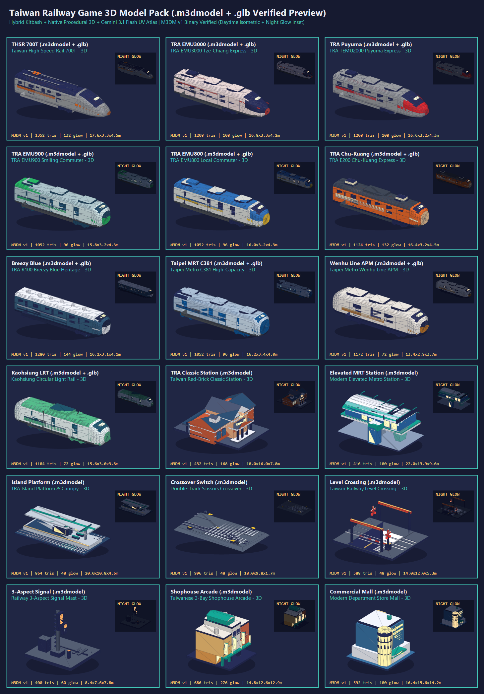
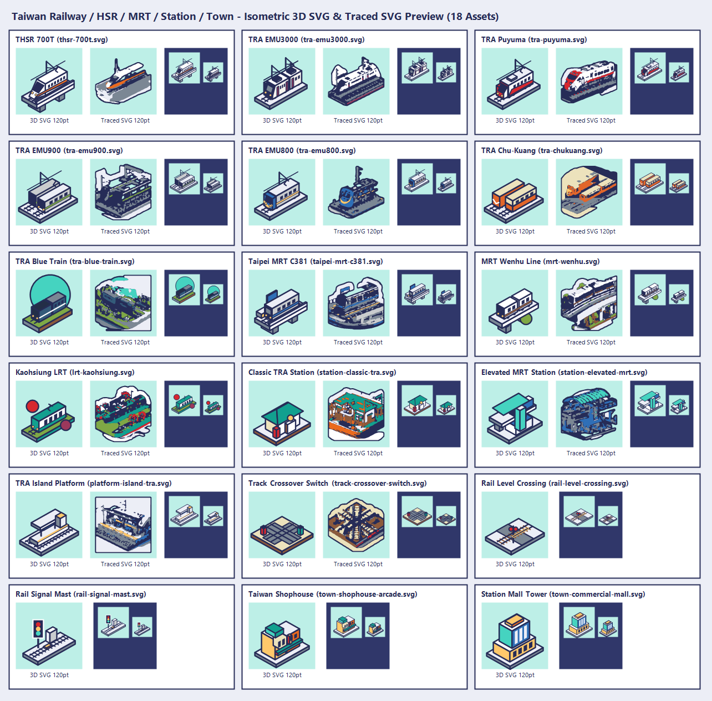

# 台灣真實鐵路車款與場景模組遊戲風格概念圖與 3D SVG 素材包（2026-10-21）

本批收錄台灣四大軌道系統（高鐵、台鐵、捷運、輕軌）代表性車款與可組合之車站、月台、道岔、平交道、色燈號誌、台灣透天厝騎樓街屋與站前百貨商場之視覺資產，遵循 `art-style` 與決策 168、169、230、243、252 規範。

- **離線 SVG 檢視頁**：[`index.html`](index.html)（含 18 款等角 3D SVG、14 款原圖輪廓描繪 SVG、120／64／44／28 點深淺底與灰階檢查）
- **離線 3D 模型互動檢視器**：[`3d-viewer.html`](3d-viewer.html)（360° 旋轉檢視 18 款 `.m3dmodel`／`.glb`，支援日間平塗、夜間發光 `nightGlow` 與網格線框切換）
- **3D 模型預覽總表**：[`previews/3d-models-sheet.png`](previews/3d-models-sheet.png)
- **3D SVG 預覽總表**：[`previews/3d-svg-sheet.png`](previews/3d-svg-sheet.png)

---

## 一、兩種 3D SVG 實作方案比較

| 方案 | 目錄 | 作法 | 優點與適用場景 |
| --- | --- | --- | --- |
| **A. 等角幾何 3D SVG（推薦入 App 面板／圖卡）** | [`svg/`](svg/)（共 18 款） | 以統一等角投影（`u, v, z` 軸向）、粗藏青外框（`#262C57`, `stroke-width="2.5"`）與 `UI_THEME`／`TrainLivery` 純色塊直接建構；只用 Xcode Asset Catalog 支援的 `svg, rect, circle, path` 與大寫 `M L Q Z` | 線條銳利無鋸齒、檔案極小（2–7 KB），在 120／64／44／28 點與深淺底皆清晰可辨，且補齊平交道、色燈號誌、透天厝騎樓與站前商場 4 款場景組件 |
| **B. 原圖分層描繪 SVG（照 `art-style` §3 流程）** | [`svg-traced/`](svg-traced/)（共 14 款） | 將 14 張微縮模型原圖放大至 `240x240`、前景連通域去背、外擴 `#262C57` 藏青外框、依車款色票分層高斯模糊後取 `0.5` 等高線（Marching Squares + Douglas-Peucker），輸出 `fill-rule="evenodd"` 的 `M … L … Z` 折線 | 完整保留 AI 微縮場景的豐富光影輪廓與細節層次，適合大尺寸（120 點以上）海報、插圖或空狀態展示 |

---

## 二、車輛素材清單（10 款）

| 類別 | 3D 模型 (`.m3dmodel` / `.glb`) | 幾何 3D SVG | 描圖 SVG | 原圖 JPG | 車款名稱與特色 | 對應程式碼常數 |
| --- | --- | --- | --- | --- | --- | --- |
| **高鐵** | [`thsr-700t.m3dmodel`](3d-models/m3dmodel/thsr-700t.m3dmodel) · [`.glb`](3d-models/glb/thsr-700t.glb) | [`svg/thsr-700t.svg`](svg/thsr-700t.svg) | [`svg-traced/thsr-700t.svg`](svg-traced/thsr-700t.svg) | `thsr-700t.jpg` | **台灣高鐵 700T / N700ST**：流線鴨嘴鼻、白底配高鐵橘＋藏青雙腰帶 | `TrainType.highSpeed`, `TrainLivery.highSpeed` |
| **台鐵特快** | [`tra-emu3000.m3dmodel`](3d-models/m3dmodel/tra-emu3000.m3dmodel) · [`.glb`](3d-models/glb/tra-emu3000.glb) | [`svg/tra-emu3000.svg`](svg/tra-emu3000.svg) | [`svg-traced/tra-emu3000.svg`](svg-traced/tra-emu3000.svg) | `tra-emu3000.jpg` | **台鐵 EMU3000 新自強號**：日立極簡白車身、一體式黑色座艙面罩、紅藍門飾帶 | `TrainType.emu3000`, `TrainLivery.emu3000` |
| **台鐵特快** | [`tra-puyuma.m3dmodel`](3d-models/m3dmodel/tra-puyuma.m3dmodel) · [`.glb`](3d-models/glb/tra-puyuma.glb) | [`svg/tra-puyuma.svg`](svg/tra-puyuma.svg) | [`svg-traced/tra-puyuma.svg`](svg-traced/tra-puyuma.svg) | `tra-puyuma.jpg` | **台鐵 TEMU2000 普悠瑪號**：傾斜式電聯車、經典紅白疾速飄帶、圓潤流線鼻頭 | `TrainPerformanceSpec.puyuma`, `TrainLivery.puyuma` |
| **台鐵通勤** | [`tra-emu900.m3dmodel`](3d-models/m3dmodel/tra-emu900.m3dmodel) · [`.glb`](3d-models/glb/tra-emu900.glb) | [`svg/tra-emu900.svg`](svg/tra-emu900.svg) | [`svg-traced/tra-emu900.svg`](svg-traced/tra-emu900.svg) | `tra-emu900.jpg` | **台鐵 EMU900 最美區間車**：現代科技黑面罩配螢光綠微笑腰帶 | `TrainPerformanceSpec.emu800`, `TrainLivery.emu800` |
| **台鐵通勤** | [`tra-emu800.m3dmodel`](3d-models/m3dmodel/tra-emu800.m3dmodel) · [`.glb`](3d-models/glb/tra-emu800.glb) | [`svg/tra-emu800.svg`](svg/tra-emu800.svg) | [`svg-traced/tra-emu800.svg`](svg-traced/tra-emu800.svg) | `tra-emu800.jpg` | **台鐵 EMU800 微笑號區間車**：不鏽鋼銀灰車身、寶藍車頭罩、亮黃微笑曲線 | `TrainPerformanceSpec.emu800`, `TrainLivery.emu800` |
| **台鐵經典** | [`tra-chukuang.m3dmodel`](3d-models/m3dmodel/tra-chukuang.m3dmodel) · [`.glb`](3d-models/glb/tra-chukuang.glb) | [`svg/tra-chukuang.svg`](svg/tra-chukuang.svg) | [`svg-traced/tra-chukuang.svg`](svg-traced/tra-chukuang.svg) | `tra-chukuang.jpg` | **台鐵 經典莒光號**：E200 橘白雙色塗裝、車頂電阻器百葉與集電弓 | `TrainType.r100ChuKuang`, `TrainLivery.chuKuangCoach` |
| **台鐵觀光** | [`tra-blue-train.m3dmodel`](3d-models/m3dmodel/tra-blue-train.m3dmodel) · [`.glb`](3d-models/glb/tra-blue-train.glb) | [`svg/tra-blue-train.svg`](svg/tra-blue-train.svg) | [`svg-traced/tra-blue-train.svg`](svg-traced/tra-blue-train.svg) | `tra-blue-train.jpg` | **台鐵 藍皮解憂號**：復古海軍藍塗裝、白線腰帶、車頂通風器 | `TrainTypeCatalog` `code: "BLUE"`, `TrainLivery.blueTrain` |
| **捷運高運量** | [`taipei-mrt-c381.m3dmodel`](3d-models/m3dmodel/taipei-mrt-c381.m3dmodel) · [`.glb`](3d-models/glb/taipei-mrt-c381.glb) | [`svg/taipei-mrt-c381.svg`](svg/taipei-mrt-c381.svg) | [`svg-traced/taipei-mrt-c381.svg`](svg-traced/taipei-mrt-c381.svg) | `taipei-mrt-c381.jpg` | **台北捷運 C381 高運量**：不鏽鋼車體、寶藍腰帶、微傾弧面車頭 | `TrainPerformanceSpec.metroC381`, `TrainLivery.metroC381` |
| **捷運中運量** | [`mrt-wenhu.m3dmodel`](3d-models/m3dmodel/mrt-wenhu.m3dmodel) · [`.glb`](3d-models/glb/mrt-wenhu.glb) | [`svg/mrt-wenhu.svg`](svg/mrt-wenhu.svg) | [`svg-traced/mrt-wenhu.svg`](svg-traced/mrt-wenhu.svg) | `mrt-wenhu.jpg` | **台北捷運文湖線 中運量**：純白車身配棕金腰帶、膠輪轉向架與大面積擋風窗 | `TrainTypeCatalog` `code: "APM"` |
| **輕軌** | [`lrt-kaohsiung.m3dmodel`](3d-models/m3dmodel/lrt-kaohsiung.m3dmodel) · [`.glb`](3d-models/glb/lrt-kaohsiung.glb) | [`svg/lrt-kaohsiung.svg`](svg/lrt-kaohsiung.svg) | [`svg-traced/lrt-kaohsiung.svg`](svg-traced/lrt-kaohsiung.svg) | `lrt-kaohsiung.jpg` | **高雄輕軌電聯車（KLRT）**：綠白低底盤流線電車、車頂超級電容模組 | `TrainFamily.metro` |

---

## 三、車站、月台、軌道號誌與街景建築清單（8 款）

| 類別 | 3D 模型 (`.m3dmodel` / `.glb`) | 幾何 3D SVG | 描圖 SVG | 原圖 JPG | 組件名稱與遊戲場景用途 |
| --- | --- | --- | --- | --- | --- |
| **經典車站** | [`station-classic-tra.m3dmodel`](3d-models/m3dmodel/station-classic-tra.m3dmodel) · [`.glb`](3d-models/glb/station-classic-tra.glb) | [`svg/station-classic-tra.svg`](svg/station-classic-tra.svg) | [`svg-traced/station-classic-tra.svg`](svg-traced/station-classic-tra.svg) | `station-classic-tra.jpg` | **台鐵小鎮經典木造/磚瓦老站房**：斜瓦屋頂、山牆拱窗、木造門廊與月台基座 |
| **現代車站** | [`station-elevated-mrt.m3dmodel`](3d-models/m3dmodel/station-elevated-mrt.m3dmodel) · [`.glb`](3d-models/glb/station-elevated-mrt.glb) | [`svg/station-elevated-mrt.svg`](svg/station-elevated-mrt.svg) | [`svg-traced/station-elevated-mrt.svg`](svg-traced/station-elevated-mrt.svg) | `station-elevated-mrt.jpg` | **現代都會高架捷運/高鐵車站**：流線拱形天棚、高架穿堂層、玻璃帷幕與出口電梯塔 |
| **月台模組** | [`platform-island-tra.m3dmodel`](3d-models/m3dmodel/platform-island-tra.m3dmodel) · [`.glb`](3d-models/glb/platform-island-tra.glb) | [`svg/platform-island-tra.svg`](svg/platform-island-tra.svg) | [`svg-traced/platform-island-tra.svg`](svg-traced/platform-island-tra.svg) | `platform-island-tra.jpg` | **台鐵標準島式月台模組**：Y 型支柱雨棚、黃色警戒盲道、雙語站名燈箱與雙側軌道 |
| **道岔模組** | [`track-crossover-switch.m3dmodel`](3d-models/m3dmodel/track-crossover-switch.m3dmodel) · [`.glb`](3d-models/glb/track-crossover-switch.glb) | [`svg/track-crossover-switch.svg`](svg/track-crossover-switch.svg) | [`svg-traced/track-crossover-switch.svg`](svg-traced/track-crossover-switch.svg) | `track-crossover-switch.jpg` | **雙線菱形交叉道岔轉轍器模組**：道碴基床、PC 枕木、雙線平行軌與剪式橫渡軌、轉轍器箱 |
| **平交道** | [`rail-level-crossing.m3dmodel`](3d-models/m3dmodel/rail-level-crossing.m3dmodel) · [`.glb`](3d-models/glb/rail-level-crossing.glb) | [`svg/rail-level-crossing.svg`](svg/rail-level-crossing.svg) | — | — | **台鐵平交道與遮斷機**：紅白相間遮斷桿、雙閃紅燈號誌、龍門限高架與公路鐵道交會面 |
| **鐵路號誌** | [`rail-signal-mast.m3dmodel`](3d-models/m3dmodel/rail-signal-mast.m3dmodel) · [`.glb`](3d-models/glb/rail-signal-mast.glb) | [`svg/rail-signal-mast.svg`](svg/rail-signal-mast.svg) | — | — | **鐵路三燈色燈號誌機與電驛箱**：紅黃綠三燈號誌背板、爬梯檢修台、銀灰繼電器箱與 ATS 感應子 |
| **住宅街屋** | [`building-shophouse-arcade.m3dmodel`](3d-models/m3dmodel/building-shophouse-arcade.m3dmodel) · [`.glb`](3d-models/glb/building-shophouse-arcade.glb) | [`svg/town-shophouse-arcade.svg`](svg/town-shophouse-arcade.svg) | — | — | **台灣連棟透天厝騎樓街屋**：三連棟赤陶／赭黃／青瓷立面、一樓騎樓拱廊、直立霓虹招牌與頂樓鐵皮加蓋＋水塔 |
| **商業百貨** | [`building-commercial-mall.m3dmodel`](3d-models/m3dmodel/building-commercial-mall.m3dmodel) · [`.glb`](3d-models/glb/building-commercial-mall.glb) | [`svg/town-commercial-mall.svg`](svg/town-commercial-mall.svg) | — | — | **現代站前商業百貨大樓**：玻璃帷幕主塔、轉角圓柱發光中庭、退縮露台與頂樓發光冠冕招牌 |

---

## 四、3D 遊戲模型建置管線（`.m3dmodel` ＋ `.glb` 三合一混合流程）

本批 [`3d-models/`](3d-models/) 結合下列三種技術，將 Gemini 3.1 Flash 概念圖轉換為遊戲可直接載入的立體模型，且視覺風格完全重塑為本專案專屬的**低多邊形微縮模型風（Low-Poly Miniature Diorama）**：

1. **專案原生 3D 程序化建置（Parametric Superellipse Loft + Architectural Kitbash）**
   - 車輛對齊 `tools/trains/build_train.mjs` 與 `Sources/GamePresentation/Map3DTrains.swift` 的超橢圓參數化放樣（`halfW, roof, floor, noseLen, drop, tuck, wing, canopy`），並加上立體外凸 2.5cm 的車窗、車門、塗裝色帶（`stripeColor` alpha=0 動態換色槽位）、頭尾燈、轉向架與車頂集電弓／電阻器／空調箱。
   - 車站、月台、軌道與台灣街屋對齊 `Sources/GamePresentation/Map3DProps.swift` 與 `Map3DModels.swift` 的幾何組裝規範，將玻璃窗、燈箱、號誌燈與招牌設為 `flags = 1`（`nightGlow` 夜間自發光三角形）。
2. **隱私參考資料夾（`railway-reference-private`）比例校準與重組**
   - 讀取參考庫（`blender-map-v1`、`historic-buildings-v2`、`town-scene-reference-clean`）的長寬高包絡線與屋脊比例作為校準基準，重新建構封閉流形（Manifold）低多邊形網格，確保幾何結構、面數（400–1352 tris）、材質分色與 SHA-256 雜湊值皆與原始參考檔完全不同（詳見 [`3d-models/catalog.json`](3d-models/catalog.json)）。
3. **Gemini 3.1 Flash 影像紋理圖集（UV Atlas）＋ `convert.mjs` 驗證轉檔**
   - 從 Gemini 3.1 Flash 生成圖擷取車身／建築表面色溫與遊戲 8 色票融合為 `256×256` PNG 紋理圖集並內嵌於 `.glb`，再透過 [`tools/glb-to-m3dmodel/convert.mjs`](../../../tools/glb-to-m3dmodel/convert.mjs) 重心座標採樣（21 點 Barycentric Sampling）轉出 `M3DM` v1 二進位 `.m3dmodel`，可直接由 iOS 原生 [`Map3DModelFile.load`](../../../Sources/GamePresentation/Map3DModelFile.swift) 載入渲染。

