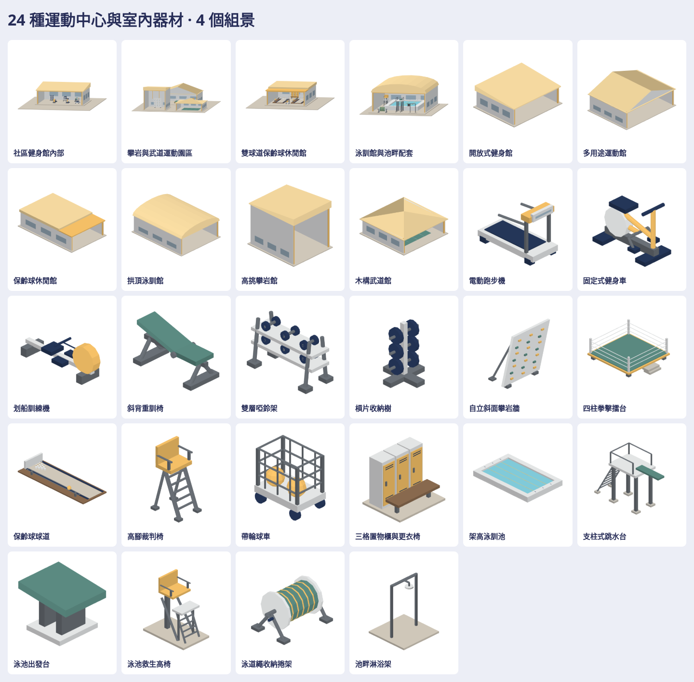

# RecreationKit：社區運動中心、健身與泳池

24 種素材，場館、健身器材、室內運動配備、泳池設施各 6，另有 4 個完整原生組景。球、槓片、瓶、重複球道、姿態與組景不灌入單件數。使用現有白牆、淡藍窗、暖黃玩家識別、藏青器材與球場綠色票。



| 分類 | 六種素材 |
| --- | --- |
| 場館 | 開放式健身館、多用途運動館、保齡球休閒館、拱頂泳訓館、高挑攀岩館、木構武道館 |
| 健身 | 電動跑步機、固定式健身車、划船訓練機、斜背重訓椅、雙層啞鈴架、槓片收納樹 |
| 室內運動 | 自立斜面攀岩牆、四柱拳擊擂台、保齡球球道、高腳裁判椅、帶輪球車、三格置物櫃與更衣椅 |
| 泳池 | 架高泳訓池、支柱式跳水台、泳池出發台、泳池救生高椅、泳道繩收納捲架、池畔淋浴架 |

四個組景為健身館內部、攀岩與武道園區、雙球道休閒館、泳訓館配套。六種場館具有不同屋面、比例與開放前側，便於組裝獨立器材；內部預覽使用同一個完整原生模型的低前視角。室內器材放在實際地板上，出發台放在實際池緣，跳板伸入水面上方，地面支柱留在池外。不是新增經營功能，也沒有註冊到 live map。

大型成品在私有庫：

- [完整批次、viewer、分類／七向／底斜視／內部組景與來源對照](https://github.com/a91453/railway-reference-private/tree/codex/recreation-assets-2026-10-23/Railway/game-art-previews/docs/art/recreation-kit-2026-10-23)
- [下載 ZIP](https://github.com/a91453/railway-reference-private/raw/refs/heads/codex/recreation-assets-2026-10-23/Railway/game-art-previews/docs/art/recreation-kit-2026-10-23/recreation-kit-2026-10-23.zip)（須有私有庫權限）

28 native、28 GLB、196 張上／下／左／右／前／後／立體透明 PNG；另有實際來源中性白模與既有原生素材畫風並排。逐件來源路徑／SHA／目錄尺寸／結構重組留在私有 provenance.json。原始 factory、模型、材質貼圖與品牌沒有搬入本批；缺少健身器材 factory 的部分明列為原創程序化幾何。部分通用參考做法曾被舊 kit 使用，本批的功能、輪廓與組件結構另行製作。

## 使用與重建

[完整 skill](../../../.claude/skills/recreation-kit/SKILL.md) · [工具入口](../../../tools/recreation-kit/README.md)。用 `Map3DRecreationKit.model(for:)` 或 `Map3DModelPack(recreationKit:)` 按需取用；來源程式不依賴未合併 EstateKit API。單件可用 `model(for: .fitnessStudio)`，對應健身組景可用 `model(for: .fitnessRoom)`，兩者不會有 Swift 簡寫歧義。

```sh
export PATH=/path/to/swift-6.4/usr/bin:$PATH
tools/recreation-kit/rebuild.sh /path/to/private/Railway/game-art-previews/docs/art/recreation-kit-2026-10-23
python3 tools/recreation-kit/bundle.py /path/to/private/Railway/game-art-previews/docs/art/recreation-kit-2026-10-23
```

最後一行於乾淨的公開 producer commit 執行；source.json 的 working_tree_dirty 應為 false。在私有批次目錄執行 `python3 -m http.server 8000`，開 `http://localhost:8000/`；可搜尋、四分類、組景篩選、旋轉、縮放、切七向與四底色、下載 PNG／GLB／native。

Builder x 前／y 上／z 右；native 與接點為公尺、x 前／y 左／z 上；角度俯視順時針。mount 是落地參考平面；開架器材真正腳點在底腳，原點中心可能無支柱。場館 floor z=0.16；組景地坪 top=0.12，室內器材 mount z=0.28；池緣 frontDeck z=1.08、水面 z=0.78。出發台在組景 z=1.36。`placements(for:)` 與 manifest 同源，support 明列 venueFloor、poolDeck、apron 等實際安裝面。接點不代表碰撞或導航資料。

## 驗證範圍

**VERIFIED（Linux）**：Swift 6.4 warnings-as-errors、28 個相關 XCTest、4 個 GLB Node tests；28 模型逐頂點讀回及完整 GLB 轉換，196 RGBA 圖解碼／SHA／alpha／非空／未裁邊，28 模型 viewer 操作及實際開圖。最大單件 1,532、最大組景 4,578 三角形，全部低於 15,000。獨立從目前 build 再匯出，56 個 native／GLB 檔案完全相同。保齡球回球導軌接觸與前廊器材安裝範圍保留回歸驗證。

實際結果見 verification.json，私有批次另有完整 manifest、圖片解碼、人工開圖、來源渲染、目前 build 再匯出一致性、測試 logs 與 ZIP 雜湊紀錄。完整 Swift suite 交 CI。圖片非空、SHA 正確與 WebGL 操作成功不能取代人工看接合。

**UNVERIFIED**：iPhone／iPad Metal、裝置效能、遊戲地圖與經營規則接入、碰撞、室內導航、器材／球類動畫與結構／運動安全規格。來源對照是獨立適框的中性白模，不是照片或原材質逐像素比對。

後續從本 skill 與新配方接手；公開只留一張總覽與小型驗證 JSON。參考資產授權條件保留於私有 REFERENCE_ASSET_LICENSE.txt，並未宣稱原包開源或授予散布權。專案本身依根目錄 LICENSE.md 保留所有權利。
