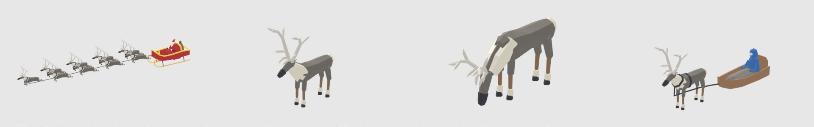

# 馴鹿與聖誕雪橇（決策 840）

由左至右：飛天的聖誕雪橇隊（九隻鹿、雪橇、聖誕老人、禮物袋）、站著的馴鹿、吃草的馴鹿、拉遊客木雪橇的馴鹿。冬毛灰褐、淺色頸毛，遊戲角度、平光、色票平塗，不畫名字與角色。總覽是工作室交件時的顏色；2026-11-18 起角改深咖啡、雪橇隊改咖啡色（決策 840 的「後來」），改前改後見 [colours-sleigh.jpg](colours-sleigh.jpg)、[colours-standing.jpg](colours-standing.jpg)。

- 做的：本地工作室（Claude 做、Codex 對照片審，作者 2026-11-18 指定）。Codex 第 1 次退回三點（小尺寸認不出角與頸毛、遠景零件懸空、遠景只有主繩），revision-4 修好後通過。
- 重檔（8 個 GLB、七向圖、遊戲大小圖、各輪紀錄、比對用照片與來源）：`a91453/railway-assets-private`，`game-art-previews/docs/art/reindeer-2026-11/`（revision-4）。照片只在那裡，不進這個 repo。
- 轉進遊戲：`tools/train-models/glb_to_swift.py`，材質順序寫在 `Sources/GamePresentation/Map3DReindeer.swift`。

## 還有哪裡不好

1. 角為了在 40°、約 14 px 認得出來，比真的粗。
2. 領頭鹿的紅鼻子在遊戲大小只有一兩個像素。
3. 身體是 5–6 邊的低面數，跟飛時近看看得出稜角。
4. 地面的鹿群停著不動（拉雪橇那隻也是）。
5. 還沒在 iPhone 上看過。
