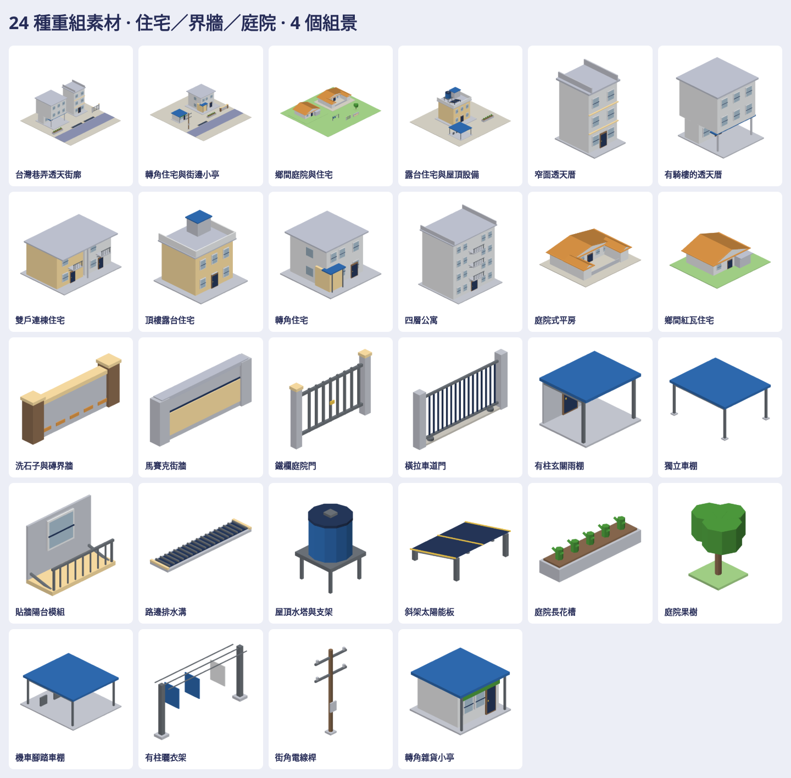

# 台灣住宅街廓素材

24 件可按需建造的原生 3D 素材：住宅、界牆與出入口、庭院及街邊設施各 8 件；另有四個由同一套件組成的獨立場景。模型分件見 `Map3DResidentialKit.Part`，組景見 `Map3DResidentialKit.Example`，遊戲可用 `Map3DModelPack(residentialKit:)` 選取需要的部分。此 PR 沒有接入地圖。

公開庫保留配方、重建工具、測試、本總覽與小型驗證 JSON。28 個 native、28 個 GLB、196 張七向透明 PNG、分類及組景、下斜視和多底色檢查圖、互動 viewer 與逐件來源對照位於私有庫 `Railway/game-art-previews/docs/art/residential-kit-2026-10-21/`。原始 factory 與原包模型不在公開庫。

重建：`tools/residential-kit/rebuild.sh /absolute/path/to/private/output/residential-kit-2026-10-21`。先讀 [residential-kit skill](../../../.claude/skills/residential-kit/SKILL.md) 與私有 `ASSET_LICENSE.txt`。這些只是可供選用的靜態遊戲配方，不代表實機 Metal、效能或地圖放置已驗證。
