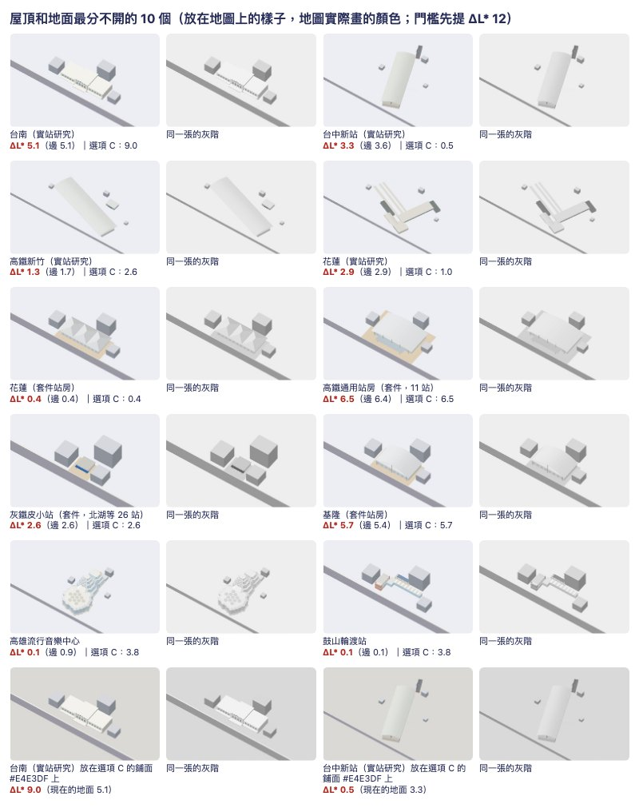
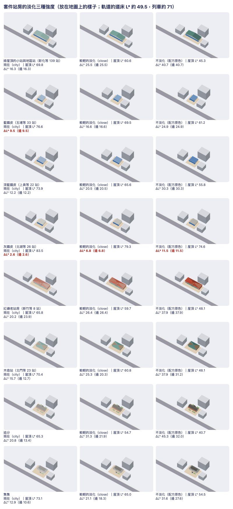
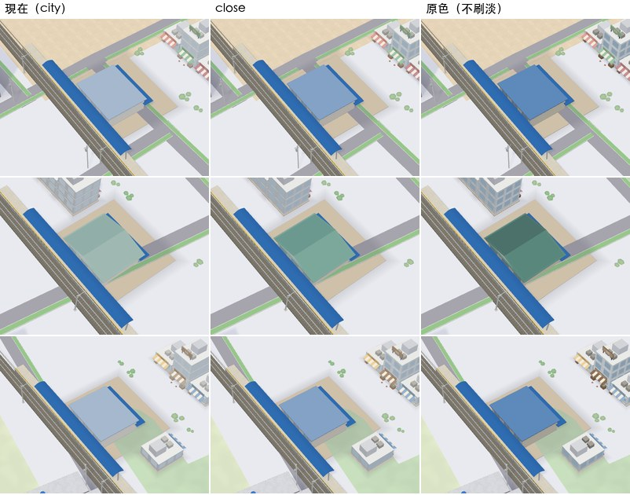
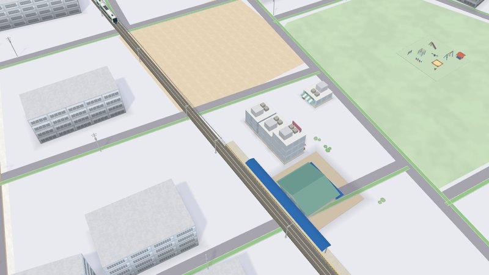

# 屋頂和地面分不分得開：自動檢查與現有模型的盤點

2026-11-13。接 #2127（3D 地圖「看起來死氣」的調色預覽）。作者要兩件事：配方加一條自動檢查，讓以後新做的模型不會再出現白屋頂放白地；把現有的車站站房與地標盤點一遍。**這一輪只盤點與提建議，沒有改任何模型的配方，`Map3DPalette`、`Map3DLook` 也沒動，App 的畫面沒有變。** 地面顏色（#2127 的 A／B／C／D）作者還沒選，所以每個數字都對「現在的地面（A）」與「選項 C 的地面」各算一次；門檻先提 12，最後的數字由作者定。



上面是最分不開的 10 個，每個左邊彩色、右邊灰階；最下面一列是台南與台中新站換到選項 C 的鋪面上。圖是 `tools/model-look/shoot.mjs --only map` 拍的（遊戲的地面色、一條路、三棟城市方塊；不是 Metal，也不是實機），模型的顏色是地圖實際畫的那一份（見下一節）。

## 1. 查證：套件建築進地圖會被淡化嗎

會，而且每一類不一樣。`Map3DScene` 組好一個區塊之後才套 `Map3DLook`（決策 370、451），模型放進哪一個網格決定它被怎麼畫：

| 模型 | 放進哪裡 | 地圖畫的顏色 |
| --- | --- | --- |
| 套件站房（`StationKitBuilder.house`，275 站） | 區塊的近景網格（`Map3DStations.addHouse`） | **被淡化**，`Map3DLook.city`（明度 0.45 + 0.52 ×、彩度 × 0.80）。站前鋪面 `plaza` 與藍色雨棚在保留名單裡，不變 |
| 套件站房的遠景方塊（`farColours`） | 遠景網格 | 同樣被淡化 |
| 實站研究（決策 625，20 座） | `ownColourNear`／`ownColourFar`，淡化之後才加 | **配方原色**（決策 625 續：淡化後玻璃、磚、色帶都近白，所以改成不淡化） |
| 地標（`Map3DTaipeiLandmark`，22 個） | 近景網格，顏色全部加進 `keptColours` | **配方原色** |
| 廟（公共套件，決策 331） | 最近的細節網格 | 被淡化，`Map3DLook.close`（0.25 + 0.73 ×、彩度 × 0.95），較輕；遠景方塊用 `city` |
| 玩家蓋的建築用到的套件零件（`Map3DPlacedBuildingKits`） | 最近的細節網格 | `close`；房地產套件的屋頂另外換成玩家建築的顏色 |

淡化對屋頂的影響很大。地區站的綠屋頂配方是 #4D756E，地圖畫出來是 #96B4AF：對站前鋪面的明度差從 40.7 掉到 16.3。藍鐵皮 #6F9AC9 → #AEC3D9，24.9 掉到 9.5。所以檢查不能讀配方裡寫的顏色，要讀淡化之後的。

另外兩個原本沒注意到的事實：

- **套件站房不是站在地面上，是站在它自己的站前鋪面上**（`plaza` #EAD9BF，L* 86.1，比地面的 92.7 暗）。它四周 3 m 幾乎都是鋪面，所以套件站房的數字在 A 與 C 之下完全一樣：地面選哪一個都不影響它們。
- `tools/model-look/export-station.sh` 匯出的是**配方原色**，拍出來的「放在地圖上的樣子」比遊戲裡深。這一輪的圖用測試匯出的「地圖畫的顏色」那一份（`ROOF_CONTRAST_REPORT`，見第 5 節）。之後用 shoot 看套件站房的第三格，要用這一份才準。

## 2. 檢查怎麼量

`Tests/GamePresentationTests/Map3DRoofContrastTests.swift`。

- 把模型從正上方看（遊戲鏡頭拉遠就是正上方），每 0.25 m 一格（大模型放大格子，總數不超過 12 萬格），每格取最高的那個面。
- 每格的顏色＝頂點色經過該類模型在地圖上的淡化（上表），再乘決策 370 白天的柔光（`Map3DShaders.metal` 的 `soft`，14:00；太陽的左右分量取平均，所以和建築朝向無關），換成 L*。
- **屋頂**＝比模型的腳高 2 m 以上的格子。**四周**＝屋頂外 3 m 內的格子：模型自己鋪了東西（站前鋪面、月台）就用它，沒有就是地圖的地面。A 的地面是 `Map3DPalette.ground` #ECEEF6（L* 92.7；#2127 在預覽頁量到 92.8）；C 的地面用建物四周 7 m 的鋪面 #E4E3DF（L* 88.8）。
- **屋頂 ΔL*＝屋頂的中位數對四周的中位數**（決策 370 的量法：各類像素的中位數相減）。**邊 ΔL*** 是屋頂最外 0.75 m 一圈的中位數對四周。
- **過＝屋頂或邊有一個達到門檻。** 這是為了作者說的那種情況：真的是白色的建築不硬改顏色，用深色的簷口、女兒牆把輪廓框出來。從上面看得到、寬 0.5 m 以上的深色邊就會過（`testAWhiteRoofFailsUntilItHasADarkEdge`：白板不過，加 0.6 m 的深邊就過，灰板直接過）。
- 沒量的：貼圖、陰影、霧、夜晚、雨天；斜看時的牆面。

讀哪些模型：套件站房每個「輪廓種類 × 屋頂變化 × 等級」一個（62 種，代表 275 站；其餘 269 站只有出入口，沒有站房）、實站研究 20、地標 22、廟 3，以及商業、公共、住宅套件的建築零件（各 12、12、10，當作單獨放在地面上，用 `close` 淡化）。

現在不過的模型列在測試的 `known` 裡（59 個）。**新模型不在名單裡，不過就紅；名單裡的模型哪天過了，測試也會紅，要求把它從名單拿掉**，所以名單只會變短。沒有為了變綠改任何模型或放寬門檻。

## 3. 兩種地面下各有多少不過

| 門檻 ΔL* | 地面 | 套件站房（62 種，275 站） | 實站研究（決策 625） | 地標（決策 370、457） | 廟（決策 331） | 商業套件的建築 | 公共套件的建築 | 住宅套件的住家 | 合計 |
| --- | --- | --- | --- | --- | --- | --- | --- | --- | --- |
| 8 | A 現在 | 18／62（44 站） | 8／20 | 8／22 | 0／3 | 1／12 | 4／12 | 0／10 | 39／141 |
| 8 | C | 18／62（44 站） | 8／20 | 11／22 | 0／3 | 6／12 | 4／12 | 7／10 | 54／141 |
| 10 | A 現在 | 22／62（77 站） | 9／20 | 8／22 | 0／3 | 1／12 | 4／12 | 0／10 | 44／141 |
| 10 | C | 22／62（77 站） | 9／20 | 14／22 | 0／3 | 10／12 | 5／12 | 7／10 | 67／141 |
| 12 | A 現在 | 22／62（77 站） | 9／20 | 11／22 | 0／3 | 6／12 | 4／12 | 7／10 | 59／141 |
| 12 | C | 22／62（77 站） | 10／20 | 15／22 | 0／3 | 10／12 | 5／12 | 7／10 | 69／141 |
| 15 | A 現在 | 28／62（101 站） | 10／20 | 14／22 | 0／3 | 10／12 | 5／12 | 8／10 | 75／141 |
| 15 | C | 28／62（101 站） | 11／20 | 16／22 | 0／3 | 10／12 | 5／12 | 8／10 | 78／141 |

- **門檻 12：A 之下 59 個不過，C 之下 69 個。** 套件站房 22 種（77 站）在兩邊都一樣（它們站在自己的鋪面上）。
- **C 的地面比較暗（88.8 對 92.7），不過的反而變多**：純白的屋頂變好（台南 5.1 → 9.0），但淺灰、淺黃、淺綠的屋頂（L* 79–83：黃瓦的城門、圓山、商業與住宅套件的 #C4C8D6 平屋頂）被拉近。A 過、C 不過的有 10 個；反過來的一個也沒有。選 C 的話，這 10 個也要處理，或門檻跟著調。
- 門檻 10 與 12 在 A 之下差 15 個：三座黃琉璃瓦的地標（11.3–11.6）、商業與住宅套件的淺灰平屋頂（10.1）。門檻 8 與 10 差的是 33 站藍鐵皮（9.5）與桃園高鐵的實站研究（邊 9.3）。
- 剛好過的（12–13）：深藍鐵皮 22 站（12.2）、套件的高雄（12.7）、集集（12.9）、東門／南門／小南門（12.1–12.5）、基隆實站研究（13.0）。門檻往上調它們先掉。

## 4. 盤點表

欄位：屋頂主色是屋頂上面積最大的那個顏色（配方 → 地圖畫的；不淡化的只有一個）。「A：屋頂／邊」「C：屋頂／邊」是 ΔL*。「不淡化時」是套件站房若照配方原色畫（像實站研究那樣）會量到的屋頂 ΔL*。判定照門檻 12、現在的地面：低於 8 是「分不開」，8–12 是「邊界，不過」。每一個都拍了圖、看過；判定與圖不一致的地方寫在建議裡。

### 4.1 套件站房（275 站，地圖上被淡化）

| 模型 | 站數 | 屋頂主色（配方 → 地圖畫的） | A：屋頂／邊 | C：屋頂／邊 | 不淡化時 | 判定 | 建議 |
| --- | --- | --- | --- | --- | --- | --- | --- |
| banqiao、nangang<br>例：板橋、南港 | 4 | #EDEFF0 → #EEEFF0 | 6.8／6.8 | 6.8／6.8 | 6.8 | **分不開** | 白裙樓加灰塔樓。實景地圖上通常由實站研究代替；套件這棟裙樓屋頂加一圈深一階的女兒牆與屋頂設備帶。 |
| baoan<br>例：保安 | 1 | #595550 → #A39F9B | 20.0／11.7 | 20.0／11.7 | 44.6 | 分得開 |  |
| 紅磚老站房（tainan、hsinchu、chiayi、taichung）<br>例：嘉義、新竹、臺中 | 4 | #B8735A → #D0B0A4 | 20.2／23.9 | 20.2／23.9 | 37.9 | 分得開 |  |
| coastTimber<br>例：追分 | 1 | #5B5752 → #A4A09C | 20.8／13.4 | 20.8／13.4 | 45.3 | 分得開 |  |
| 小站與地區站：綠屋頂（v0、2、4、6）<br>例：彰化、八堵、苗栗 | 139 | #4D756E → #96B4AF | 16.3／16.3 | 16.3／16.3 | 40.7 | 分得開 |  |
| 小站與地區站：藍鐵皮（v1）<br>例：五堵、蘇澳新、和平 | 33 | #6F9AC9 → #AEC3D9 | 9.5／9.5 | 9.5／9.5 | 24.9 | **邊界，不過** | 藍鐵皮屋頂，配方對站前 ΔL* 24.9，被淡化洗到 9.5。彩色看得出、灰階看不出。不必改配方：站房不淡化就過。 |
| 小站與地區站：灰鐵皮（v3）<br>例：北湖、岡山、田中 | 26 | #BDBBB1 → #D5D4CF | 2.6／2.6 | 2.6／2.6 | 11.5 | **分不開** | 灰鐵皮平屋頂，配方本身就只差 11.5，淡化後 2.6。鐵皮灰深一階（約 #8E8C84），或沿屋簷加深色收邊。 |
| 小站與地區站：深藍鐵皮（v5）<br>例：上員、七堵、中洲 | 22 | #5F8BC0 → #A7BBD4 | 12.2／12.2 | 12.2／12.2 | 30.3 | 分得開 | 深藍鐵皮，剛好過（12.2）；門檻若提高就不過。同藍鐵皮：不淡化就有 30。 |
| heritage<br>例：山佳、平溪、日南 | 4 | #B8735A → #D0B0A4 | 20.2／23.9 | 20.2／23.9 | 37.9 | 分得開 |  |
| 高鐵通用站房（highSpeed、zuoying、hsr*）<br>例：嘉義、左營、彰化 | 11 | #EDEFF0 → #EEEFF0 | 6.5／6.4 | 6.5／6.4 | 6.5 | **分不開** | 整片白屋頂。先對照片確認屋面顏色（印象中是金屬板，沒有查證）：是的話改淺金屬灰（L* 75–80），外加一圈深色封簷。 |
| hualien<br>例：花蓮 | 1 | #E8EAEB → #EBEDED | 0.4／0.4 | 0.4／0.4 | 6.5 | **分不開** | 白色四坡頂落在米色站前，幾乎同明度。對照片確認屋面顏色；真是白的就加深色屋脊與簷口線。 |
| jiji<br>例：集集 | 1 | #69655F → #AAA7A3 | 12.9／10.6 | 12.9／10.6 | 31.6 | 分得開 | 屋頂過（12.9）、邊不過；灰瓦被淡化。 |
| kaohsiung<br>例：高雄 | 1 | #5E8F86 → #A3BDB9 | 12.7／12.7 | 12.7／12.7 | 31.2 | 分得開 | 剛好過（12.7）。綠屋頂被淡化成淺綠灰。 |
| keelung<br>例：基隆 | 1 | #EDEFF0 → #EEEFF0 | 5.7／5.4 | 5.7／5.4 | 5.7 | **分不開** | 白色拱頂。加深色的拱緣與落柱，或拱面改淺金屬灰。 |
| taipei<br>例：台北 | 2 | #C64C36 → #C4826C | 26.8／26.4 | 26.8／26.4 | 38.3 | 分得開 |  |
| taitung<br>例：臺東 | 1 | #EDEFF0 → #EEEFF0 | 6.0／5.2 | 6.0／5.2 | 6.0 | **分不開** | 白色大雨庇蓋住整棟。對照片確認；雨庇邊緣加深色收邊，露出下面的牆色。 |
| timber<br>例：沼平、北門、二萬平 | 23 | #8E6E52 → #BFAC9B | 15.7／12.7 | 15.7／12.7 | 37.9 | 分得開 |  |

### 4.2 實站研究（決策 625，配方原色）

| 模型 | 站數 | 屋頂主色（配方 → 地圖畫的） | A：屋頂／邊 | C：屋頂／邊 | 不淡化時 | 判定 | 建議 |
| --- | --- | --- | --- | --- | --- | --- | --- |
| tra-taichung |  | #E5E7E2 | 3.3／3.6 | 0.5／0.2 | 同左 | **分不開** | 白色拱形大屋頂。先對照片確認屋面顏色；拱的兩側收邊與端牆框線加深，屋面可深一階。 |
| tra-hsinchu |  | #86947D | 35.0／34.8 | 31.1／30.9 | 同左 | 分得開 |  |
| tra-hualien |  | #E8E6DE | 2.9／2.9 | 1.0／1.0 | 同左 | **分不開** | 米白屋頂與月台雨棚。屋面深一階，或屋脊、簷口加深色線。 |
| tra-taitung |  | #ADBDBD | 18.5／18.5 | 14.6／14.6 | 同左 | 分得開 |  |
| tra-banqiao |  | #EEE5DA | 2.7／2.7 | 1.1／1.1 | 同左 | **分不開** | 米色裙樓屋頂（#EEE5DA）。屋頂設備區與女兒牆深一階。 |
| tra-nangang |  | #AAB3B1 | 21.6／21.6 | 17.8／17.8 | 同左 | 分得開 |  |
| hsr-taoyuan |  | #E6E9E6 | 2.7／9.3 | 1.1／5.4 | 同左 | **邊界，不過** | 白／淺銀屋面。先對照片確認（印象中是金屬板，沒有查證）：是的話改淺金屬灰（L* 75–80），外緣加深色封簷；只要邊夠深（寬 0.5 m 以上）測試就過。 |
| hsr-hsinchu |  | #E9ECE8 | 1.3／1.7 | 2.6／2.2 | 同左 | **分不開** | 白／淺銀屋面。先對照片確認（印象中是金屬板，沒有查證）：是的話改淺金屬灰（L* 75–80），外緣加深色封簷；只要邊夠深（寬 0.5 m 以上）測試就過。 |
| hsr-taichung |  | #E6EAE6 | 1.9／2.0 | 2.0／1.9 | 同左 | **分不開** | 白／淺銀屋面。先對照片確認（印象中是金屬板，沒有查證）：是的話改淺金屬灰（L* 75–80），外緣加深色封簷；只要邊夠深（寬 0.5 m 以上）測試就過。 |
| hsr-tainan |  | #E7EBEA | 5.5／5.5 | 1.6／1.6 | 同左 | **分不開** | 白／淺銀屋面。先對照片確認（印象中是金屬板，沒有查證）：是的話改淺金屬灰（L* 75–80），外緣加深色封簷；只要邊夠深（寬 0.5 m 以上）測試就過。 |
| hsr-zuoying |  | #EEF1EE | 0.6／0.6 | 4.5／4.5 | 同左 | **分不開** | 白／淺銀屋面。先對照片確認（印象中是金屬板，沒有查證）：是的話改淺金屬灰（L* 75–80），外緣加深色封簷；只要邊夠深（寬 0.5 m 以上）測試就過。 |
| b2-keelung |  | #A7AFB1 | 13.0／14.0 | 9.2／10.1 | 同左 | 分得開 |  |
| b2-chiayi |  | #B58D53 | 32.4／3.0 | 28.5／0.9 | 同左 | 分得開 |  |
| b2-tainan |  | #FFFDF7 | 5.1／5.1 | 9.0／9.0 | 同左 | **分不開** | 真的是白牆白頂的老站房：不改顏色。加深色簷口線、屋頂女兒牆內緣與牆腳；#2127 選項 C 用的是它配方裡的粉灰屋面。 |
| b2-beimen |  | #2C322F | 69.7／69.7 | 65.9／65.9 | 同左 | 分得開 |  |
| b2-fenqihu |  | #77746D | 47.2／44.6 | 43.3／40.7 | 同左 | 分得開 |  |
| b2-alishan |  | #D2D4CF | 62.8／9.4 | 58.9／5.5 | 同左 | 分得開 |  |
| b2-wushulin |  | #323839 | 66.7／64.9 | 62.8／61.1 | 同左 | 分得開 |  |
| b2-xihu |  | #6F5948 | 65.0／63.2 | 61.1／59.3 | 同左 | 分得開 |  |
| b2-qiaotou |  | #AFC8CB | 15.1／31.3 | 11.2／27.4 | 同左 | 分得開 |  |

### 4.3 地標（配方原色）

| 模型 | 站數 | 屋頂主色（配方 → 地圖畫的） | A：屋頂／邊 | C：屋頂／邊 | 不淡化時 | 判定 | 建議 |
| --- | --- | --- | --- | --- | --- | --- | --- |
| taipei101 |  | #EDEEF0 | 0.1／0.1 | 3.8／3.8 | 同左 | **分不開** | 塔樓：從正上方只看到很小的塔頂，遊戲裡是靠牆面與輪廓認的。**量法不適用，建議不改**，留在已知清單。 |
| taipeiMainStation |  | #DDB19C | 18.4／18.3 | 14.5／14.4 | 同左 | 分得開 |  |
| kaohsiungMainStation |  | #CFE0C8 | 4.7／6.7 | 0.9／2.8 | 同左 | **分不開** | 淡綠大雨庇（#CFE0C8）。綠再深一階，或雨庇外緣加深色收邊。 |
| kaohsiung85SkyTower |  | #98C4AE | 3.5／3.8 | 0.4／7.6 | 同左 | **分不開** | 塔樓：從正上方只看到很小的塔頂，遊戲裡是靠牆面與輪廓認的。**量法不適用，建議不改**，留在已知清單。 |
| shinKongLifeTower |  | #E6E4E0 | 3.5／3.5 | 0.4／0.4 | 同左 | **分不開** | 塔樓：從正上方只看到很小的塔頂，遊戲裡是靠牆面與輪廓認的。**量法不適用，建議不改**，留在已知清單。 |
| changhuaRoundhouse |  | #AEB5BD | 20.5／20.5 | 16.6／16.6 | 同左 | 分得開 |  |
| greatHarborBridge |  | #DDA996 | 0.1／5.0 | 3.8／1.1 | 同左 | **分不開** | 是橋不是建築，橋面白、兩側粉色欄杆。**量法不適用**；要改的話橋面用路面灰。 |
| kaohsiungMusicCenter |  | #F8F7F3 | 0.1／0.9 | 3.8／3.0 | 同左 | **分不開** | 真的是白色蜂巢外殼：不改顏色。蜂巢格線與底部牆腳加深，讓六角形的輪廓出來。 |
| gushanFerryTerminal |  | #E6E4E0 | 0.1／0.1 | 3.8／3.8 | 同左 | **分不開** | 白屋頂的小站體。加深色簷口線，或屋面用淺灰。 |
| cijinFerryTerminal |  | #DC968A | 25.1／20.7 | 21.2／16.8 | 同左 | 分得開 |  |
| chiangKaiShekMemorialHall |  | #E4E2DE | 4.2／4.2 | 0.3／0.3 | 同左 | **分不開** | 藍瓦屋頂本身很清楚；不過是因為高於 2 m 的白色基座也被算成屋頂。**量法誤判，建議不改**。 |
| libertySquareGate |  | #9DB4D6 | 22.0／21.3 | 18.2／17.5 | 同左 | 分得開 |  |
| nationalTheater |  | #EACB80 | 11.6／4.2 | 7.7／0.3 | 同左 | **邊界，不過** | 黃琉璃瓦：明度差 11.3–11.6，但彩度高，彩色圖一眼分得開。**建議不改**；門檻訂 10，或量法加彩度，就會過。 |
| nationalConcertHall |  | #EACB80 | 11.6／4.2 | 7.7／0.3 | 同左 | **邊界，不過** | 黃琉璃瓦：明度差 11.3–11.6，但彩度高，彩色圖一眼分得開。**建議不改**；門檻訂 10，或量法加彩度，就會過。 |
| presidentialOffice |  | #AEB5BD | 20.5／20.5 | 16.6／16.6 | 同左 | 分得開 |  |
| ximenRedHouse |  | #AEB5BD | 21.4／20.7 | 17.5／16.8 | 同左 | 分得開 |  |
| sunYatSenMemorialHall |  | #EACB80 | 11.3／11.2 | 7.4／7.3 | 同左 | **邊界，不過** | 黃琉璃瓦：明度差 11.3–11.6，但彩度高，彩色圖一眼分得開。**建議不改**；門檻訂 10，或量法加彩度，就會過。 |
| grandHotel |  | #EACB80 | 13.6／15.2 | 9.8／11.3 | 同左 | 分得開 | 黃瓦，現在的地面剛好過；選項 C 的地面較暗，會掉到 8–10。 |
| northGate |  | #AEB5BD | 21.5／9.6 | 17.7／5.7 | 同左 | 分得開 |  |
| eastGate |  | #EACB80 | 12.1／9.6 | 8.2／5.7 | 同左 | 分得開 | 黃瓦，現在的地面剛好過；選項 C 的地面較暗，會掉到 8–10。 |
| southGate |  | #EACB80 | 12.5／9.6 | 8.6／5.7 | 同左 | 分得開 | 黃瓦，現在的地面剛好過；選項 C 的地面較暗，會掉到 8–10。 |
| smallSouthGate |  | #EACB80 | 12.2／9.6 | 8.4／5.7 | 同左 | 分得開 | 黃瓦，現在的地面剛好過；選項 C 的地面較暗，會掉到 8–10。 |

### 4.4 廟

| 模型 | 站數 | 屋頂主色（配方 → 地圖畫的） | A：屋頂／邊 | C：屋頂／邊 | 不淡化時 | 判定 | 建議 |
| --- | --- | --- | --- | --- | --- | --- | --- |
| large |  | #DE9747 → #E2AE73 | 16.7／18.9 | 16.7／18.9 | 23.9 | 分得開 |  |
| temple |  | #DE9747 → #E2AE73 | 16.7／16.7 | 16.7／16.7 | 23.9 | 分得開 |  |
| small |  | #E39A48 → #E6B074 | 15.6／15.6 | 15.6／15.6 | 23.0 | 分得開 |  |

三種廟近看都過。但它們的遠景方塊（`templeRoof` 經 `city` 淡化）對鋪面只差 6.5。

### 4.5 遠景方塊

套件站房拉遠後換成一個方塊（`Map3DStationKit.farColours`），顏色同樣被淡化。對四周的 ΔL*：紅磚與台北 26.4、追分與保安 17.5、綠屋頂 12.7（高雄、小站、地區站、木造站全用這個綠，所以藍鐵皮與灰鐵皮的小站拉遠反而變清楚）、集集 6.2、白的（板橋、南港、高鐵通用、花蓮、基隆）6.8。**遠景不過的是 18 站加三種廟**；這一項只列在這裡與 TSV 的 `far-a` 欄，沒有放進測試。

### 4.6 套件的建築零件（配方單獨放在地面上）

商業套件：

| 模型 | 屋頂主色（配方 → close 淡化後） | A：屋頂／邊 | C：屋頂／邊 | 判定 |
| --- | --- | --- | --- | --- |
| commercial-departmentStore | #C4C8D6 → #CED1DD | 10.1／1.5 | 6.2／5.4 | **邊界，不過** |
| commercial-cinema | #C4C8D6 → #CED1DD | 10.1／10.1 | 6.2／6.2 | **邊界，不過** |
| commercial-supermarket | #C4C8D6 → #CED1DD | 10.1／10.1 | 6.2／6.2 | **邊界，不過** |
| commercial-cornerOffice | #C4C8D6 → #CED1DD | 10.1／12.2 | 6.2／8.3 | 分得開 |
| commercial-yellowCafe | #BA7E3B → #CB9C67 | 21.7／21.7 | 17.8／17.8 | 分得開 |
| commercial-gasStation | #EEF6FA → #EBF4F9 | 1.5／1.5 | 5.4／5.4 | **分不開** |
| commercial-parkingGarage | #CFCBC2 → #CFCBC2 | 12.2／12.2 | 8.3／8.3 | 分得開 |
| commercial-commercialHotel | #CFCBC2 → #CFCBC2 | 12.2／12.2 | 8.3／8.3 | 分得開 |
| commercial-bankBranch | #454A52 → #6D7581 | 44.6／44.6 | 40.7／40.7 | 分得開 |
| commercial-stackedShopHouse | #A1A4AF → #B5B7C0 | 13.2／13.2 | 9.3／9.3 | 分得開 |
| commercial-warehouseStore | #C4C8D6 → #CED1DD | 10.1／10.1 | 6.2／6.2 | **邊界，不過** |
| commercial-metroEntrance | #AFC6D2 → #BFD1DA | 11.5／11.8 | 7.6／7.9 | **邊界，不過** |

公共套件：

| 模型 | 屋頂主色（配方 → close 淡化後） | A：屋頂／邊 | C：屋頂／邊 | 判定 |
| --- | --- | --- | --- | --- |
| civic-clinic | #C4C8D6 → #CED1DD | 3.5／3.5 | 3.5／3.5 | **分不開** |
| civic-policePost | #2F6DB5 → #2F6DB5 | 41.5／41.5 | 41.5／41.5 | 分得開 |
| civic-fireStation | #C64C36 → #C4826C | 26.4／26.4 | 26.4／26.4 | 分得開 |
| civic-postOffice | #99C98F → #AFD3A8 | 6.3／6.3 | 6.3／6.3 | **分不開** |
| civic-primarySchool | #2F6DB5 → #2F6DB5 | 41.5／41.5 | 41.5／41.5 | 分得開 |
| civic-kindergarten | #2F6DB5 → #2F6DB5 | 40.5／40.5 | 40.5／40.5 | 分得開 |
| civic-library | #C4C8D6 → #CED1DD | 3.5／3.5 | 3.5／3.5 | **分不開** |
| civic-communityHall | #275994 → #407EC8 | 35.3／35.3 | 35.3／35.3 | 分得開 |
| civic-schoolGym | #2F6DB5 → #2F6DB5 | 41.6／41.8 | 41.6／41.8 | 分得開 |
| civic-dayCareCenter | #99C98F → #AFD3A8 | 5.3／5.3 | 5.3／5.3 | **分不開** |
| civic-publicToilet | #99C98F → #AFD3A8 | 12.9／12.9 | 9.1／9.1 | 分得開 |
| civic-marketHall | #275994 → #407EC8 | 30.6／30.6 | 30.6／30.6 | 分得開 |

住宅套件：

| 模型 | 屋頂主色（配方 → close 淡化後） | A：屋頂／邊 | C：屋頂／邊 | 判定 |
| --- | --- | --- | --- | --- |
| residential-oldNarrowTownhouse | #C4C8D6 → #CED1DD | 10.1／10.1 | 6.2／6.2 | **邊界，不過** |
| residential-oldShophouse | #E39A48 → #E6B074 | 18.9／18.9 | 15.0／15.0 | 分得開 |
| residential-narrowTownhouse | #C4C8D6 → #CED1DD | 10.1／10.1 | 6.2／6.2 | **邊界，不過** |
| residential-arcadeTownhouse | #C4C8D6 → #CED1DD | 10.1／10.1 | 6.2／6.2 | **邊界，不過** |
| residential-duplexHouse | #C4C8D6 → #CED1DD | 10.1／10.1 | 6.2／6.2 | **邊界，不過** |
| residential-roofTerraceHouse | #C4C8D6 → #CED1DD | 10.1／10.1 | 6.2／6.2 | **邊界，不過** |
| residential-cornerHouse | #C4C8D6 → #CED1DD | 10.1／10.1 | 6.2／6.2 | **邊界，不過** |
| residential-walkupApartment | #C4C8D6 → #CED1DD | 10.1／10.1 | 6.2／6.2 | **邊界，不過** |
| residential-courtyardHouse | #BA7E3B → #CB9C67 | 15.4／15.4 | 15.4／15.4 | 分得開 |
| residential-farmHouse | #BA7E3B → #CB9C67 | 13.6／13.6 | 13.6／13.6 | 分得開 |

派工時說「商業、住宅套件的配方是深屋頂配淺牆，沒有這個問題」，量到的不完全是：斜屋頂的（銀行、咖啡店、老店屋、三合院、農舍）確實深；**平屋頂的一律是 #C4C8D6 的淺灰樓板**（商業 5 個、住宅 7 個、診所與圖書館），`close` 淡化後對地面只差 10.1，在 C 的地面剩 6.2。要注意這些是「配方單獨放在地面上」：地圖目前只在車站前的商業區與玩家蓋的建築裡用到其中一部分（多半站在鋪面上），住宅套件的零件地圖沒有直接畫。房地產套件沒有量：它的屋頂是放的時候才換成玩家建築的顏色。

## 5. 建議的順序（要改哪些由作者決定）

1. **套件站房改成不淡化**（像決策 625 續對實站研究做的）。不必動任何配方：綠屋頂 16 → 41、紅磚 20 → 38、木造與灰瓦 13–21 → 32–45、藍鐵皮 9.5 → 24.9（33 站從不過變過）。這是程式上一個地方的改動，影響 275 站的樣子，要作者看過圖再決定，並量一次決策 370「玩家的軌道、月台、列車比建築清楚」還成不成立。
2. **灰鐵皮的小站與地區站（26 站）**：配方本身就太淺，鐵皮灰深一階或加深色屋簷。一個配方的一個顏色。
3. **高鐵的白屋頂**：套件的高鐵通用站房（11 站）與五座高鐵實站研究。屋面改淺金屬灰、外緣加深色封簷，一起做才一致。
4. **真的白的建築只加框**：台南、高雄流行音樂中心、鼓山輪渡站；台中新站、花蓮、板橋的實站研究與套件的花蓮、基隆、臺東要先對照片確認屋面顏色。
5. **不建議改**：三座塔樓、中正紀念堂、三座黃琉璃瓦、大港橋（量法不適用或誤判，見表）。它們留在 `known`；要讓它們離開名單，改的是量法（下一節第 1、2 點），不是模型。
6. 平屋頂的 #C4C8D6：等地面選定再看。選 C 的話它是最大的一批。

### 5.1 建議 1 的預覽：套件站房的淡化三種強度（作者 2026-11-13 要看）



只是預覽，遊戲沒有改。左：現在（`Map3DLook.city`）。中：改用較輕的淡化（`Map3DLook.close`，決策 451 給最近的細節用的那一級）。右：完全不淡化（配方原色，像實站研究）。站前鋪面與藍色雨棚三種都一樣（本來就在保留名單）。白屋頂的站房（高鐵通用、板橋、南港、花蓮、基隆、臺東）三種都一樣白，沒有放進圖。

| 站房 | 站數 | 現在（city）：屋頂 L*／ΔL*／邊 | 較輕（close） | 不淡化 |
| --- | --- | --- | --- | --- |
| 綠屋頂的小站與地區站 | 139 | 69.8／16.3／16.3 | 60.6／25.5／25.5 | 45.3／40.7／40.7 |
| 藍鐵皮 | 33 | **76.6／9.5／9.5** | 69.5／16.6／16.6 | 61.2／24.9／24.9 |
| 深藍鐵皮 | 22 | 73.9／12.2／12.2 | 65.6／20.5／20.5 | 55.8／30.3／30.3 |
| 灰鐵皮 | 26 | **83.5／2.6／2.6** | **79.3／6.8／6.8** | **74.6／11.5／11.5** |
| 紅磚老站房 | 8 | 65.8／20.2／23.9 | 59.7／26.4／26.4 | 48.1／37.9／37.9 |
| 木造站 | 23 | 70.4／15.7／12.7 | 60.8／25.3／20.3 | 48.1／37.9／31.2 |
| 追分 | 1 | 65.3／20.8／13.4 | 54.7／31.3／21.9 | 40.7／45.3／32.0 |
| 保安 | 1 | 66.0／20.0／11.7 | 55.3／30.8／19.8 | 41.5／44.6／29.6 |
| 集集 | 1 | 73.1／12.9／10.6 | 65.0／21.1／18.3 | 54.5／31.6／27.6 |
| 高雄（套件） | 1 | 73.3／12.7／12.7 | 65.7／20.3／20.3 | 54.8／31.2／31.3 |

粗體是門檻 12 之下不過的。

- **不淡化**：屋頂 L* 41–61。玩家的道床是 49.5（#2127 量的），所以綠屋頂、紅磚、木造、追分、保安的屋頂會和軌道一樣深或更深，決策 370「玩家的軌道比任何建築清楚」在車站旁邊就不成立了。圖上看，車站變成畫面裡最重的東西。
- **較輕的淡化（close）**：屋頂 L* 55–70，都比道床亮 5 以上、比列車（71）暗；對站前鋪面 ΔL* 17–31，除了灰鐵皮全部過門檻，藍鐵皮 33 站從 9.5 變 16.6。顏色認得出是綠、是藍、是紅磚，仍是淡色系。
- **灰鐵皮三種都不過**（2.6／6.8／11.5）：它要改的是配方，不是淡化。
- 我的看法：三個裡 close 最平衡。但這是做的人說的，要作者看圖決定；而且圖是 shoot 的畫法、單棟放在通用方塊旁邊，**沒有在整張地圖（`tools/map3d-preview`）或實機上和軌道、列車一起看過**，那一步該在動手改之前做。
- 實作上是一處：`Map3DStations.addHouse` 的近景網格改放到 `close` 那一級或自己的一份（遠景方塊的 `farColours` 要一起換，否則拉遠時顏色會跳）。要領決策號。

### 5.2 放進整張地圖看（作者 2026-11-13「放進地圖看」）



三列是同一條玩家路線上的三座站（藍鐵皮、綠屋頂、藍鐵皮），三欄是現在（`city`）、`close`、原色。
旁邊的軌道、月台、藍色雨棚、站前廣場、街屋都沒動，只換站房的顏色。下面是 `close` 的整個畫面，左上角有列車：



從畫出來的圖上取屋頂中間 24 × 24 像素的中位數（含光線、陰影貼圖）：

| 屋頂 | 現在 | `close` | 原色 |
| --- | ---: | ---: | ---: |
| 藍鐵皮 | L\* 74.0 | 65.5 | 55.9 |
| 綠屋頂 | L\* 73.1 | 65.2 | 52.8 |

對照（配方算的，沒從圖上取）：地面 92.7、站前廣場 86.1、列車約 71、道床約 49.5。

怎麼做的、哪裡不是真的：

- 場景是 `tools/map3d-preview` 的 `island` 新局（台南西邊，底圖、足跡、不蓋區都開），四站的玩家路線加一列車，14:00。
- 沒有改 `Map3DLook`。是把輸出的頂點檔裡、站房範圍內顏色等於「配方色刷 `city`」的頂點，換成同一個配方色刷 `close` 或不刷；9,576 個頂點。保留色（雨棚藍、深藍、廣場）本來就不刷，沒動。
- 這條路線的車站預設會是另一種站房；為了看綠屋頂與藍鐵皮，輸出時暫時把車站類型固定成小站（一行暫時的程式，沒有進這個 PR）。站房在圖上的大小是小站配方原本的大小。
- 灰鐵皮（三種強度都不過的那 26 站）這張圖裡沒有。
- 只看了 14:00 晴天、鏡頭距離 160 m 一種；沒看夜晚、雨天、手機實機。

## 6. 還有哪裡不好

1. **只量明度，不量彩度。** 黃琉璃瓦、藍鐵皮在彩色圖上一眼分得開，仍被判不過。要改成色差（ΔE）或「明度或彩度其一夠」是量法的決定，這一輪照派工的「明度差」做。
2. **「高於 2 m 就是屋頂」太粗。** 中正紀念堂的白色基座、大港橋的橋面、實站研究的月台雨棚都算進去；塔樓從上面看只剩一小塊塔頂。這幾個是誤判，表裡標了。
3. **整個模型取一個中位數。** 實站研究一個模型裡有好幾棟（主站房、月台雨棚、附屬建物），主站房白、雨棚深的時候中位數可能過。嘉義實站研究屋頂過（32.4）、邊只有 3.0，我沒有逐棟拆開量。
4. **選項 C 的地面只用了鋪面一種顏色。** C 在軌道 8 m 內留白、空地是草綠；車站緊貼軌道，實際的四周會是白、鋪面、草混在一起，而且 C 還沒有實作。C 的數字是估計。總覽圖最下面一列只換了地面色，城市方塊沒有照 C 變深。
5. **貼圖沒有算。** 屋瓦的線條、平屋頂的材質會讓畫面比量到的暗一點（瓦線最多 7%）；牆沒有量。
6. **只有白天晴天、只從正上方。** 斜看 40° 時牆面佔一半畫面，這個檢查完全沒看；黃昏、夜晚、雨天也沒有。
7. **圖不是遊戲畫面。** shoot 的光（0.8 + 0.2 × 太陽）和遊戲的柔光不完全一樣，城市方塊是通用的三棟。看的是相對關係；要確認得在 `tools/map3d-preview` 或實機看。沒有在實機驗證。
8. **套件的建築零件不是地圖上的樣子**（第 4.6 節）；房地產、海岸、遊憩、公園套件與鐵道博物館、機廠棚沒有量。擴建後的站房（決策 506 的側翼）也沒有量。
9. **遠景方塊沒有進測試**，只列了數字。
10. **門檻 12 是提案。** 剛好落在 10.1（淺灰平屋頂）與 12.2（深藍鐵皮）之間，這兩群離門檻都只有 2；數字稍微一動，名單就差二、三十個模型。
11. 第 5.1 節的淡化預覽只有單棟、只有 shoot 的畫法；三種強度的檔是把配方原色的模型在電腦上重新上色（照 `Map3DLook` 的算式，city 那一份和測試量到的數字一致），不是遊戲畫的。
12. 這一輪沒有照片比對，也沒有做 model-look 的三輪：沒有改模型，只是量與看。及格與否不是我說的，表裡的「分得開／分不開」只是門檻 12 的結果。

## 7. 怎麼重做

```sh
swift build --build-tests
swift test --skip-build --filter Map3DRoofContrastTests          # 檢查本身，約 10–20 秒
ROOF_CONTRAST_REPORT=/tmp/roof swift test --skip-build --filter Map3DRoofContrastTests/testReport
# /tmp/roof/roof-contrast.tsv：全部 141 個模型的數字（含取景框、屋頂主色、不淡化時的數字）
# /tmp/roof/models/*.m3dmodel：車站與地標，顏色是地圖畫的那一份
node tools/model-look/shoot.mjs --model /tmp/roof/models/station-study-b2-tainan.m3dmodel --only map \
  --focus <TSV 的 focus 欄> --max-triangles 200000 [--ground E4E3DF] --title 台南 --out tainan.jpg
```

`shoot.mjs` 這次加了 `--only map`（只出「放在地圖上的樣子」那一格）與 `--ground RRGGBB`（換一個地面色試）。107 張單張圖、11 張接觸表與 TSV 在私有素材庫 `game-art-previews/docs/art/roof-ground-contrast-2026-11-13/`；拼接觸表與批次拍圖的腳本沒有進 repo，留在這一組 session 的共用筆記資料夾 `roof-ground-contrast/`。

沒有用參考庫或外部專案的檔案；量法是決策 370 的（各類像素的中位數相減），程式是這個專案自己寫的。

## 8. 五方

這一輪沒有替作者選任何東西（門檻、地面、要改哪些都留給作者），只記各方在意什麼：

- 玩家：拉遠之後車站要找得到；現在 77 站的站房和站前鋪面黏在一起。
- 鐵道迷：真的是白的站（台南）不該為了過測試被塗深，所以檢查接受「加深色的邊」。高鐵站的屋面顏色要對照片，這一輪沒有對。
- 開發：測試 10–20 秒，放在 `rest` shard，不需要改 CI。已知清單 59 個，只會變短。
- 美術：建議 1（套件站房不淡化）會讓車站比城市建築鮮明，方向和決策 370「玩家的東西最清楚」一致，但要看圖。
- 音樂：無。
