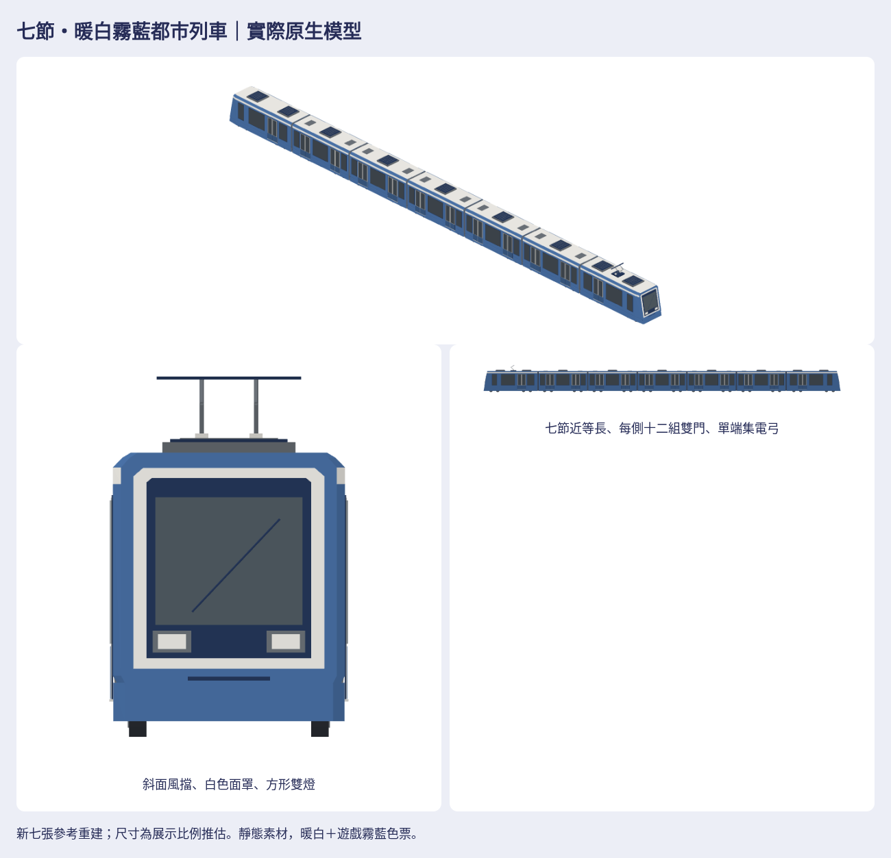

# 七節暖白霧藍低裙板都市電車

作者本輪七張圖片均已查看。新七節近等長結構、低裙板、單端集電弓，與先前長短交替的七節輕軌及四節傳統列車分開製作。配方`Map3DSevenCarBlue.swift`沒有呼叫舊列車的車體、底盤、車頭、門窗或編組；只共用原生幾何工具、色票和封裝。暖白／低飽和霧藍、淺暖灰門葉、細中縫與寬門玻璃，沒有紅色。

## 外觀結論

**可見結構與遊戲風格已逐項檢查；未確認的真實型號、工程尺寸及裙板內走行系統仍是資料不足，不標為真車完整考證。** 沒有捏造相似度分數或作者已認可本版。圖片是透視，不能與正交模型假稱完全同視角；以下比對依據是可辨識輪廓、排列與相對比例。模型正交圖自身採一致公尺尺度，端部局部及hero另行取景。

| 檢查 | 結果與對照位置 |
| --- | --- |
| 類別／整體長寬高 | 已符合可見的細長、低裙板都市電車；7近等長單元、兩端略長，不採舊長短交替。參考圖1／3–5對照`blue-audit.png`側面／上視；54.679×2.731×4.120m是實際模型bounds，全部展示推估 |
| 頭尾懸伸、輪徑、軸距 | 已修輪子露出過多、車頭下方空隙；參考圖2／6／7對照`blue-cab-before-after.png`。可見小輪下緣相符；隱藏兩架四軸／節與工程軸距資料不足，28軸只是展示補全 |
| 端部、風擋、肩線 | 已符合兩端外向斜風擋、稍收窄車頭、白色面罩／雙方燈／下方橫槽、白屋頂藍肩線；參考圖1／4／5對照端部正交與斜視。沒有舊車緩衝塊／長連結器 |
| 窗帶／門窗節奏 | 已符合端節每側1組雙門＋3窗、中節每側2組雙門＋3窗，全組每側12組雙門。兩側反向核對圖6／7；門窗玻璃頂齊，細框，門葉配色屬遊戲美術調整 |
| 大型設備 | 已符合九個大型屋頂箱（端各2、中各1）、中節雙扁平蓋、只在前端的一支集電弓。圖1／3–5對照上視；隱藏車底設備外形資料不足 |
| 頭尾／單元排列 | 已符合兩端同型反向、五中節無風擋／車燈／駕駛設備、單端集電弓；中節不殘留車頭。兩側門位同節奏，六風琴沿共同中線 |
| 浮空／穿模／缺面／反面／閃爍 | 已修裙板末端缺口與風琴下緣，分離相鄰風琴外肋；全7單元封閉有向邊、184個主要玻璃三角的實體車殼支持、56輪面遮擋射線、接節延伸、50mm輪頂淨空均通過。放大原生七向、白模／剪影親自查看；非真機光柵驗證 |
| 配色／材質／密度 | 已符合既有palette、霧面頂點色；`style-unit-comparison.png`同相機同尺度對照已接受四節／七節模型，並看四底色、灰階、模糊。無貼圖／商標／真實品牌 |

初版是實際本機原生配方匯出（未提交的prototype，記recipe/native SHA，沒有假造producer commit）。只修下裙、封閉下巴與風琴，全部門窗玻璃的閉合幾何逐三角保持相同；`revision-verification.json`與`history/initial/`可重現。修訂前後使用相同相機中心和尺度，非概念圖。

## 素材與交接

完整私有目錄：[素材包與驗證](https://github.com/a91453/railway-reference-private/tree/codex/seven-car-blue-2026-10-23/Railway/game-art-previews/docs/art/seven-car-blue-2026-10-23)。下載須有私庫權限。

- [完整ZIP](https://github.com/a91453/railway-reference-private/raw/refs/heads/codex/seven-car-blue-2026-10-23/Railway/game-art-previews/docs/art/seven-car-blue-2026-10-23/asset-package.zip)、[單檔viewer（下載後開啟）](https://github.com/a91453/railway-reference-private/blob/codex/seven-car-blue-2026-10-23/Railway/game-art-previews/docs/art/seven-car-blue-2026-10-23/viewer-standalone.html)。ZIP解壓後`index.html`可經本機HTTP開啟；可旋轉、縮放及下載native／GLB／PNG，folder版另有ZIP下載。
- [獨立單元總覽](https://github.com/a91453/railway-reference-private/blob/codex/seven-car-blue-2026-10-23/Railway/game-art-previews/docs/art/seven-car-blue-2026-10-23/previews/blue-units.png)、[七向圖](https://github.com/a91453/railway-reference-private/tree/codex/seven-car-blue-2026-10-23/Railway/game-art-previews/docs/art/seven-car-blue-2026-10-23/views)、[編組正交](https://github.com/a91453/railway-reference-private/blob/codex/seven-car-blue-2026-10-23/Railway/game-art-previews/docs/art/seven-car-blue-2026-10-23/previews/blue-audit.png)。每件上／下／左／右／前／後／立體透明PNG來自同一最終模型。
- [車頭與裙板修訂前後](https://github.com/a91453/railway-reference-private/blob/codex/seven-car-blue-2026-10-23/Railway/game-art-previews/docs/art/seven-car-blue-2026-10-23/previews/blue-cab-before-after.png)、[整組前後](https://github.com/a91453/railway-reference-private/blob/codex/seven-car-blue-2026-10-23/Railway/game-art-previews/docs/art/seven-car-blue-2026-10-23/previews/blue-before-after.png)、[同尺度風格](https://github.com/a91453/railway-reference-private/blob/codex/seven-car-blue-2026-10-23/Railway/game-art-previews/docs/art/seven-car-blue-2026-10-23/previews/style-unit-comparison.png)。
- [配方、特徵／尺寸依據、重建與組裝](../../../tools/seven-car-blue/README.md)、[HANDOFF §7.3](../../HANDOFF.md#73-3d-的後續)。兩庫draft PR與最新CI於[issue #1094](https://github.com/a91453/railway-game-ios/issues/1094)互鏈。

七單元＋編組＋兩比較＝10 native／10GLB／70七向PNG，其他實際模型預覽與原型前後共152PNG；完整ZIP、SHA256SUMS、source-record和package-verification於私庫。全編組13968三角（預算15000），前端1988、各中節2024、後端1860。組裝只平移x＝23.2、15.2、7.6、0、−7.6、−15.2、−23.2m，原生+x前／+y左／+z上，共同輪底z=0；不要再旋轉後端。GLB採[x,z,−y]轉換一次。

## 技術結論

VERIFIED：Linux官方Swift6.4 warnings-as-errors build與19相關測試；原生每頂點／顏色／法線讀回；Float32平移後獨立重算法線及精確組裝；封閉邊／玻璃承板與實體殼射線／輪組與底板淨空／下裙遮擋及接節末端連續；缺面、反面、移開完整封閉玻璃共6故障案例拒收；Blender4.3.2獨立匯入10GLB（三角／bounds／軸向／頂點色／霧面）；152PNG完整解碼、70七向透明與不裁邊；folder與斷網內嵌viewer全10件載入、七方向／拖曳／縮放／PNG、native、GLB真下載及390px版面。ZIP完成後另記實際下載／CRC／完整解壓／逐檔相同，實際producer commit與SHA由bundle強制核對，不能手填假SHA。

UNVERIFIED：真機Metal、效能、動畫、OS雙擊file://、工程尺寸與隱藏架式。這是靜態素材，未綁定營運車種；**合併不會自動替換路網列車**。沒有改GameCore、存檔、golden／replay fixtures或既有玩法，未合併PR／開auto-merge／啟動TestFlight。CI只以最新public head的實際Checks為準，本頁不把本機通過當CI通過。
