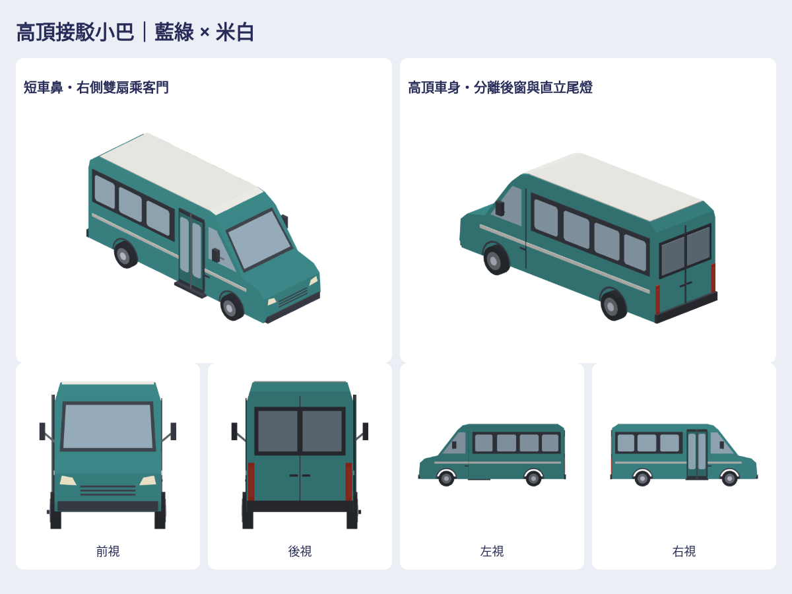

# 高頂接駁小巴

依作者提供的4張前／後／左右參考圖，保留高頂、短車鼻、長窗帶及右側雙扇乘客門；配色改現有藍綠／米白，重組車頭護罩、輪拱、窗框、後窗與直立尾燈，不放品牌標誌。

新增1款原生街景車型 `life-shuttleBus`，另附既有大型公車作風格對照，對照不算新增。2 native、2 GLB、14張上／下／左／右／前／後／立體透明圖，另有高解析立體前後底、互動viewer及ZIP。

入口 `Map3DShuttleBus.model()`／`Map3DStreetModel.shuttleBus`。約6.78m長、2.08m身寬、2.88m高，含後視鏡低於2.8m寬；非實測特定品牌車。輪拱為真正空隙，風擋背板沿實際斜面，頭尾燈有glow。街景原本5%公車池內30%選小巴，其餘維持大型公車，交通密度／公車上限／保守間距不增。這是街景視覺車型，非GameCore新增購買或營運系統。

主要造型依作者圖片重新程序化建置；私有Service Van factory只參考分件、風擋／輪拱／後視鏡的建模方法，不拷原mesh／貼圖／品牌／車頂設備。來源SHA與改造對照留私有庫。

[私有成品](https://github.com/a91453/railway-reference-private/tree/codex/shuttle-bus-assets-2026-10-21/Railway/game-art-previews/docs/art/shuttle-bus-2026-10-21) · [重建工具](../../../tools/shuttle-bus/README.md) · [Claude/Codex指引](../../../.claude/skills/shuttle-bus/SKILL.md) · [驗證](verification.json)。Metal與真機效能、車門／輪子動畫未驗證。
