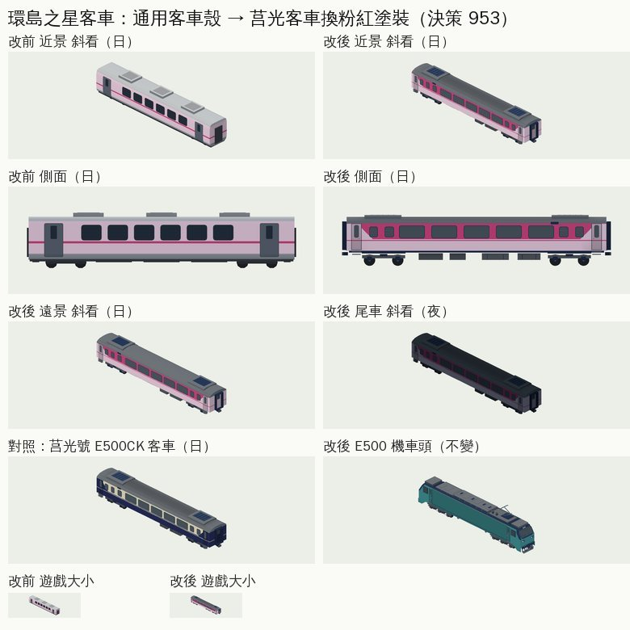

# 環島之星客車：莒光客車換粉紅塗裝（決策 953）

上兩列：改前（通用客車殼）與改後（莒光客車 `Map3DChuKuangPassenger`，`Paint.formosaStar`）。第三列：改後的遠景版、夜裡的尾車。第四列：莒光號 E500CK 的客車對照、E500 機車頭（不變）。最下：遊戲大小。

各輪的圖、候選 B（深粉車身）與重建指令在素材庫 -2 `game-art-previews/docs/art/star-coach-livery-2026-11/README.md`。
