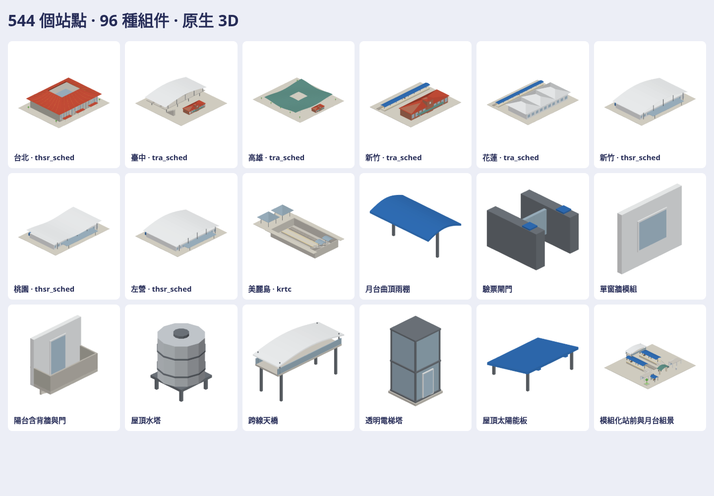

# 台灣車站與可組合小零件

本批交付 **544 個站點模型、96 種組件、1 個模組化組景範例**；共 **641 個原生模型／GLB、4,487 張 384 × 384 透明方向圖**。完整成品存放在作者的私有庫：

`a91453/railway-reference-private` → `Railway/game-art-previews/docs/art/station-kit-2026-10-21/`

[私有素材 PR #25](https://github.com/a91453/railway-reference-private/pull/25) 包含全部模型、GLB、圖片與離線檢視頁。公開遊戲庫保留原生生成碼、工具、測試、這份入口及一張總覽，依 CLAUDE.md 的大型預覽安排交付。



## 覆蓋範圍

「全部」是本專案 `track_stations.geojson` 中的每個 `(system, name)`，相同路網同名轉乘站合併線路資訊；同名的台鐵、高鐵、捷運保持獨立。這不是全台最新營運站數的宣告。

| 來源系統 | 站點 |
| --- | ---: |
| 台鐵 tra_sched | 242 |
| 高鐵 thsr_sched | 12 |
| 林鐵 afr_sched | 21 |
| 北捷 mrt | 119 |
| 桃捷 tymc | 22 |
| 淡海 ntdlrt | 14 |
| 安坑 ntalrt | 9 |
| 三鶯 sanying | 12（來源規劃路線） |
| 高捷／高雄輕軌 krtc | 75 |
| 中捷 tmrt | 18 |

**35 個代表站點**有明確對照的辨識外觀，例如台北紅色環形屋頂、台中新舊站房、高雄綠色天棚／開口／舊站、南港／板橋量體、新竹站、花蓮、台東、左營，以及高鐵桃園、新竹、台中與台南；另有集集、車埕、菁桐等木造站型及美麗島出入口。多系統共構站仍是獨立素材，並非 35 座不同實體建築。

其餘模型為 **catalog-archetype 一般遊戲站型**，依站等級、路網與固定變化建置，可替換或進一步細化。尺寸、室內、軌道配置與建物／軌面高度都是示意；不宣稱逐站測繪復刻、完整真實室內或營運工程圖。`planned`、`fidelity`、來源系統、站名、路線、經緯度與接點保存在 manifest；真實高度留 null。

## 可組合的零件

**64 車站零件**：直／弧／端部／島式月台、坡道、階梯、曲頂雨棚、V／Y 柱、屋架、跨線天橋、電扶梯、電梯、驗票閘門與寬閘門、售票設備、資訊牌、時鐘、導盲磚、全高／半高月台門、候車椅／亭、寄物櫃、飲水設備、垃圾桶、電話亭、無品牌販賣機、公廁、自行車架／棚、公車／計程車雨棚、樹池、門架／號誌／機電箱、通風排煙、地下出口、站門、採光罩、地坪、照明與充電柱。

**32 建築零件**：含背牆與窗框的單／雙窗牆、門牆、櫥窗、百葉、轉角牆、騎樓柱跨、樓板、陽台／轉角陽台、女兒牆、屋頂樓梯間、三種屋頂、排水、冷氣架／室外機、水塔／支架、太陽能板、風管／風機、逃生梯、室外階梯、雨棚、鐵捲門、無字招牌、裝卸平台與圍牆鐵門。

模組單位：一般地坪 4 m、樓層 3.2 m、直月台 8 m。接點採原生 x 前／y 左／z 上；`mount` 區分地面、壁掛與屋頂。壁掛配件要依安裝面貼牆；它不是可以擺在空中的地面模型。窗片包含真正背牆，陽台有門、樓板重疊、支架與安裝板。

`station-kit-example` 使用相同零件組合月台、雨棚、坡道、天橋、入口、閘門、騎樓、售票設備與候車區，沒有另用概念圖替代幾何。

## 原生取用

```swift
if let station = Map3DStationKit.stations.first(where: {
    $0.system == "tra_sched" && $0.name == "臺北"
}) {
    let model = Map3DStationKit.model(for: station)
    let pack = Map3DModelPack(stationKit: [station], parts: [.platformCanopy, .wallWindow])
    let index = pack.index(of: station.id)
}
```

只按需建置選中的模型。原生 API 不依賴 GLB 或 PNG，也不自動替換地圖站房、修改遊戲容量或載入全部素材。新檔均為獨立 `Map3DStationKit*.swift`，不修改另一條列車整合工作的 `Map3DSceneKit`。

後續 Claude 從 [station-kit 技能](../../../.claude/skills/station-kit/SKILL.md) 與 [工具 README](../../../tools/station-kit/README.md) 開始。工具可一鍵重建；GLB／原生模型／各方向圖及驗證紀錄都來自同一配方。

## 來源與重組

| 查閱／重用來源 | 本次使用 |
| --- | --- |
| 本專案 `track_stations.geojson`、`tra_station_class.json` | 544 站名／來源路網／路線／定位與站等級；不修改來源資料 |
| 私有 `Railway/taiwan-rail-reference-clean/source/rail-3d/assets/stations/README.md`、台北／高雄 metadata | 12 個核心站區的辨識特徵與「展示高度不當真實高度」做法；不搬 footprint 多邊形或原始模型 |
| 私有 `source/rail-3d/station-models.js` 的 `buildTaipeiMain`／`buildStation` | 取環形開口曲頂、分件、柱列及曲面支撐做法；以不同長寬、屋面曲線、柱距、樓層與原生調色盤重建 |
| 本專案 Map3DMesh／Map3DShapes／Map3DPalette；前批自製 SceneKit 幾何／匯出基礎 | 改成獨立站點 API、封底基本形、曲頂及支架；GLB、法線、顏色、glow 與各方向共用原生幾何 |

站點資料沿用本專案 TDX 衍生目錄與 OSM 對齊座標；© [OpenStreetMap contributors](https://www.openstreetmap.org/copyright)，[ODbL 1.0](https://opendatacommons.org/licenses/odbl/1-0/)。不將 OSM 建築輪廓作為本批量體。幾何由本專案自製與重組，霧面頂點色來自現有調色盤，不含外部貼圖、品牌招牌、logo 或人臉；未使用購買素材包的原模型或把私有原件上傳生成服務。

## 驗證與範圍

本機使用 Linux／Swift 6.4，執行 warnings-as-errors 建置、相關原生模型測試、原生逐頂點讀回、GLB 對等、全批圖片與瀏覽器互動檢查。完整結果與計數見私有包 `verification.json`；公開精簡紀錄見 `verification.json`。

**UNVERIFIED**：iPhone／iPad Metal 實機顯示與效能；實際地圖的選型、比例、地形放置與列車／月台對齊。這批交付素材及原生入口，這些整合需要另外驗證。
