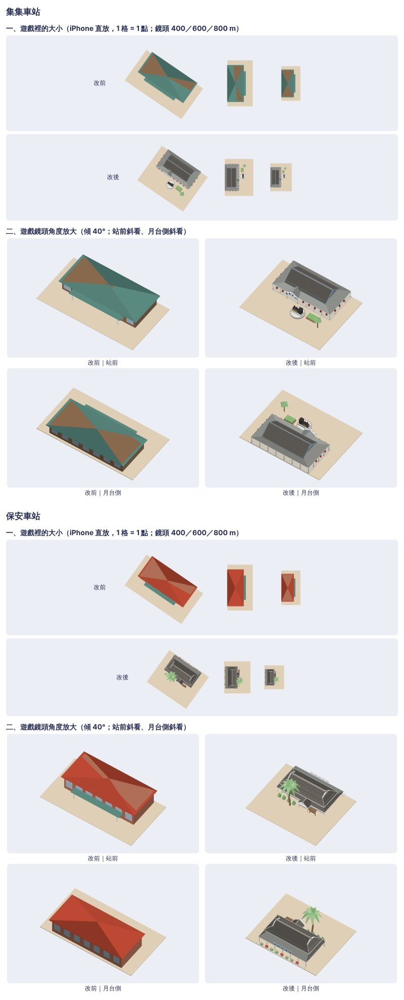

# 集集、保安車站進 3D 地圖（決策 705，2026-11-12）

規矩在 [model-look skill](../../../.claude/skills/model-look/SKILL.md)，決定在 [決策 705](../../decisions/705.md)。這裡只放一張沒有照片的總覽圖（「改前」是 `main` 上的通用站型）；含真實照片的各輪並排圖、照片、來源表與模型檔在私有素材庫 `a91453/railway-assets-private` 的 `game-art-previews/docs/art/station-look-2026-11-12/`。

圖是地圖實際畫的那一個模型（`house(_:)`：站房與站前，沒有車站套件的月台），用 `tools/model-look/export-station.sh <資料夾> house:station-tra_sched-29dab41a house:station-tra_sched-7711185c` 匯出、`shoot.mjs` 拍的。

## 憑什麼認出它（沿用考題那兩次寫下的）

- 集集：深灰瓦的長山牆屋頂；四周一圈又寬又低的灰色披簷與柱；站前偏一側的白色小山牆與四塊「集集車站」；米白牆、灰藍山牆；簷下一排紅燈籠、站前圓花台上的黑色蒸汽機車。
- 保安：低矮木造站房、深灰瓦入母屋頂；白牆與大片格子窗、兩層屋簷；站前偏一側的山牆玄關；月台側簷口上一排白底藍字的方形站名牌；站前高過屋頂的棕櫚。

## 每一輪

第 1–4 輪是決策 685 考題裡做的（紀錄在私有素材庫 `model-look-2026-11-11/evals/*-with/report.md`）。這次接著做：

| 輪 | 看圖找到的毛病 | 改了什麼 |
|---|---|---|
| 0 | （考題第 4 輪的配方套到 `main`，改用地圖實際畫的 `house` 拍）兩站 800 m 正上方只剩深灰方塊；站名牌是白方塊加深色方塊；屋面是一整片平的灰；集集的燈籠藏在屋簷下，從上面一顆都看不到；機車碑是幾個方塊 | — |
| 1 | — | 站名牌改成筆畫拼的字；兩站屋面加瓦壟線；集集燈籠移到簷口外緣、加兩端；名牌山牆封簷板加粗、加白色屋脊；機車鍋爐改圓 |
| 2 | 集集名牌山牆的白屋脊像一根白棍橫過披簷；並排圖有兩張照片的方向放反了 | 屋脊改成瓦脊的灰；照片方向改正；另外拍了擴建後（大站）的樣子 |
| 3 | 集集燈籠是紅方塊；近看：集集英文站名牌上的深色橫條像多一個「一」字；保安月台側的白牌和淺灰披簷糊在一起 | 燈籠改成圓的、上下有深色蓋；英文牌改成一條細灰線；保安月台側披簷改深一階 |
| 4 | 見下面 | — |

## 清單現況（第 4 輪；事實，不是評分）

| # | 項目 | 集集 | 保安 |
|---|---|---|---|
| 1 | 像盒子 | 山牆頂加一圈披簷加站前小山牆；正上方看仍是矩形套矩形 | 入母屋頂、兩層屋簷、突出的玄關、棕櫚 |
| 2 | 比例 | 沿用考題量的；深度與月台側是推估 | 沿用考題量的；長度最沒把握（13–17 m 取 17） |
| 3 | 窗戶 | 有框、凸出牆面，但都在披簷下，遊戲角度幾乎看不到 | 有框與窗櫺；遊戲大小看不到窗櫺 |
| 4 | 屋頂與牆 | 沒有變 | 沒有變 |
| 5 | 零件浮空 | 燈籠用吊件接在簷口封板下；名牌貼在山牆前，外側兩塊有一半超出山牆的封簷板 | 站名牌立在披簷邊緣上 |
| 6 | 顏色 | 深灰瓦、淺灰披簷、米白牆、紅燈籠、深藍字 | 深灰瓦、白牆、藍字、棕櫚的綠、盆花的紅；月台側仍偏灰 |
| 7 | 光太平 | 瓦壟線把屋面分段；兩坡的明度差仍小 | 淺色斜脊與瓦壟線 |
| 8 | 遠看認不出 | 400 m：看得到紅燈籠一圈、機車碑、站名山牆；800 m：見下 | 400 m：看得到棕櫚、斜脊、月台側的盆花；800 m：見下 |

## 還有哪裡不好

1. **800 m 正上方仍然認不出是哪一站。** 集集是「淺灰框裡一塊深灰，邊上幾個紅點，旁邊一個圓點」，保安是「深色小屋頂加一棵棕櫚」。和紅磚、綠頂的通用站分得開，但兩站彼此、和追分也只差在紅點與棕櫚。站名牌、山牆、玄關都是直立的面，從正上方本來就看不到；這一條沒有過。
2. **兩站都比原本的通用站型小很多**（集集連披簷約 24 m，保安約 19 m；通用站型的站房約 33 m）。這是真的大小，但在地圖上比隔壁的通用站不顯眼。
3. **字是直線筆畫拼的**，不是字體；近看像刻的，「站」「集」的筆畫擠。臺鐵標誌只是一個八邊的圈加十字。集集的英文站名牌只有一條灰線。
4. **保安的白牆在圖上是中灰**：繪圖器裡直立的面比朝上的面暗，已經用調色盤裡最白的顏色。Metal 裡是不是一樣沒看過。
5. **月台側**：集集沒有照片，是猜的（同樣的披簷、柱與窗）；保安月台側把披簷改深之後，整面更灰，顏色只剩藍字與盆花。
6. **擴建後不好看**：側翼比木造站房高、站前玻璃雨庇蓋住機車碑、棕櫚穿過雨庇（圖在私有素材庫 `rounds/expanded-hall.jpg`）。這是所有站共用的擴建畫法，這次沒有動。
7. **瓦壟線是凸出屋面的細條**，不是瓦；600 m 以外就看不到。
8. 集集的機車碑仍然很粗（駕駛室是方塊、沒有輪子的形狀）；站前的樹與花台是通用的，位置不是照片上的位置。保安的棕櫚從正上方看像風車；盆栽、盆花是方塊。
9. 1,600 m 以外的遠景方盒照整個站前的外框畫（所有站都一樣），兩站會變成一塊比站房大的灰方塊。
10. 尺寸全是照片推估；沒有俯視照。**沒有放進真實地圖的場景裡拍，Metal、模擬器、實機未驗證（UNVERIFIED）。**

及不及格請遊戲規劃或作者看總覽圖決定。
