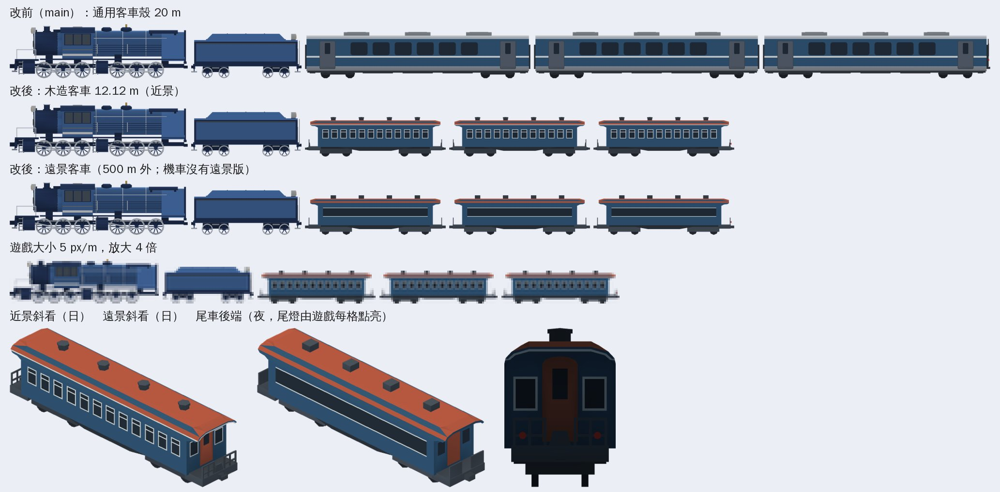

# 蒸汽列車的木造客車（決策 957）

`overview.jpg`：上兩列是改前（通用客車殼 20 m）與改後（工作室 `revision-3` 的木造客車 12.12 m，`Map3DSteamCoach`）排在 `Map3DDuplexSteam` 與煤水車後面，同一比例；第三列是 500 m 外的遠景客車（機車與煤水車還沒有遠景版，STEAM-FAR 另一張單）；第四列是遊戲大小 5 px/m 放大 4 倍；最下是近景、遠景的斜看與夜裡尾車的後端。用 `tools/train-models` 匯出（main 一份、分支一份）、`render.mjs` 拍圖（Linux 的 WebGL，不是 Metal）。

`compare-old.jpg`：工作室的「和作者舊版並排」（上：作者舊版帶貼圖、× 0.85；下：成品），取自素材庫 -2 `game-art-previews/docs/art/tra-steam-coach-2026-11/revision-3/compare-old.jpg`。

接回時比的四樣（派工單第 11 節）：

| 項 | 舊版 | 遊戲裡 |
| --- | --- | --- |
| 顏色 | 深藍木板、紅褐弧頂、金線 | 深藍 `blueTrain` 車身、紅褐 `cityRoofs[5]` 弧頂與端門、白線 `blueTrain` 窗框與簷下線（工作室定的色票，遊戲原本這列車就是藍車身白線） |
| 窗格的主方向 | 每側 12 扇直立小窗，上段一條橫檔 | 同：12 扇直立、上下兩格；遠景併成一條窗帶 |
| 每個面的特徵 | 側：12 窗、無門；端：中門＋左右窗；頂：4 個通風器；兩端露台與欄杆 | 同；字牌不畫 |
| 各段高度比 | 地板 0.97、牆頂 3.44、弧頂 3.66、通風器 4.00（舊版原尺寸） | × 0.85：0.82、2.92、3.11、3.40；機車最高 4.68（煙囪）、煤水車 3.86 |

各輪的圖、工具與重建指令在素材庫 -2 `game-art-previews/docs/art/tra-steam-coach-2026-11/`。
