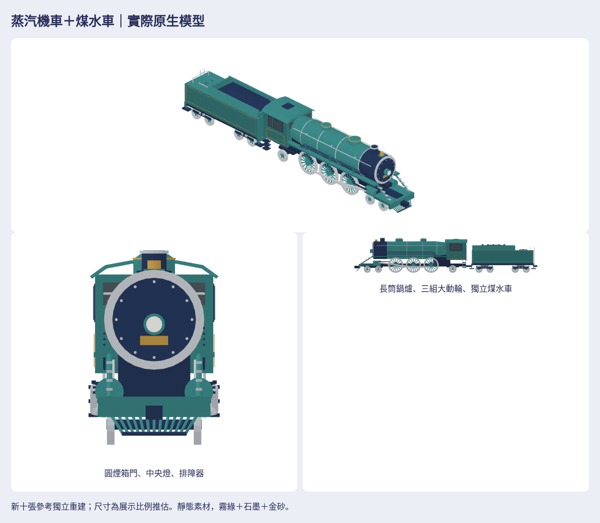

# 霧綠金砂蒸汽機車＋煤水車

依作者本輪10張新參考獨立製作的原生靜態素材。原圖10張全部實際開啟查看；公開庫不含原圖／私有mesh／貼圖。原生配方 `Map3DSteamTender.swift`，重建與測試入口：[tools/steam-tender](../../../tools/steam-tender/README.md)。Issue [#1103](https://github.com/a91453/railway-game-ios/issues/1103)。前置公開#1082/#1096、私有#56/#58均已merged；base為public main1aff6a5、private main87a94c7。

**本次只完成靜態素材註冊。合併不會自動替換遊戲內營運列車。** 沒有新增車型指派、連桿／輪組動畫、煤水車跟隨物理、GameCore行為；沒有改存檔、golden、replay或既有玩法。不把本件稱為CT273或已確認真車型。

完整成品在[私有素材目錄](https://github.com/a91453/railway-reference-private/tree/codex/steam-tender-2026-10-23/Railway/game-art-previews/docs/art/steam-tender-2026-10-23)：`models/`五件native／GLB、`views/`35張七向透明PNG、`previews/`總覽／單元／編組／白模／剪影／同尺度比較／真正前後對照、`viewer-standalone.html`、`index.html`、完整`asset-package.zip`、來源／SHA及技術紀錄。GitHub不執行HTML，下載單檔或ZIP後在本機開啟；HTTP資料夾啟動方式見重建README。

## 參考判讀與尺寸

| 特徵 | 本輪依據與製作 |
| --- | --- |
| 類別／單元／順序 | 長鍋爐蒸汽機車在前＋獨立煤水車在後；兩件，不沿用電車車體、車頭、底盤或編組 |
| 側面／正面／俯視 | 長筒鍋爐、短後置駕駛室、低煙囪與兩個頂罩；圓煙箱門、中央單燈與下方排障器；煤槽在煤水車前部，後水箱蓋和抓桿 |
| 頭尾／左右 | 機車前圓後方、煤水車尾端平直帶梯；左右管線3／4層分開；煤水車沒有駕駛窗或頭燈 |
| 相對大小 | 機車主體約14m、煤水車主體8m；大動輪直徑約為導輪兩倍以上；不把透視圖像素當工程尺寸 |
| 門窗／設備 | 駕駛室側窗＋前側小窗，薄框、玻璃貼壁；後部入口、踏梯；鍋爐帶、扶手、鐘、連桿、汽缸、煤堆、水箱蓋、尾梯 |
| 走行 | 兩側各3大動輪、前2小輪及後1支承輪的展示配置；煤水車兩架各2軸。隱藏軸式是補全假設，不宣稱真車軸式已確認 |
| 資料缺口 | 無唯一真實車型、工程圖、精確尺寸、隱藏管線／機構相位。內部駕駛室沒有足夠圖，採封閉有支承的外觀模型 |

已查專案原生單位／軸向、私庫台灣車庫`README.md`及`ct273.json`（明載Q-proportions、engineeringDimensionsM=null）、世界車型目錄README／catalog與OpenWorld train-model-specs。都不能唯一匹配本輪圖，沒有採用其mesh或Q版尺寸。**下表全部為比例推估的公尺展示規格，不是工程尺寸。**

| 項目 | 展示值 |
| --- | --- |
| 鍋爐軸高／主要半徑 | 2.94m／約1.02–1.17m |
| 駕駛室寬／最高煙囪 | 2.78m／4.565m（軌面起） |
| 機車主框／煤水車主殼長 | 13.70m／8.00m；連結器與排障器另外伸出 |
| 大動輪直徑／中心x | 2.00m／−2.30、0、2.30m（機車局部） |
| 前導輪／後支承輪直徑 | .90／1.00m；遮蔽結構補全 |
| 煤水車輪徑／架心／架內軸距 | .94m／±2.35m／1.44m |
| 踏板至動輪頂淨空 | 實測.055m；煤水車全寬底架至輪頂.060m |
| 車體間距 | .60m，連結器端面相接，不互穿 |

## 原生組裝與實際輸出

+x前、+y左、+z上，公尺，所有輪底z=0。只作平移，不再鏡射或旋轉：機車`steam-locomotive`在(+4.35,0,0)，煤水車`steam-tender`在(−7.25,0,0)。完整編組`steam-formation`。配方各件原點保留，不能以bounds中心重新置中後直接套此平移。

| 模型 | 實際bounds min → max（m） | 三角形 |
| --- | --- | --- |
| 機車 | (−7.10,−1.540,0) → (7.67,1.540,4.565) | 9,672 |
| 煤水車 | (−4.50,−1.391,0) → (4.50,1.391,3.750) | 4,000 |
| 完整編組 | (−11.75,−1.540,0) → (12.02,1.540,4.565) | 13,672 |

精確Float32值以manifest為準。另附`metro-four-leading`、`lrt-seven-leading`只作霧面、色票、細節密度與同公尺尺度比較；沒有複製它們的結構。色彩使用現有shopAwnings[0]／playerRim／containers[3]／tankSteel，霧綠、石墨與少量金砂，無紅色漆、品牌或照片貼圖。GLB roughness=1、metallic=0，頂點色、單面實體幾何。

## 外觀驗收（人工視檢，與技術測試分開）

先從實際native渲染三件的配色、白模、剪影，各看側、正、俯、斜，才批次。初版煤水車承接輪軸不足：補實體軸箱／彈簧支承，修連結器端面、增加少量有支承煤塊與機車後入口。輪圈改20面，小輪輻條8→6，大動輪16輻條保留。真正初版與中間支承版模型／配方存在history，未以新模型冒充前版。

| 狀態 | 項目與證據 |
| --- | --- |
| 已符合 | 兩單元順序與相對長短、長筒鍋爐／圓煙箱主輪廓、駕駛室曲頂、三組大動輪／連桿、前導小輪、左右管線差異、煤槽與水箱蓋、後梯、無紅配色與霧面細節密度。已看最終七向、正交左右／上／下、正面局部、白模／剪影與同尺度風格比較 |
| 已符合 | 玻璃薄而貼合，煤水車無駕駛窗／頭燈；輪底共同貼軌面、踏板不切大動輪。前後對照使用同相機中心／範圍與公尺尺度；非修訂車體／鍋爐／窗／管線等逐頂點保持 |
| 仍不符合 | 無已知尚待修正的主要可見輪廓偏差；本結論限靜態展示與這批可見參考，不代表作者已認可 |
| 資料不足 | 真實車型、工程尺寸、遮蔽軸式、內部駕駛設備及機構相位；不捏造相似度分數或車型確認 |

配色／白模／剪影來自同一模型。歷史圖明確置history；最終35張七向與其餘最終預覽全部重新匯出。局部放大另取景，不能當同尺度比較。

## 技術驗證與交接

**VERIFIED（Linux）**：Swift6.4 warnings-as-errors build、19個相關測試；Swift原生逐頂點／法線／顏色讀回；封閉有向邊與正體積；489零件的真實三角面支承接觸圖；玻璃到cab-wall射線、輪組淨空、完整組裝及既有模型共存。缺面、反面、封閉玻璃浮空、踏板切輪、封閉鐘浮空的故障植入均遭拒收。Blender獨立GLB匯入、軸向／bounds／三角數／頂點色／霧面材質；所有PNG完整解碼、35標準圖透明且不裁邊；viewer載入五件、七方向、拖曳旋轉、縮放、native／GLB／PNG／ZIP實際下載與SHA。ZIP完整解壓、CRC、成員集合及逐檔bytes，並確認所有配方／工具與實際producer commit一致。各原始驗證JSON與log在私庫。

**UNVERIFIED**：實體iPhone／iPad的Metal顯示、效能、記憶體、輪組／連桿動畫、動態淨空、物理與營運指派；OS雙擊file://。單檔viewer以斷網內嵌HTML操作驗證，不把它當OS雙擊。沒有執行TestFlight。

**CI獨立記錄**：以上為本機檢查，不能當最新CI綠燈。兩張draft PR的最新head、Checks與衝突狀態在PR與issue #1103更新；`source-record.json`記實際public producer，避免文件提交後假指舊head。私庫沒有對此目錄設定CI；無check runs不等於passed。

下一位從本目錄README、`tools/steam-tender/README.md`及私庫source-record／manifest接手。需要讓遊戲出現此車時另做車型／編組映射與動態呈現，先確認使用這套參考造型，不擅自綁到真實CT273或替換STEAM／SUMMER。不需改存檔或fixture來接入純顯示。
