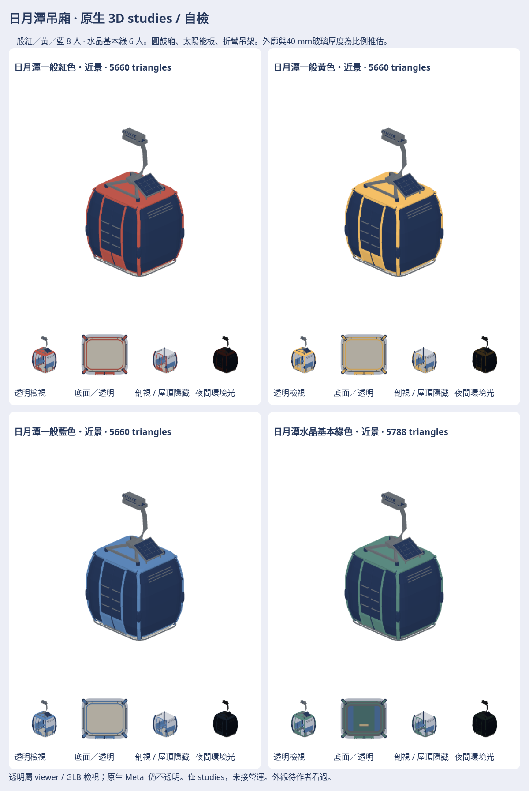

# 日月潭吊廂 · 原生3D studies / 自檢

一般三色共享同廂體，水晶廂另有玻璃／鋼框；各近景與LOD，共8模型。日月潭圓鼓廂身、窄彩框／深窗、屋頂太陽能板與蜘蛛支架、折彎吊架、雙門、兩排椅與中央地板獨立製作。

[配方、重建與驗證](../../../tools/sunmoon-cabin-studies/README.md)。原生／GLB／日夜七向／離線viewer／SOURCE及與貓空同尺度畫風對照在私庫 `game-art-previews/docs/art/sunmoon-cabin-2026-11/`。這是日月潭第一輪，不把貓空當前版。

官方門寬80cm、一般8人／水晶6人；外廓尺寸、吊架與40mm玻璃均為比例推估。基本綠色省略後續櫻花彩繪與商標。抱索器／型材仍簡化，玻璃原生仍不透明；透明診斷／GLB是檢視效果。只有studies，未接營運，外觀待作者看過。
