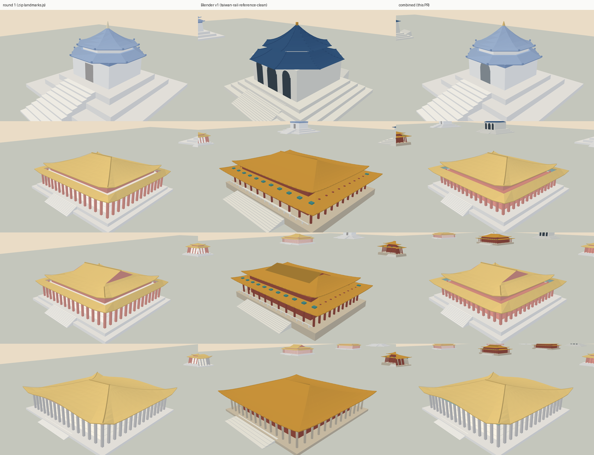

# 台北市中心的地標：和 Blender 模型比對

決策 457。中正紀念堂、國家戲劇院、國家音樂廳、國父紀念館（上到下），三版並排（左到右）：

1. 第一輪：照清理包 `landmarks.js` 的屋頂與分件，用 OSM 的規格重做；
2. 參考庫 `Railway/taiwan-rail-reference-clean/source/rail-3d/assets/blender-buildings-v1/` 的近看網格（只比對，遊戲不讀）；
3. 合起來：每個部件取比較準的一邊（決策 457「和 Blender 模型比對」的表）。

這張是右前方；七個方向的七張（每張四棟 × 三版）在 `a91453/railway-assets-private` 的 `game-art-previews/docs/art/taipei-landmarks-457/revision-2/`。

用 `tools/map3d-preview/` 的 WebGL 頁照 `Map3DShaders.metal` 的算式畫，14:00 的光線；不是 Metal、不是實機畫面。重建：`tools/map3d-preview/README.md`「地標的比對圖」。
