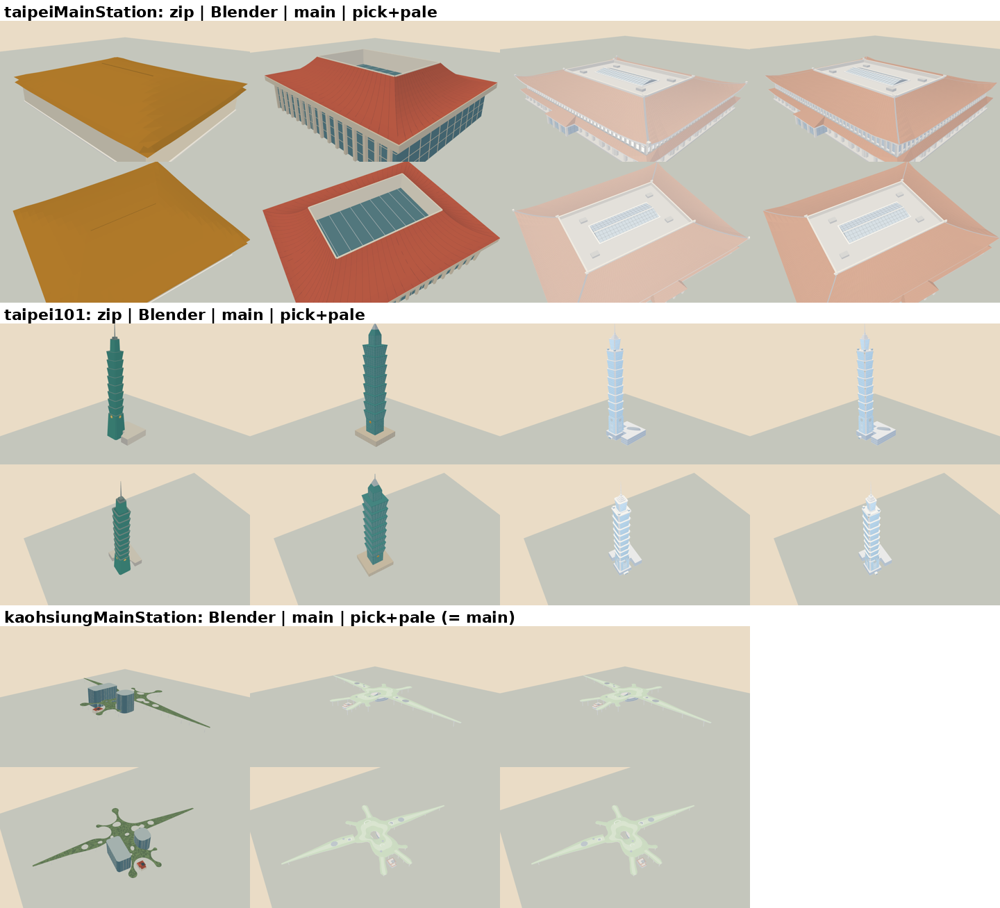

# 台北市中心的地標：和 Blender 模型比對

決策 457。中正紀念堂、國家戲劇院、國家音樂廳、國父紀念館（上到下），四版並排（左到右）：

1. 第一輪：照清理包 `landmarks.js` 的屋頂與分件，用 OSM 的規格重做；
2. 參考庫 `Railway/taiwan-rail-reference-clean/source/rail-3d/assets/blender-buildings-v1/` 的近看網格（只比對，遊戲不讀）；
3. 第二輪：整棟取比較準的一邊再改幾處（決策 457「和 Blender 模型比對」的表）；
4. 第三輪：每棟每個部件各挑最好的一版，再一起調淡、保持深淺順序（決策 457「逐件挑選」的表）。

這張是右前方；七個方向的七張（每張四棟 × 四版）在 `a91453/railway-assets-private` 的 `game-art-previews/docs/art/taipei-landmarks-457/revision-3/`（第二輪的三欄圖在 `revision-2/`）。

用 `tools/map3d-preview/` 的 WebGL 頁照 `Map3DShaders.metal` 的算式畫，14:00 的光線；不是 Metal、不是實機畫面。重建：`tools/map3d-preview/README.md`「地標的比對圖」。

## 後來：台北車站、101、高雄車站

決策 457「後來」。上到下台北車站、101、高雄車站；每棟上排右前方、下排高處。台北車站與 101 四欄：zip（`landmarks.js`）、Blender v1、現有（決策 370）、逐件挑選後調淡；高雄車站三欄：Blender v1、現有（決策 431）、本輪（＝現有，不動）。

每棟七個方向的大圖在 `a91453/railway-assets-private` 的 `game-art-previews/docs/art/taipei-landmarks-457/later-stations-101/`。每個版本各自一次匯出、單獨畫，不會有旁邊的模型闖進畫面。
