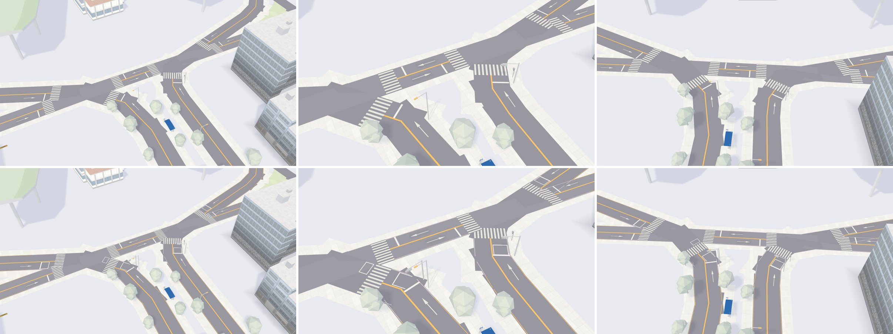

# 3D 路口照台灣法規：斑馬線、機車停等區、待轉區、紅黃線（決策 447）

都是 `tools/map3d-preview/` 的 WebGL 預覽（不是 Metal、不是 iPhone 的畫面），高雄車站北邊，和決策 355 同一個路口（`MAP3D_WORLD=kaohsiung MAP3D_BASEMAP=1 MAP3D_CITY=1 MAP3D_CROP=5:190:350`），14:00、含陰影。

| 欄 | 鏡頭（`MAP3D_VIEWS`） | 上：之前（`main` 353300d） | 下：之後 |
| --- | --- | --- | --- |
| 左 | `junction:5:188:110:30` | 斑馬線白條 0.45 m、離人行道 0.6 m | 白條 0.4 m、間距 0.4 m，離路緣 3 m；停等區、待轉區；紅黃線 |
| 中 | `close:5:188:55:30` | 同上，近一點 | 同上 |
| 右 | `top:5:188:90:0` | 從上面看 | 同上 |

沒有選的做法 B（斑馬線退 5 m、停等區深 5 m、紅黃線 15 cm），鏡頭同中欄：

每個鏡頭含／不含陰影的原尺寸圖在 `a91453/railway-reference-private` 的 `Railway/game-art-previews/docs/art/taiwan-road-markings-447/`。

高雄的建物與道路來自 © OpenStreetMap 貢獻者（ODbL）。
