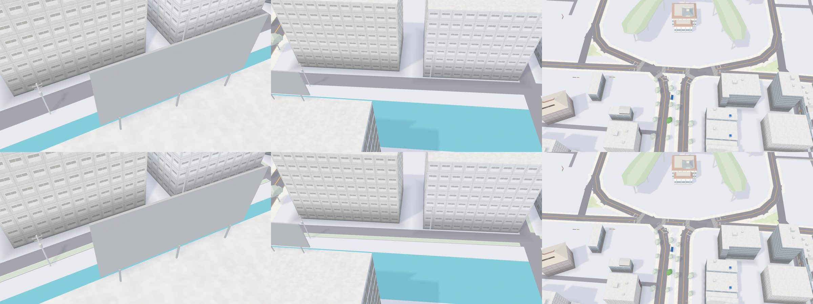
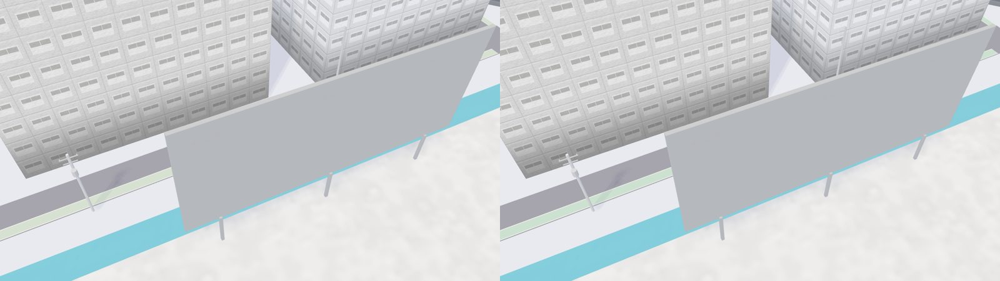

# 巷子的標線型人行道、騎樓 3.64 m（決策 447 續）

都是 `tools/map3d-preview/` 的 WebGL 預覽（不是 Metal、不是 iPhone 的畫面），高雄車站北邊（`MAP3D_WORLD=kaohsiung MAP3D_BASEMAP=1 MAP3D_CITY=1 MAP3D_CROP=5:190:350`），14:00、含陰影。

| 欄 | 鏡頭（`MAP3D_VIEWS`） | 上：之前（決策 447 第一個 PR，2d2a63d） | 下：之後 |
| --- | --- | --- | --- |
| 左 | `lane:51:294:45:30` | 巷子只有路面 | 巷子一側一條綠色帶、兩側白線 |
| 中 | `lanetop:60:290:80:0` | 同上，遠一點 | 同上；接到別條路的地方斷開 |
| 右 | `wide:5:188:220:0` | 站前路口 | 一樣：綠色帶只畫在近景，遠看不畫 |

沒有選的做法 B（更深的綠 #1E8A44，接近 hebe 的色碼），鏡頭同左欄；左是選的（樹的綠 #4E9E3E），右是 B：

霧面的畫法把兩種綠都畫淡，看起來差不多，所以用現有色票的綠。

高雄的建物與道路來自 © OpenStreetMap 貢獻者（ODbL）。
