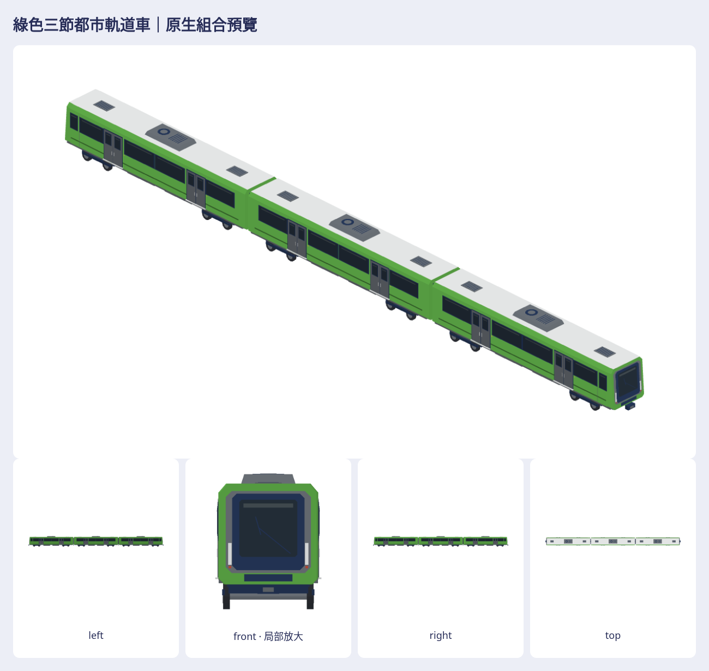

# 三節都市軌道車（本輪新參考）

原生配方：[Map3DThreeCarUrban.swift](../../../Sources/GamePresentation/Map3DThreeCarUrban.swift)；[重建／組裝／viewer 使用](../../../tools/three-car-urban/README.md)；認領 [#987](https://github.com/a91453/railway-game-ios/issues/987)，工作登記 #231。從 main `0d88dfba` 開 `codex/three-car-urban-2026-10-22`；已查 #954、#961 合入 main，沒有依賴尚未合併的造型分支。

完整素材在私有庫：[本批根目錄](https://github.com/a91453/railway-reference-private/tree/codex/three-car-urban-2026-10-22/Railway/game-art-previews/docs/art/three-car-urban-2026-10-22)。以下私有連結需登入 GitHub：

- [ZIP 下載](https://github.com/a91453/railway-reference-private/raw/refs/heads/codex/three-car-urban-2026-10-22/Railway/game-art-previews/docs/art/three-car-urban-2026-10-22/asset-package.zip)
- [單檔離線 viewer](https://github.com/a91453/railway-reference-private/raw/refs/heads/codex/three-car-urban-2026-10-22/Railway/game-art-previews/docs/art/three-car-urban-2026-10-22/viewer-standalone.html)；[資料夾版 viewer 檔案](https://github.com/a91453/railway-reference-private/blob/codex/three-car-urban-2026-10-22/Railway/game-art-previews/docs/art/three-car-urban-2026-10-22/index.html)（下載 ZIP 後用本機 HTTP server 開啟，GitHub 原始碼頁不執行 WebGL）
- [七向總覽](https://github.com/a91453/railway-reference-private/blob/codex/three-car-urban-2026-10-22/Railway/game-art-previews/docs/art/three-car-urban-2026-10-22/previews/directions.png)、[各單元](https://github.com/a91453/railway-reference-private/blob/codex/three-car-urban-2026-10-22/Railway/game-art-previews/docs/art/three-car-urban-2026-10-22/previews/units.png)、[正交外觀／底視](https://github.com/a91453/railway-reference-private/blob/codex/three-car-urban-2026-10-22/Railway/game-art-previews/docs/art/three-car-urban-2026-10-22/previews/audit.png)
- [同相機修訂前後](https://github.com/a91453/railway-reference-private/blob/codex/three-car-urban-2026-10-22/Railway/game-art-previews/docs/art/three-car-urban-2026-10-22/previews/before-after.png)、[同公尺風格對照](https://github.com/a91453/railway-reference-private/blob/codex/three-car-urban-2026-10-22/Railway/game-art-previews/docs/art/three-car-urban-2026-10-22/previews/style-comparison.png)

## 參考判讀與特徵表

五張附圖均實際查看：圖 1 沿車頂朝向駕駛端；圖 2、3 為相反端的全編組斜視；圖 4、5 為相反側的局部近側視。原圖是透視圖，無本地原圖檔，未做像素疊圖，也未以透視像素稱為工程尺寸。圖中無可確定的製造型號；不假定它是先前通勤車或電車的變體。

| 特徵 | 判讀／本模型 | 依據與限制 |
| --- | --- | --- |
| 類別、編組、走行 | 三節高地板都市軌道車；頭車—中間車—尾車，每節兩組雙軸轉向架，共 12 軸、24 輪 | 圖 2–5；兩外端駕駛面，內端是短黑連接處。沒有可辨識的集電弓，未自加 |
| 主輪廓 | 平直側牆，平頂白屋頂，小斜角肩線；外端僅最後約 0.55 m 收束並微後傾；內端直立 | 圖 1–3；非長鼻、非圓肩通勤車，非低地板多鉸接電車 |
| 端部與左右側 | 兩外端同屬雙向列車的單片高風擋；各自建構朝 ±x，內端為連接面；中間車沒有駕駛窗、頭燈、雨刷或外端連接器 | 圖 2、3 的相反端可見相同家族造型；兩側雙門節奏相同，駕駛窄側窗位置隨外端改變 |
| 展示尺度 | 名義車體 15 × 2.65 m；屋頂高 3.34 m，空調頂 3.606 m；每單元最長外廓 15.445 m；全組 46.170 × 2.818 × 3.606 m | **比例推估**；外廓含門踏板和連接器。專案公尺座標與同類車尺度作合理性檢查，沒有查到可唯一對應的工程規格 |
| 相對尺寸 | 車體長／寬約 5.66；側窗下緣 1.82 m、玻璃 1.88–2.80 m；肩線自 3.10 至 3.34 m；駕駛端風擋 1.39–2.91 m | 以圖 1、4、5 的比例判讀，非製造尺寸 |
| 軸距／懸伸 | 轉向架中心 x=±4.98 m、中心距 9.96 m；每架軸距 1.68 m，輪徑 0.68 m；車殼端至最外軸約 1.68 m | 圖 4、5 的四個側輪位；均為比例推估，頭尾外端另有短連接器 |
| 門窗 | 每節每側兩組雙扇乘客門；主窗節奏為窗—門—雙窗—門—窗；外端另有窄駕駛側窗／細門縫 | 圖 4、5；窗框薄，兩扇門有獨立玻璃和把手，不增加第三組門 |
| 車頂／車底 | 每節中央一個斜邊空調箱（風扇＋格柵），前後各一片低矮通風蓋；閉合底板、兩轉向架、兩個中央設備櫃 | 圖 1–3 可確認車頂數量；底面不可見，設備櫃與貫通車軸為專案簡化構造，設備用途／型號資料不足 |

## 外觀驗收（與技術測試分開）

所有成品視圖來自同一份最終 native 頂點。白模／剪影、左右／前後／俯視／底視、單元與編組均已親自查看。七向 PNG 對每個模型使用固定 m/pixel，三個獨立單元共用同一尺度；全組另取適合全長的尺度。`audit.png` 四列正交圖共用 **0.030 m/pixel**。`detail-front`、overview 前端局部與 hero 為另標示的放大取景。參考為透視，成品斜視是正交立體，相機無法完全一致；不捏造相似度分數。

| 狀態 | 項目／具體核對 |
| --- | --- |
| 已符合 | 整體三節、等寬等高與短單元比例：圖 2、3 對 `overview`、`units`；未沿用前批 19.3 m／三門車體，也沒有低地板車的鉸接輪位 |
| 已符合 | 過胖／過窄／過高／過短：`audit` 左右與俯視、`detail-front` 逐項核對。名義長寬比約 5.66，端面接近直立，肩線只有小斜角，沒有長鼻或誇大曲面 |
| 已符合 | 前後懸、12 軸、輪徑與轉向架位置：`audit` 側視、底視及各單元七向；輪底 z=0，每架兩軸，不用單輪代替轉向架 |
| 已符合 | 圖 1 的單片高風擋、略後傾端面、兩側直式燈、中央下連接器；圖 2、3 的兩個外端各自朝外；中間車無多餘駕駛設備 |
| 已符合 | 圖 4、5 的兩組門、兩扇門葉、雙中央窗、窄駕駛側窗；圖 1–3 的每節一空調／兩通風蓋與窄節間，見 `audit` 及 `units` |
| 已符合 | 暖白、專案綠、深色霧面玻璃、低對比窗上緣；與已接受通勤車同公尺、同相機比較，材質與細節密度相容，未複製其車體／底盤／門窗／車頭／編組 |
| 已符合 | 初版車頭單面片已改有厚度封閉板件，玻璃有支持面；最終七向及底視未見浮空、缺面、反面、可見穿模或閃爍；幾何紅綠證據另列於技術記錄 |
| 仍不符合 | 沒有已知未修正的主要結構偏差。參考較亮綠與偏藍玻璃，成品依遊戲既有色票壓低亮度；風扇保留環形符號，未做細扇葉，屬美術簡化 |
| 資料不足 | 實際型號、工程尺寸、不可見內端／車底設備細部及電氣用途。底盤簡化不能宣稱是實車工程復刻；透視角度差異與無原圖檔也限制對照精度 |

`before-after.png` 是本次初版與最終版的實際 native、同一相機和同公尺範圍：只封閉端面板件與增加窗上緣色塊；主要輪廓、門窗、輪位、色票均穩定。初版編組 native 私有保存在本批相鄰的 `three-car-urban-2026-10-22-initial/models/`，不混入最終素材 ZIP。這是本 session 的外觀判讀，沒有宣稱作者已接受。

## 技術驗證與使用界線

新增頭／中／尾三單元各 **2,596／2,356／2,596** 三角形；完整靜態編組 **7,548** 三角形。完整包另含兩件既有車作比較，共 6 件 native／6 GLB／42 張七向透明 PNG；單元及編組只是同一組幾何的不同使用形式，沒有把重複編組當作額外新車型。

**VERIFIED（Linux）**：Swift 6.4.0 `swift build --build-tests -Xswiftc -warnings-as-errors`、24 個相關 XCTest（新模型、既有模型共存、前兩批車、native 讀回）；每個組裝頂點／顏色逐一比對；3 個單元封閉有向邊、116 個可見玻璃三角面的支持射線（最遠約 11 mm）；實際刪除一面／反轉一面的故障注入均被拒；GLB 逐位元重建與 Blender 4.3.2 獨立匯入、尺寸／面數／頂點色；42 七向 PNG 的透明、非空、不裁邊、SHA，以及全部 PNG 完整解碼；viewer 六模型載入、七向切換、拖曳旋轉、縮放、native／GLB／PNG 下載與 390 px 版面。單檔 viewer 另以瀏覽器斷網、內嵌 HTML 模式驗證同樣操作與下載。ZIP 的實際 producer commit、SHA、完整解壓及逐檔位元組比對在私有 `source-record.json`、`SHA256SUMS.txt`、`package-verification.json`。

**UNVERIFIED**：iPhone／iPad Metal 外觀與效能、真機載入、任何動畫或物理；本批是靜態素材函式庫，尚未綁定營運車種。macOS App 編譯與 Simulator 以本次公開 PR 最新提交的 CI 為準，不把 Linux WebGL 當成 Metal 證明。受管 Chromium 封鎖 `file://` 導航，所以作業系統雙擊開檔未直接驗證；內嵌離線模式與資料夾 HTTP 模式已驗證。未啟動 TestFlight。

來源：本輪五張作者附圖的人工判讀、專案 `Map3DPalette`／`Map3DTrainStyle.glass`、既有封閉幾何及匯出工具。私有 `taiwan-rail-reference-clean/source/rail-3d/README.md` 只查模型／編組機制，無法唯一匹配真車尺寸；沒有搬私有來源 mesh、貼圖或原圖，也沒有外部生成服務、品牌字或商標。只使用既有專案工具，未增加依賴。公開庫僅此一張總覽與原生配方、工具、必要測試和文件；完整素材皆私有。
