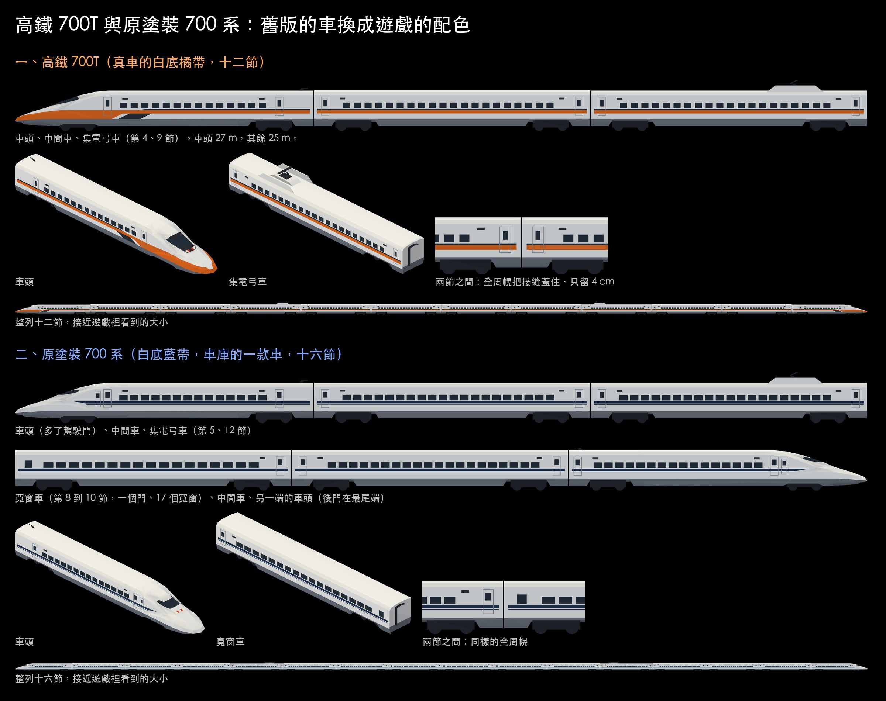

# 高鐵 700T 與原塗裝 700 系：作者舊版的車（決策 988、989）



總覽（遊戲的匯出與模型光，`tools/train-models/run.sh` 與繪圖器；版面是另外排的）：

1. 700T：車頭、中間車、集電弓車相接的側面；車頭與集電弓車的斜看；兩節之間的接縫；整列十二節縮到遊戲裡的大小。
2. 原塗裝 700 系：車頭、中間車、集電弓車；寬窗車、中間車、另一端的車頭；斜看與接縫；整列十六節。

和舊版並排的那一份有舊版的貼圖，只給擁有者看，不進這個公開庫。

- 來源：作者舊版的模型（作者自己的內容）：頭車 `7a188937`、中間車 `e33da7fa`，700 系另加另一端的頭車 `ede98f53` 與寬窗車 `48634371`。原始 GLB 與貼圖不進這個公開庫。
- 轉換：`tools/texture-palette/thsr_700t.py` 直接在車身上畫色塊（700T 的位置在實車照片上量，700 系的位置照舊版貼圖量），再由 `tools/train-models/glb_to_swift.py` 寫成 `Map3DTHSR700TMesh.swift` 與 `Map3DSeries700Mesh.swift`。材質順序寫在 `Map3DTHSR700T.swift`、`Map3DSeries700.swift`。
- 用在：700T 是高鐵路線的車（set `highSpeed`，十二節）；700 系是車庫「高鐵」類的一款車（set `series700`，十六節）。
- 決策：`docs/decisions/988.md`、`docs/decisions/989.md`。

## 重做

```sh
M=<舊版的 models 資料夾>
uv run --with pillow --with numpy python tools/texture-palette/thsr_700t.py \
    --cab $M/item_7a188937dcb3847ad0de70ed.glb --middle $M/item_e33da7fa8c20227eb64993e4.glb --out-dir OUT
python3 -I tools/train-models/glb_to_swift.py --enum Map3DTHSR700T \
    --materials white,orange,black,skirt,glass,dark,headlamp,taillamp,frame \
    --out Sources/GamePresentation/Map3DTHSR700TMesh.swift \
    OUT/thsr-700t-cab.glb OUT/thsr-700t-middle.glb OUT/thsr-700t-pantograph.glb

uv run --with pillow --with numpy python tools/texture-palette/thsr_700t.py --train series700 \
    --cab $M/item_7a188937dcb3847ad0de70ed.glb --tail $M/item_ede98f5384005fd9e80bf737.glb \
    --middle $M/item_e33da7fa8c20227eb64993e4.glb --green $M/item_486343712291bd42d5c60abe.glb --out-dir OUT2
python3 -I tools/train-models/glb_to_swift.py --enum Map3DSeries700 \
    --materials white,band,line,skirt,glass,dark,headlamp,taillamp,frame \
    --out Sources/GamePresentation/Map3DSeries700Mesh.swift \
    OUT2/series-700-cab.glb OUT2/series-700-tail.glb OUT2/series-700-middle.glb OUT2/series-700-green.glb OUT2/series-700-pantograph.glb
```

工具驗四個原檔的 SHA-256；`report.json` 列出每節的面數、每扇門的範圍、窗數與重複段的截面差（`section`，要小於 0.02 m）。

## 接回時比的四樣

1. 顏色：兩款各九格，都是遊戲既有的色票。700T 的白與橘是原來 700T 的兩格（青綠塗裝照樣換得到）；700 系的藍是 `shinkansenBlue`。
2. 窗格的主方向：一排小方窗。700T 頭車 14 扇、中間車與集電弓車 20 扇；700 系頭車 14 扇、另一端 16 扇、寬窗車 17 扇寬窗加車端一扇小窗。
3. 每個面的特徵：長車鼻、前窗、兩肩各一白一紅的燈；700T 的前窗與燈在一片黑色面罩裡（從燈到前窗上緣），橘帶繞過鼻尖、前門後一塊斜的黑色；700 系的前窗與燈分開、藍帶在乘務員門前斜著起頭；集電弓車後半的集電弓、絕緣子蓋與導風板；車端一圈全周幌。
4. 各段高度比：輪子到軌面、灰裙板、白車身、窗下的帶與線（700T 黑線疊橘帶；700 系寬藍帶 1.78 到 1.99 m、細藍線 1.67 到 1.72 m）、窗、車頂 3.65 m。

## 還有哪裡不好

見兩份決策的「還有哪裡不好」。這張圖夜晚沒有拍：繪圖工具不會亮燈，遊戲裡車頭亮白燈、車尾亮紅燈，窗會亮。
