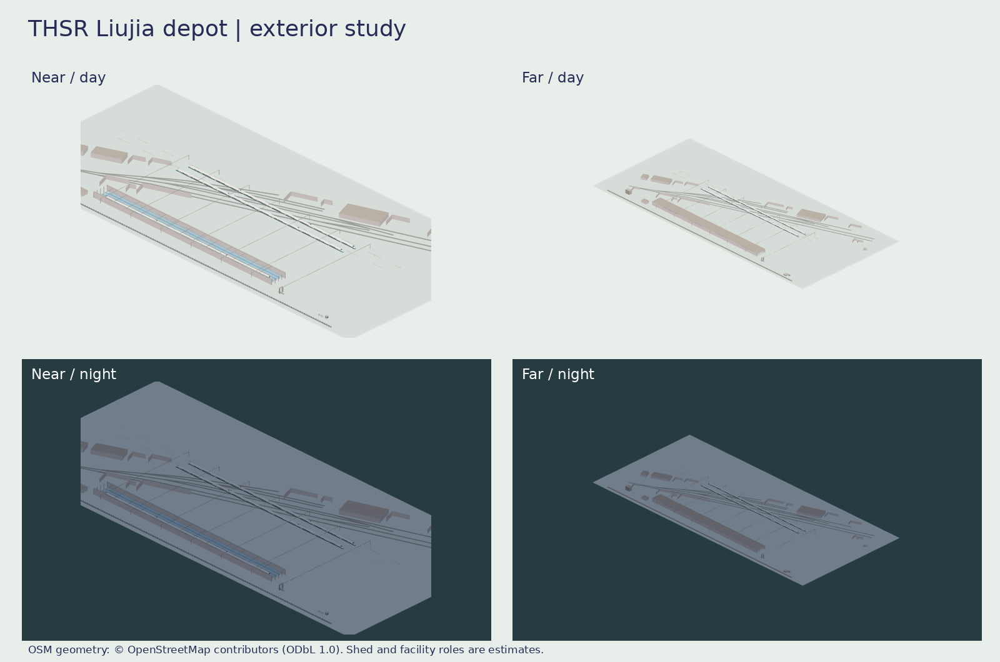

# 高鐵北部機廠（六家基地）研究組景



本批是獨立 exterior study；`tools/thsr-liujia-depot-studies/` 是可重建配方與測試。沒有註冊到 `Map3DModelPack` 或接入地圖。完整四份 M3DM／GLB、日夜各七方向 PNG、離線 `viewer.html` 與來源逐項紀錄放在私庫 `game-art-previews/docs/art/thsr-liujia-depot/`，見互鏈 draft PR。

## 來源及量測

優先順序：參考庫查有無可沿用的車型與線形 → OSM 指定基地幾何 → 官方／照片只核對外觀。OSM 是 [© OpenStreetMap contributors，ODbL 1.0](https://www.openstreetmap.org/copyright)，資料來自 `osmtoday.com/asia/taiwan.pbf` 全台 extract；縮取的 31 個 way 在 `osm_geometry.json`。OSM way 321663143 的 `landuse=railway`／「高鐵六家基地」為基地外框；以 24.798603°N、121.042793°E 為原點、約 131.5° 軸向投影，外接框約 **615 × 293 m**、多邊形約 **75,834 m²**。這是 OSM 多邊形計算值，非地籍或工程面積。

`tools/hsr-depots/hsr_depots.json` 從同一 OSM extract 歸納 **8 股、每股約 420 m**；本次保存 way 500406362–370 等股道幾何，按頂點畫車場線。OSM 把部分實體股道切成數個 way，不能拿 way 數直接當股數。`building=depot` 共 16 個足跡；例如 way 500406371 的投影外接框約 71 × 43 m，way 500406379 約 64 × 46 m。這些 way 不標明檢修、洗車、辦公等逐棟功能，模型中的用途由研究配方推估。

參考庫 `Railway/taiwan-rail-reference-clean/source/rail-3d/README.md` 及 `source/rail-3d/assets/garage-blender-v1/700t.*` 確認 700T 車型來源；實際停放使用遊戲既有 `Map3DTrainShapeRefresh` 的 revision-10 四種原生 700T 車廂，十二車編組按 `refresh-700t-formation.m3dscene.json` 的車心。`Railway/tdx-snapshot-2026-10/data/THSR_Shape.json.gz` 的 THSR 主線最近取樣距基地原點約 497 m；它是主線線形，不拿來充作庫內軌道。官方資料與照片未提供可量的逐棟尺寸，本輪未複製照片或其網格。

| 元件／量值 | 配方 | 依據 |
| --- | ---: | --- |
| 軌距 | 1.435 m | 高鐵標準軌；本配方 `GAUGE`，兩軌中心 ±0.7175 m |
| 基地外框 | 615 × 293 m | OSM way 321663143，投影外接框 |
| 駐車場 | 8 股、約 420 m／股 | OSM，`hsr_depots.json` 的整理值 |
| 檢修庫 | 4 股，長 324 m、寬 24.6 m、股距 5.8 m | **推估組景**；可容遊戲 700T 的約 304.4 m 可見長度，不是 OSM 庫房足跡 |
| 高檢修走道 | 頂 1.58 m、欄杆至 2.20 m | **推估**，供外觀審查，非作業安全尺寸 |
| 庫頂／架空線 | 庫頂約 8.5 m、接觸線示意 5.65 m | **推估**；700T 原生集電設備最高約 4.6 m |
| 洗車門架 | 跨 6.45 m、高約 8.2 m | 沿用上一輪洗車門架外觀比例，股道改為標準軌；位置與設備功能**推估** |
| 辦公／門房／門柵／圍欄 | 沿用 `Map3DDepotYardKit` 原件 | 直接由已合配方匯出，沒有改既有模型或雜湊；在場內的位置**推估** |
| 變電設施 | 14 × 10 × 5 m 建築量體 | **推估**；OSM 本場內無可確定對應的變電設施標籤，不把場外隘口變電所搬入 |

三列停放的 700T：一列在檢修庫、一列在中段駐車線、一列在外側駐車線。近景敞開檢修庫屋頂局部以看見車輛與走道，遠景蓋完整屋面；兩者皆是外觀研究。700T 編組的原生模型雜湊在私庫 `SOURCE.md`、各組景 M3DM provenance 與 manifest。單一完整組景約 23 萬三角，超出 App 單件模型上限，供離線審查。

## 重建及驗證

使用 Swift 6.4、Python 3（Pillow）、Node、Playwright 與 Chromium；輸出目錄必須在公開 repo 以外。

```sh
PATH=/workspace/swift-6.4/usr/bin:$PATH NODE_PATH=/opt/codex/cua_node/lib/node_modules \
  tools/thsr-liujia-depot-studies/rebuild.sh \
  ../railway-assets-private/game-art-previews/docs/art/thsr-liujia-depot ../railway-assets-private
python3 -m unittest tools/thsr-liujia-depot-studies/test_study.py
```

**VERIFIED（Linux）**：Swift 6.4 `GamePresentation` warnings-as-errors build；OSM 外框與股道來源、標準軌／車長與既有 700T SHA 測試；M3DM／GLB 匯出與日夜七向 PNG 生成。**UNVERIFIED**：現場逐棟用途、高度與洗車機位置、列車與真實股道的精確停靠、iOS Metal 顯示與效能；外觀待作者審閱。
