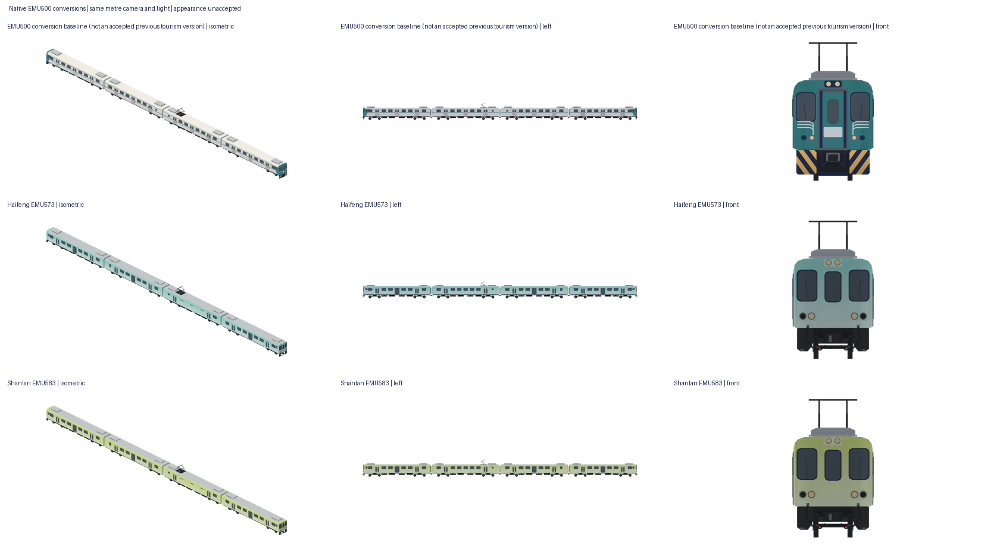

# 臺鐵海風號／山嵐號 EMU500 改造 studies

目前為第二輪修整。兩款各自仍沒有已接受前版；上一輪交付 producer `f036e7f79279586f5831c7cb9bf9d8cce3444558` 只是未接受的前稿。

真正producer：`0e2f38a244db7ea0301169cdb4b6d81f0c340a78`。素材draft [#35](https://github.com/a91453/railway-assets-private/pull/35)。

- [海風完整素材](https://github.com/a91453/railway-assets-private/tree/codex/haifeng-shanlan-emu500/game-art-previews/docs/art/haifeng-emu500/revision-2)／[viewer](https://github.com/a91453/railway-assets-private/blob/codex/haifeng-shanlan-emu500/game-art-previews/docs/art/haifeng-emu500/revision-2/index.html)
- [山嵐完整素材](https://github.com/a91453/railway-assets-private/tree/codex/haifeng-shanlan-emu500/game-art-previews/docs/art/shanlan-emu500/revision-2)／[viewer](https://github.com/a91453/railway-assets-private/blob/codex/haifeng-shanlan-emu500/game-art-previews/docs/art/shanlan-emu500/revision-2/index.html)

下載自含HTML後開啟；本機HTTP實測通過，file://受環境政策阻擋、UNVERIFIED。

一般EMU500只標「改造基準」，也沒有取得其第八版或營運遠景的明確producer使用者外觀接受證據，故 **UNVERIFIED**。合併本輪只增加studies，兩款均不出現在遊戲，無玩家選用；靜態四車不代表動態行駛。完整來源逐圖網址／SHA／權利見 [sources.json](sources.json)，重建見 [工具](../../../tools/tourism-emu500/README.md)。公開僅此共同總覽，完整兩套近遠單元／四車、GLB／viewer在互鏈素材draft PR。

## 第二輪外觀修整

撤回上一輪對車頭外觀過寬的自評。本輪收薄深色下裙、移除中央實心大封板與舊前連結器重疊，重建可辨識的連結器頭、支座及主要管線；補出上雙燈盒與下成對圓燈座，放寬中央窗並讓窗框／玻璃的三角面貼合最終弧面。修整中間稿下窗角曾被殼面穿出，已用實際原生射線重現並加入可拒收的驗收，沒有把中間稿當交付。

海風與山嵐分別調亮藍綠／黃綠，真車殼頂點色連續內插，去除原先逐面分段楔形；兩款幾何仍共用已知相同部分，沒有捏造不同車鼻。四角色、四車順序、輪組、空調及集電位置保持。細管線、連結器機構與隱藏設備仍是外觀簡化，非工程復刻。真正前稿與本輪採同公尺相機／光線比較；原EMU500只是改造基準。

## 身份與版本

| 項目 | 海風號 | 山嵐號 |
|---|---|---|
| 正式名／原組 | 海風號／EMU573 | 山嵐號／EMU583 |
| 原車號（Blair攝影實錄） | 45EMC573–45EP573–45ET573–45EM573 | 45EMC583–45EP583–45ET583–45EM583 |
| 改造後身份 | 海風號EMU573；未取得官方新車號／除籍重編帳冊 | 山嵐號EMU583；未取得官方新車號／除籍重編帳冊 |
| 原製造 | 韓國大宇重工；攝影車籍頁列1995，非改造廠 | 同；兩列不同實體編組，並非共同一列 |
| 改造／設計／照明 | 仕佳興業／築點設計／沁弦築影 | 同一專案團隊，不代表BOM完全相同 |
| 車輛／行程服務 | 臺鐵／雄獅旅遊協力 | 臺鐵／雄獅旅遊協力 |
| 工程時間 | 設計團隊刊載2022-11開始、2024-08完工（整體專案，非逐車驗收） | 同一刊載範圍 |
| 試運轉紀錄 | 2024-08-06、09-24、11-08實車照片 | 2024-08-30、09-24實車照片 |
| 正式營運 | 2024-12-07（交通部施政報告） | 2025-04-19（交通部／公視） |
| 逐列交付／驗收日 | 資料不足，不能用試車照替代交付證書 | 資料不足 |
| 選定塗裝 | 現行官網海水藍綠上深下淺、車頭漸層，非活動彩繪 | 現行官網黃綠上深下淺、車頭漸層，非活動彩繪 |

2024試車照片只支持可見外形；一般營運版本另用臺鐵現行頁、2025設計刊物及營運消息核對。附圖的外觀設計示意不是工程圖；未把它當左右側全部設備的證明。沒有第三方幾何／照片貼圖、品牌字或商標，來源原圖不公開、不送外部生成服務。

## 一般EMU500／海風／山嵐逐部件對照

| 部件 | 原生一般EMU500 | 海風、山嵐改造及證據 | 實作／資料界線 |
|---|---|---|---|
| 截面／長寬 | 原配方20.33m中心距、2.853m寬、直側圓肩 | 同EMU500基體、多角度照片支持保留 | 直接引用e500Section、e500CabGrid／CabX；改造精密尺寸未取得 |
| 主車頭 | 淺弧正面、貫通門與突出框 | 封閉貫通門、中央窗保留，無原框／白門牌 | 重建封閉正面；沒有舊門藏在新殼後 |
| 前玻璃／燈 | 左右駕駛玻璃、成對燈 | 照片支持三窗正面與原燈大布局 | 重做中央窗及薄框，圓燈／雨刷簡化；不放字標 |
| 側門 | 每側三組雙葉門 | 中央門封閉改落地展望窗，保留兩端入口 | 不呼叫原三門生成段；新玻璃／新門葉直接建立 |
| 客窗 | 六組一般窗、角色小窗 | 客室中央落地展望窗、固定大窗；ET無障礙區，EP廚房 | EP／ET專用窗列；完整反側窗冊不足，布局位置為照片／平面功能推估 |
| 屋頂空調 | 兩端空調斜肩外殼 | 照片可見保留兩端大型空調 | 沿用原生成段，兩列隱藏BOM／管線差異未知 |
| 集電 | EP單臂弓，展示4.95m | 實照可見EP集電與高壓設備 | 沿用生成段；4.95m只展示升弓，未稱官方降弓高度 |
| 台車／輪組 | 兩台車八輪胎、860mm、2.8m軸距 | 保留EMU500走行大結構，照片可見 | 沿用生成段及位置，未取得兩列動拖台車所有零件BOM，不稱完全相同 |
| 車底 | 原角色設備箱簡化 | 主要設備保留、餐車改造可能有設備增設 | 原角色箱體為合理簡化；精密車底差異／管路資料不足 |
| 塗裝 | 遊戲暖白／綠松、白折線與黃裙紋 | 海風藍綠、山嵐黃綠霧面漸層，無原折線／黃裙紋 | 漸層在真殼面頂點內插，非浮動色片；跨角色同高連續 |
| 窗內 | 一般配方實心外殼支承玻璃 | 兩款不同座席／色彩配置 | 窗內深色簡化，未做餐飲系統或完整內裝互動 |

兩款確定差異是實體原車、漸層色相及官方座席配置。尚無證據顯示外部殼形必須不同，因此本輪兩款幾何相同、身份／塗裝／配置紀錄獨立，沒有捏造特殊鼻形；這不表示實車每個零件相同。內裝差異只記來源，不把未製作的座席宣稱已交付。

## 四車契約

| 角色／單元順序 | 原EMU573／583對應 | 功能／動拖 | 建模門窗、設備 |
|---|---|---|---|
| EMC／1 | EMC573／583 | 端部客車、駕駛動車 | 正向三窗封門頭；每側兩組入口、中央落地窗、兩空調、兩動力台車簡化 |
| EP／2 | EP573／583 | 餐車、集電拖車 | 兩組入口、廚房側簡化封窗／格柵、反側窗列；單弓、兩空調／兩拖車台車 |
| ET／3 | ET573／583 | 客車、無障礙拖車 | 中央落地窗、無障礙側小窗簡化；兩空調／兩拖車台車 |
| EM／4 | EM573／583 | 端部客車、駕駛動車 | 同類封門頭，組裝時只旋轉一次180°；兩動力台車 |

EMU500 2M2T角色定義來自型式資料；本輪沒有改造牽引電路證書，不將四角色清單直接當動拖改造認證。官方現頁海風EMC19／EP0／ET19+2輪椅／EM21；山嵐EMC21／EP0／ET16+2輪椅／EM23。早期61／62席宣傳與現行頁不同，沒有把過時數字寫成現行配置。

`+X前、+Y左、+Z上、公尺、共同軌面Z0`。四車中心`30.495,10.165,-10.165,-30.495`，角度`0,0,0,180`。單元模型EM未預反向；尾端不重複旋轉。兩款各自assembly JSON從最終單元重組，不共用一般EMU500的列車常數作為改造已驗證證據。

中心距／沿用車輛長20.33m；一般殼長19.88m、駕駛車殼從-9.94到最大9.99m；相鄰普通殼間隙0.45m（弧頭端因曲率不同）；車端連結器至約±10.165m。中心距、殼隙、連結面距和連結器範圍分別記錄；81.32m為四節中心距包絡，非新測整列外殼長。未取得改造後連結面工程測量。

## 改造基準與保護

近景原producer `07bd8f0db6c693a5863a4979722893c9141a2f97`，私庫第八版；公開#1312 head e124d917已MERGED。遠景producer `40528d8a8f997c25efd0473ce593fd6dbfcbcee9`，#1336已MERGED；第八版私包未含這個後來新增的far，不假稱已有同包交付。兩者外觀接受UNVERIFIED。現main經材質／遮蔽後的payload才是本輪保護對象，不拿舊包bytes替代目前輸出。

目前一般EMU500營運：`Map3DTrainSet.localTrain`以車次mod20×7mod20的9／6／5分EMU900／500／800（#1346 head4506b6d4已MERGED），是遊戲呈現分法而非實際配車事實；EMC EP ET EM | EM ET EP EMC八車、ownLengths、後半鏡像；近500m、遠500–900m、之外盒子，列車包／回退不變。HAIFENG／SHANLAN原來都映到commuter；本輪不接這個泛用接點，不改GameCore、購車、解鎖、班表或控制。後續可靠固定四車身份選用契約、燈與裝置驗證另做，不能把studies註冊當玩家可選。

安坑／淡海公開#1533 headfb77411f、素材#34 headd7a0deb2均MERGED，producer0d3b6733；目錄／分支保護。原EMU500全部角色／近遠／完整車組、營運EMU800／900、其他臺鐵列車、共用車、高雄紅橘／輕軌及安坑淡海均以未改main **777個實際payload與全部頂點欄位FNV**對照，最終結果見verification.json。不修改原EMU500 API、共用殼、色票、loader或gate。

## 外觀與驗證界線

原生配色／白模／剪影全部單元近遠及四車正／側／頂／斜圖自檢，固定公尺相機；共用overview包含原EMU500改造基準。來源照片只本機旁置，不在公開或素材PR複製。已符合：三窗封門頭、兩組入口、中央落地窗、兩款不同主色、EP單弓、四車及Z0；仍為簡化：細燈線、台車懸吊／管線、窗內深色；資料不足：逐車反側、屋頂精密站位、底部BOM與改造後連結面尺寸。自檢不等於使用者接受。

最終producer／bytes重建、geometry、獨立Swift／Blender、RGBA、viewer真下載SHA、保護與最新PR head CI寫在verification.json及素材README。接觸及射線為抽樣，不是工程復刻、全自交或完整動態碰撞證明。Linux WebGL不是Metal；Simulator視覺／真機FPS、坡道彎道／弓／運轉動畫UNVERIFIED。四態以各款status.json為準，不能從CI或prompt推定外觀接受。

原車年份及台車資料需分層閱讀：Blair兩個原車籍頁均列1995，而EMU500全系列資料為1995–1997；本輪沒有原廠逐車出廠證書，不將泛型年份當個車精確製造日期。Blair連結稱TR-55，型式資料另列ABB動拖台車代號；未取得兩列改造BOM核對，因此模型只代表可見的兩軸台車外形，沒有聲稱代號／所有零件已查明一致。

第二輪最終實跑：44模型／GLB／組裝檔、40私庫PNG＋公共總覽與兩個最終交付viewer，獨立producer checkout重建bytes相同；本輪14個Swift相關測試0失敗（首輪71項、3既有skip、0失敗，為前稿歷史記錄）。共用Node5、Python6；20GLB獨立Blender4.3.2匯入；獨立Swift組裝誤差≤3.82e-6m。每款近景22220、遠景9120三角，完整列車合法分件；全部單元≤15000。最終交付viewer每款10項×七向×日夜、旋轉縮放／390px、原生與GLB真下載bytes／SHA均過。素材最新輪次為revision-2；同PR移除revision-1重檔，保留PNG／README／來源。staged tree與HEAD guard結果見verification.json。完整證據：[verification.json](verification.json)。

首輪對照開工main a1e33214與上游46ae42b9，本輪另對照main d6c5c899，均實際匯出777既有模型；和本輪producer分支的payload bytes／全部頂點欄位FNV一致。上游UI／效能變更與本輪分開判讀。各自同33舊全量失敗（32舊鎖差異＋TEMU2000整列預算）留存，未改gate。standard613模型／3565788頂點／142.6MB不增加，啟用記憶體檢查通過。原EMU500 API／配方原檔完全不改；保護營運選用／列車包及回退。
