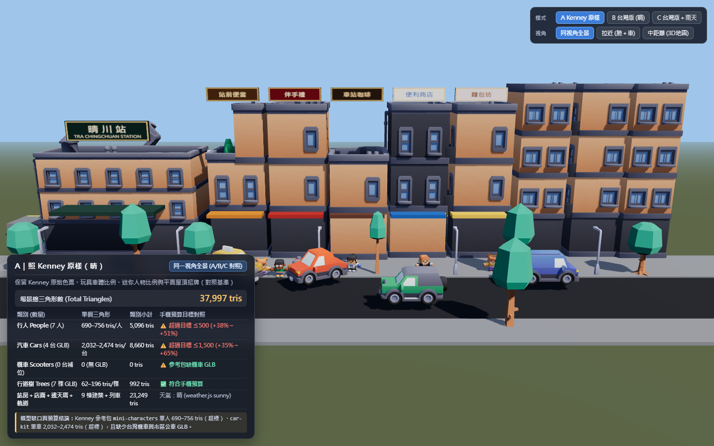

# 台灣車站前 3D 城鎮試看與 Kenney 參考包評估（2026-10-17）

> 2026-10-22 起這個資料夾只留這份 README、總覽圖 `a-kenney-sunny.png` 和文字紀錄；其他 4 張圖搬到 `a91453/railway-reference-private: Railway/game-art-previews/docs/art/town-scene-preview-2026-10-17/`，檔名不變（作者 2026-10-21 的規則，`docs/HANDOFF.md` §2）。

> **目的**：評估 `railway-reference-private/Railway/town-scene-reference-clean/` 內的 Kenney CC0 低多邊形模型包放入「台灣車站前」場景時的視覺效果、調色盤相容性、手機三角形預算，以及模型缺口。
> **試看工具位置**：[`Web/CityView/tools/town-preview/`](../../../Web/CityView/tools/town-preview/index.html)（獨立預覽頁，不改動 `CityView` 主程式或 `package.json`）。
> **模型與來源清單**：[`Web/CityView/public/models/town/SOURCES.json`](../../../Web/CityView/public/models/town/SOURCES.json)。

---

## 1. 五張對照與視角截圖

### (1) 同一視角三張：A 照 Kenney 原樣 ／ B 配成台灣版 ／ C 台灣版＋雨天

| 模式 | 截圖 | 總三角形數 | 視覺與配置重點 |
| --- | --- | ---: | --- |
| **A｜照 Kenney 原樣（晴）** |  | **37,997 tris** | 保留 Kenney 原始色票（薄荷綠樹葉 `#29c9ab`、紅／橘／青／紫玩具感車色、預設紫橘人物服色）、玩具短胖車體比例、平面屋頂招牌，無騎樓／無機車／無透天厝頂樓鐵皮與水塔。 |
| **B｜配成台灣版（晴）** | B 配成台灣版（`a91453/railway-reference-private: Railway/game-art-previews/docs/art/town-scene-preview-2026-10-17/b-taiwan-sunny.png`） | **39,797 tris** | 改用 [`docs/UI_THEME.md`](../../UI_THEME.md) 與 3D 畫風調色盤；人物拉回真人比例（**1.70 m**）、汽車拉回台灣常見車型尺寸（**4.45–4.60 m**）；5 家店（`站前便當`、`伴手禮`、`車站咖啡`、`便利商店`、`麵包坊`）加上**騎樓柱廊、條紋斜雨遮、2F/3F 鐵皮窗遮、直立招牌**；右側 3 棟**透天厝**加上鐵捲門、鐵窗、**頂樓綠／藍鐵皮加蓋與不鏽鋼／藍色水塔**；路邊機車格補上 3 台自製低面數機車。 |
| **C｜台灣版＋午後雷陣雨** | C 台灣版＋雨天（`a91453/railway-reference-private: Railway/game-art-previews/docs/art/town-scene-preview-2026-10-17/c-taiwan-rain.png`） | **39,797 tris** | 完整套用 `weather.js` 的 `PRESETS.rain` 數值（`daySunScale: 0.56`、`dayHemiScale: 0.92`、`skyTint: #66778a (mix 0.24)`、`fogTint: #586777 (mix 0.24)`、`fogNear: 0.84`、`fogFar: 0.76`、`rain: 1` 480 條斜雨絲幕），搭配午後雷陣雨濕亮柏油路面與提早亮起的店招燈箱。 |

---

### (2) 拉近特寫（看得到人的臉和車的細節）與中距離視角（遊戲 3D 地圖拉近高度）

| 視角 | 截圖 | 總三角形數 | 觀察重點 |
| --- | --- | ---: | --- |
| **D｜拉近特寫（人物臉部＋車輛細節）** | D 拉近特寫（`a91453/railway-reference-private: Railway/game-art-previews/docs/art/town-scene-preview-2026-10-17/d-taiwan-closeup.png`） | **39,797 tris** | 近距離檢視 1.70 m 行人的臉部五官（眼睛、眉毛、眼鏡、微笑嘴型、暖膚色 `#EDC4A0`/`#E8C9A8`）與台灣調色盤服裝（珊瑚紅 `#E8574A`、台鐵藍 `#3B7DD8`、琥珀黃 `#FFC86B`），以及兩側台灣黃計程車（`#F2C230`）與白色房車（`#F2F3F1`）的車頭燈、保險桿、擋風玻璃與輪圈細節。 |
| **E｜中距離視角（遊戲 3D 地圖拉近高度）** | E 中距離視角（`a91453/railway-reference-private: Railway/game-art-previews/docs/art/town-scene-preview-2026-10-17/e-taiwan-mid.png`） | **39,797 tris** | 模擬遊戲 3D 地圖拉近時的俯角高度（約 `y = 23.5 m`、俯角 ~40°）：可清楚辨識月台側列車、`晴川站`、站前廣場斑馬線、5 家店面直立招牌與騎樓雨遮、3 棟透天厝頂樓鐵皮加蓋與水塔。 |

---

## 2. 三角形數量統計與手機預算審核

> **手機預算目標**：近景人一個 **≤ 500 tris**、車一台 **≤ 1,500 tris**。

### 各圖層三角形明細表

| 類別 | 場景數量 | 單個模型三角形數 | 類別總三角形數（A 原樣） | 類別總三角形數（B/C 台灣版） | 手機目標預算 | 審核結果 |
| --- | ---: | --- | ---: | ---: | --- | --- |
| **行人（People）** `mini-characters` GLB | **7 人** | `character-male-b`: **690** `character-male-d`: **711** `character-male-a`: **723** `character-female-c`: **732** `character-female-b` (×2): **742** `character-female-e`: **756** | **5,096 tris** *(平均 728 tris/人)* | **5,096 tris** *(平均 728 tris/人)* | **≤ 500 tris / 人** | ⚠️ **超標 (+38% ～ +51%)** 所有 Kenney 人物皆在 690–876 tris 之間，超過手機近景人 500 tris 上限 |
| **汽車（Cars）** `car-kit` GLB | **4 台** | `sedan.glb`: **2,032** `taxi.glb`: **2,072** `van.glb`: **2,082** `suv.glb`: **2,474** | **8,660 tris** *(平均 2,165 tris/台)* | **8,660 tris** *(平均 2,165 tris/台)* | **≤ 1,500 tris / 台** | ⚠️ **超標 (+35% ～ +65%)** 主要因為 4 顆車輪圓柱導角（單輪 ~332 tris，4 輪即佔 ~1,328 tris） |
| **機車（Scooters）** 參考包缺口補位 | **3 台** *(僅 B/C)* | 自製程式化低面數機車：**188 tris/台** | **0 tris** *(參考包無機車)* | **564 tris** | **≤ 1,500 tris / 台** | ✅ **符合預算 (188 tris/台)** ⚠️ 註明：參考包 `car-kit` **完全沒有機車 GLB** |
| **行道樹（Trees）** `nature` GLB | **7 棵** | `tree_simple.glb` (×1): **62** `tree_default.glb` (×3): **114** `tree_oak.glb` (×3): **196** | **992 tris** *(平均 142 tris/棵)* | **992 tris** *(平均 142 tris/棵)* | 低面數行道樹 | ✅ **符合手機預算** 62–196 tris/棵，輕量且剪影自然 |
| **建築與台灣街景構件** 站房＋5店＋3透天厝 | **9 棟** | `building-k` (晴川站): **2,960** 5 店 (`d/a/c/h/b`): **1,100–1,512** 3 透天厝 (`f/g/f`): **1,794–2,006** ＋B/C 騎樓、雨遮、直立招牌、鐵皮水塔 | **15,033 tris** | **16,089 tris** | 靜態場景批次 | ✅ 靜態建築可合併批次 |
| **月台、軌道、列車、路燈與地面** | 1 組 | `railroad-straight` (×8): **3,008** `train-electric-square-a/b` (×3): **4,650** `light-square` (×5): **300**＋月台道路 | **8,216 tris** | **8,396 tris** | 背景鐵道環境 | ✅ 符合預算 |
| **場景總計（Total）** | — | — | **37,997 tris** | **39,797 tris** | — | — |

---

## 3. 天氣系統數值對照（`weather.js`）

場景嚴格採用 `Railway/town-scene-reference-clean/source/weather.js` 的 `PRESETS.sunny` 與 `PRESETS.rain` 參數（以午後 14:00 基準光 `sun = #fff2de (intensity 3.0)`、`hemi = #cfe2ff / #4a4234 (intensity 1.0)`、`sky = #9fc6ea` 進行線性混色與倍率縮放）：

| 參數 | `PRESETS.sunny`（晴：圖 A / B / D / E） | `PRESETS.rain`（午後雷陣雨：圖 C） | 視覺影響 |
| --- | --- | --- | --- |
| `daySunScale` | `1.00` (Intensity `3.00`) | `0.56` (Intensity `1.68`) | 午後烏雲遮蔽直射陽光，陰影對比柔化 |
| `dayHemiScale` | `1.00` (Intensity `1.00`) | `0.92` (Intensity `0.92`) | 天光漫射略降，保留暗部細節 |
| `skyTint` / `skyMix` | `#ffffff` / `0.00` | `#66778a` / `0.24` | 天空由晴空藍 `#9fc6ea` 轉為鉛灰藍 `#91b3d3` |
| `hemiTint` / `hemiMix` | `#ffffff` / `0.00` | `#8392a3` / `0.10` | 天頂環境光帶入冷灰濕氣 |
| `groundTint` / `groundMix` | `#ffffff` / `0.00` | `#68737f` / `0.12` | 地表反光轉冷 |
| `fogTint` / `fogMix` | `#ffffff` / `0.00` | `#586777` / `0.24` | 遠景透天厝與月台籠罩午後雨霧 |
| `fogNear` / `fogFar` | `1.00` / `1.00` (`48m / 128m`) | `0.84` / `0.76` (`40.3m / 97.3m`) | 能見度收攏，強化雨天空氣透視 |
| `rain` | `0` | `1` (`480` 條斜雨絲，`RAIN_SLANT = 0.12`) | 2D 雨絲幕＋濕亮柏油路面＋店招提早點亮 |

---

## 4. 授權查證結果（License Verification）

完整記錄於 [`Web/CityView/public/models/town/SOURCES.json`](../../../Web/CityView/public/models/town/SOURCES.json)：

1. **3D 模型與色票貼圖（25 個 `.glb`＋色票 `.png`）**：
   - 全部來自 **Kenney**（<https://kenney.nl>）公開發行的 6 個資產包：
     - [Kenney City Kit (Commercial)](https://kenney.nl/assets/city-kit-commercial)
     - [Kenney Train Kit](https://kenney.nl/assets/train-kit)
     - [Kenney Car Kit](https://kenney.nl/assets/car-kit)
     - [Kenney Mini Characters 1](https://kenney.nl/assets/mini-characters-1)
     - [Kenney Nature Kit](https://kenney.nl/assets/nature-kit)
     - [Kenney City Kit (Roads)](https://kenney.nl/assets/city-kit-roads)
   - **授權條款**：**CC0 1.0 Universal (Public Domain Dedication)**（<https://creativecommons.org/publicdomain/zero/1.0/>），可自由商用、修改、重製與打包進 iOS / Web 專案，無須署名。
2. **技術修補說明**：
   - `commercial` 與 `roads` 的 GLB 內部引用 `Textures/colormap.png`，而 Kenney 原始壓縮包將該貼圖命名為 `Models/Textures/variation-a.png`（見 `TEXTURE_REFERENCES.json`）。我們將 `variation-a.png` 同步放置為 `colormap.png`，消除載入 404 並還原 Kenney 原始材質。
3. **音樂檔案排除**：
   - 參考包內的 `source/assets/music/01-sunny-station.mp3` 無授權證明文件（見 `ATTRIBUTION_AND_RIGHTS.md`），**完全不複製、不使用**。

---

## 5. 建議與四方觀點整理（供作者決策）

### (1) A ／ B ／ C 哪個方向好？
- **建議選擇 B（配成台灣版・晴）作為日常基準，並搭配 C（午後雷陣雨）作為台灣夏季特色天氣變化**。
- **原因**：
  - **A（Kenney 原樣）**的薄荷綠樹葉（`#29c9ab`）、玩具感短胖車輛與歐美商業大樓外觀，一眼看去像歐美低多邊形樣品屋，缺乏台灣鐵道城鎮辨識度。
  - **B（台灣版）**透過我們的 [`docs/UI_THEME.md`](../../UI_THEME.md) 調色盤重上色，並加上**騎樓柱廊、斜雨遮、2F/3F 鐵皮窗遮、直立招牌、透天厝頂樓鐵皮加蓋與水塔**後，即使底層建築是 Kenney `commercial` 幾何，也能立刻呈現台灣車站前商店街的親切感。
  - **C（午後雷陣雨）**只需套用 `weather.js` 的輕量光影倍率與 2D 雨絲幕，就能在零額外 3D 幾何負擔下做出極具台灣夏日午後氛圍的視覺變化。

### (2) 哪些模型能直接用？哪些要減面或自己建模？
1. **可直接沿用（但需改用我們的調色盤）**：
   - ✅ **行道樹（`nature/tree_default.glb`, `tree_oak.glb`, `tree_simple.glb`）**：每棵僅 **62–196 tris**，把原本刺眼的薄荷綠改成 `#6FA85A`／`#5E9A78` 後非常耐看，手機效能負擔極低。
   - ✅ **路燈与軌道／通勤電車（`roads/light-square.glb`, `train-kit/*`）**：路燈僅 **60 tris**，電車單節 **1,418–1,616 tris**，適合做站內背景點綴。
   - ✅ **商業建築（`commercial/building-a/b/c/d/f/g/h/k.glb`）**：每棟 **1,100–2,960 tris**，作為中近景站前建築骨架可用，但**必須搭配台灣在地附加構件（騎樓、直立招牌、鐵皮雨遮、水塔）**才不會像歐美積木城。
2. **不建議直接原樣大量放進手機版（超過預算，需減面 LOD 或維持既有方塊人／車）**：
   - ⚠️ **人物（`mini-characters`）**：單人 **690–756 tris**，超過手機目標（**≤ 500 tris**）。若畫面同時出現 30–50 人會吃掉 2.5 萬～3.8 萬三角形。建議：**拉近特寫或站前重點 NPC（≤ 8 人）可用減面至 ≤ 450 tris 的版本，一般街道遠景行人維持目前 `Map3DStreetLife.swift` 的 84 tris 程式化小人**。
   - ⚠️ **汽車（`car-kit`）**：單台 **2,032–2,474 tris**，超過手機目標（**≤ 1,500 tris**），主因是四顆高面數車輪（佔 ~1,328 tris）。建議：**用 Blender / 腳本將車輪簡化為 8–10 角柱（單台可立刻降至 ~950–1,100 tris，符合 ≤ 1,500 目標）**，並將車身長寬比固定拉回台灣實車比例。
3. **參考包缺口（需自己建模或程式化生成）**：
   - 🛠️ **台灣機車（Scooter）**：參考包**完全沒有機車**，而台灣車站前若無成排機車與機車待轉區會少掉靈魂。本次試看頁以 **156 tris/台** 的程式化幾何補位，未來建議自建一款 **300–450 tris** 的台灣常見速克達 GLB（含菜籃／後照鏡／白底黑字車牌）。
   - 🛠️ **台灣市區低底盤公車／客運（Bus）**：參考包無公車模型（`main.js` 也是用方塊拼湊），建議自建一款 **800–1,200 tris** 的台灣站前客運／市區公車模型。
   - 🛠️ **台鐵站房與跨站天橋**：`building-k.glb` 比較像現代商辦，真正台灣經典車站（洗石子立面、弧形雨庇、月台Y型棚架）建議自建專用低面數模組。

### (3) 四方觀點整理（供遊戲規劃彙整給作者）
- **玩家視角**：拉近到車站前時，一眼看到「站前便當、伴手禮、便利商店」的直立招牌、騎樓下避雨的行人、黃色計程車與路邊一整排機車，才會有「這真的是台灣火車站前」的驚喜感；午後雷陣雨時店招亮起非常有生活感。
- **開發者視角**：`weather.js` 的參數化日夜／天氣混色架構極為乾淨，可直接移植到 SceneKit (`Map3DScene.swift`)；但 `mini-characters` 與 `car-kit` 單體面數超標，在 iOS 端應採用「中遠景維持程式化幾何（84–156 tris）、僅特寫鏡頭載入減面後 GLB」的兩段式 LOD。
- **美術視角**：Kenney 原色偏高彩度冷綠與玩具色，直接放進遊戲會與我們柔和的鐵道地圖調色盤衝突；改用 `UI_THEME.md` 暖米白牆面、台鐵藍、樟樹綠與台灣招牌色後，整體視覺立刻統一。
- **音樂／音效視角**：參考包內的 `01-sunny-station.mp3` 缺乏授權不可使用；未來台灣站前場景若加入午後雷陣雨，建議搭配環境雨聲白噪音與台鐵進站鈴聲合成音，不依賴未授權外部音檔。
