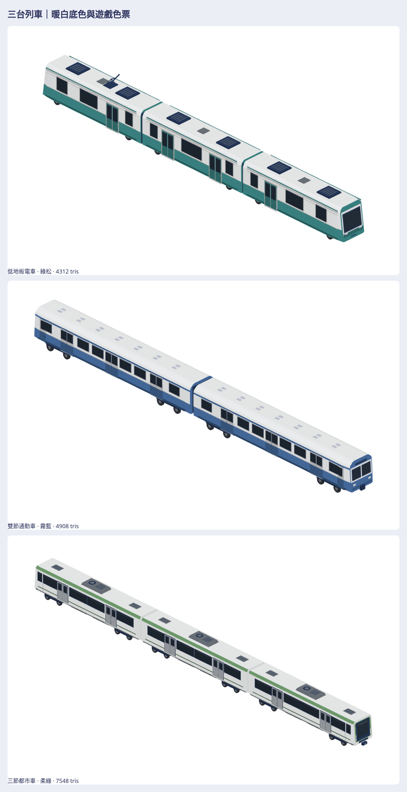

# 三台列車：遊戲配色修訂

作者要求「改一下配色，其他兩台也是」，並指定「你決定就好，以最好看的遊戲風格呈現方式」。本輪只調整既有面的頂點色：電車暖白綠松、雙節通勤車暖白霧藍、三節都市車暖白柔綠。三個配方的幾何、尺寸、門窗、輪位、設備、編組、模型 ID、alpha 與 glow 全部保留；不是新增三個車型。公開 PR [#988](https://github.com/a91453/railway-game-ios/pull/988) 與私有 PR [#39](https://github.com/a91453/railway-reference-private/pull/39) 繼續保持 draft。

[重建／組裝／viewer](../../../tools/train-colors/README.md)。完整最新版在私有庫 [train-colors-2026-10-22](https://github.com/a91453/railway-reference-private/tree/codex/three-car-urban-2026-10-22/Railway/game-art-previews/docs/art/train-colors-2026-10-22)：

- [完整 ZIP](https://github.com/a91453/railway-reference-private/raw/refs/heads/codex/three-car-urban-2026-10-22/Railway/game-art-previews/docs/art/train-colors-2026-10-22/asset-package.zip)、[單檔 viewer](https://github.com/a91453/railway-reference-private/raw/refs/heads/codex/three-car-urban-2026-10-22/Railway/game-art-previews/docs/art/train-colors-2026-10-22/viewer-standalone.html)
- [三台配色前後](https://github.com/a91453/railway-reference-private/blob/codex/three-car-urban-2026-10-22/Railway/game-art-previews/docs/art/train-colors-2026-10-22/previews/before-after.png)、[同公尺完整編組比較](https://github.com/a91453/railway-reference-private/blob/codex/three-car-urban-2026-10-22/Railway/game-art-previews/docs/art/train-colors-2026-10-22/previews/fleet-same-scale.png)、[四底色／灰階／縮小模糊](https://github.com/a91453/railway-reference-private/blob/codex/three-car-urban-2026-10-22/Railway/game-art-previews/docs/art/train-colors-2026-10-22/previews/color-checks.png)
- [所有七向圖](https://github.com/a91453/railway-reference-private/tree/codex/three-car-urban-2026-10-22/Railway/game-art-previews/docs/art/train-colors-2026-10-22/views)、[獨立單元](https://github.com/a91453/railway-reference-private/blob/codex/three-car-urban-2026-10-22/Railway/game-art-previews/docs/art/train-colors-2026-10-22/previews/units.png)、[原生／GLB 模型](https://github.com/a91453/railway-reference-private/tree/codex/three-car-urban-2026-10-22/Railway/game-art-previews/docs/art/train-colors-2026-10-22/models)

## 配色與外觀結論

| 車輛 | 專案既有色票 | 最終表現 |
| --- | --- | --- |
| 低地板電車 | `tileWhite`、`shopAwnings[0]`、`tankWhite` | 暖白主體、低飽和綠松下裙、中性細窗框；保留前版圓收端面和原玻璃 |
| 雙節通勤車 | `tileWhite`、`trimBlue`、`roof` | 暖白窗帶／屋頂、霧藍下半身、冷淺灰藍窗框；保留雙風擋、三門與原圓肩 |
| 三節都市車 | `tileWhite`、`containers[2]`、`tankSteel` | 大面積暖白、柔綠肩線／細腰線／端框、淺灰門；保留單風擋、兩門、12 軸與屋頂空調配置 |

**已符合**：減少原本三台近似的大面積飽和綠，以暖白、深色玻璃和不同色帶建立共同家族與各自辨識。霧面、薄框、細節密度維持遊戲風格。已親自查看三台最終立體、側面、端面、俯視、底面、四底色、灰階及縮小模糊；新舊比較使用真正 native，所有車輛與新舊版本共用同一公尺相機範圍，沒有各別放大掩飾差異。無已知因換色造成的主要外觀缺陷；這是本 session 的判讀，未宣稱作者已認可成品。

**保留／資料不足**：原批的車種類別、比例、頭尾與門窗判讀不變；色彩已依作者要求偏離參考原綠色。工程尺寸／不可見車底細部仍沿用各批限制，不因換色冒稱補齊。外觀基準是 producer `2b2bfab2ae6f2a94407c8acd0224516d590a07f5` 的實際 native；該快照私有保存在 `train-colors-2026-10-22-before/`，僅供比較，不放進最終素材 ZIP。

`before-after.png` 比較三台斜視；`before-after-tram.png`、`before-after-commuter.png`、`before-after-urban.png` 各含同相機側／前／斜視。白模與剪影各自從最終三個原生編組產生。造型沒有修訂，因此不以配色掩飾或宣稱修掉幾何問題。

## 技術與交接

8 個獨立單元＋3 個完整編組＋1 件未改色專案比較車＝12 native／12 GLB／84 張七向透明 PNG；完整編組三角形保持 **4,312／4,908／7,548**。每個模型的七向圖固定公尺尺度，八個單元也共用尺度。詳細尺寸、組裝順序與中心位移在 manifest 和工具 README。

**VERIFIED（Linux，Swift 6.4）**：warnings-as-errors build、24 相關 XCTest；全部 12 模型與上一版逐頂點確認位置、法線、三角形順序／數量、alpha／glow 完全相同，只有三款車顏色改變，比較車連顏色也相同；三編組逐頂點重組比對；native 讀回、GLB 逐位元重建與 Blender 4.3.2 獨立載入／尺寸／頂點色／霧面無貼圖；84 七向透明、不裁邊及全部 PNG 解碼；資料夾版與單檔版 viewer 的 12 模型載入、逐件 native／GLB 下載、七向、旋轉、縮放、PNG 下載與 390 px。三節都市車的閉合邊與 116 個可見玻璃支持面也再次通過；前兩台以原測試及幾何完全相同檢查驗證，沒有改造原幾何。

來源紀錄寫實際 producer commit，並驗證 Git 中三個配方、共用幾何／色票／renderer 與本批工具的 bytes。ZIP 完整解壓／CRC／逐檔位元組比對結果與 SHA 在私有 `source-record.json`、`SHA256SUMS.txt`、`package-verification.json`。原批私有包作歷史保留；最新配色使用本整合包，避免拿到舊綠色版本。

**UNVERIFIED**：iPhone／iPad Metal 外觀、效能、真機載入、任何動畫與物理；工程尺寸。受管 Chromium 禁止 file://，單檔以瀏覽器斷網的內嵌 HTML 模式驗證，系統雙擊開啟未直接測。最新公開提交的實際 CI 看 PR checks；不把本地 WebGL 當成 Metal。未改 GameCore、存檔、golden／replay 或營運控制，未啟動 TestFlight。
