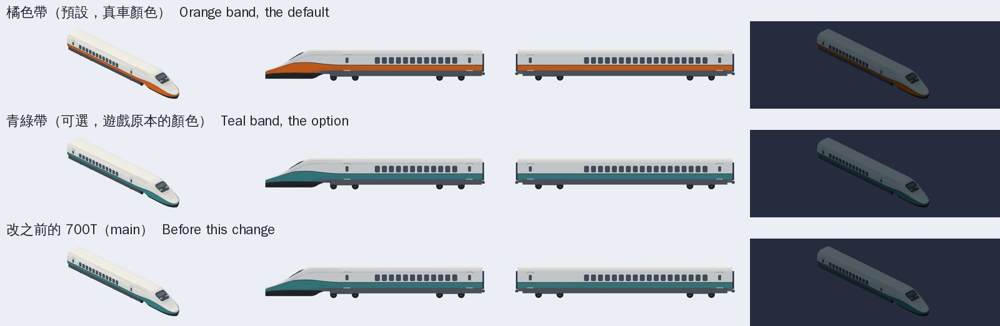

# 路線頁逐線選塗裝：700T 的橘色帶與青綠帶（決策 983）



三列由上而下：橘色帶（預設，真車顏色）、青綠帶（可選，從橘色帶的模型換色出來）、改之前的 700T（main 的配方）。每列由左而右：車頭等角、車頭側面、中間車側面（白天），車頭等角（夜晚）。

- 青綠帶和改之前看起來一樣：換色保留了每個面的明暗。
- 黑色細線、白車身、玻璃都沒被換到。

重建（分支 `claude/project-thread-40kinx`，決策 983 的 commit）：

```sh
IDS=set-highSpeed-head,set-highSpeed-car
tools/train-models/run.sh OUT/after --tag after --ids $IDS
tools/train-models/run.sh OUT/teal --tag teal --ids $IDS --paint teal
node tools/train-models/render.mjs OUT/after --time both --ids $IDS --views left,isometric
node tools/train-models/render.mjs OUT/teal --time both --ids $IDS --views left,isometric
```

「改之前」那一列是把 `Map3DTrainShapeRefresh.highSpeedBandColor` 暫時改回 `Map3DPalette.shopAwnings[0]` 匯出的，`check.mjs` 對 main 的鎖全部相同。

Linux 的 WebGL 預覽，不是 Metal；實機畫面 UNVERIFIED。圖是這個專案自己的模型畫出來的，沒有外部素材。
