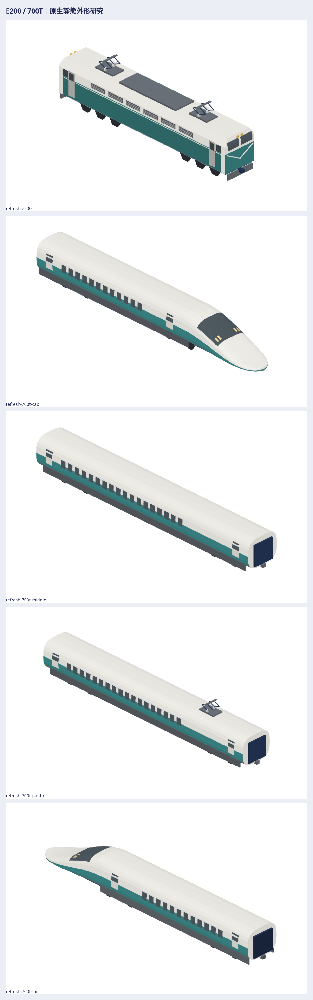

# E200 / 700T：暖白綠松原生外形研究

本批依實際查看的真實照片，獨立製作 E200 與 700T 的靜態模型；不是舊列車車殼改色。照片來源／建模前特徵表／尺寸依據／重建與編組見 [工具交接](../../../tools/train-shape-refresh/README.md)。沒有私有原圖、mesh、貼圖、品牌或個資進公開庫或外部生成服務。

公開／私有 draft PR、最新 head CI 狀態見 [issue #1200](https://github.com/a91453/railway-game-ios/issues/1200)。完整私包：[train-shape-refresh-2026-10-24](https://github.com/a91453/railway-reference-private/tree/codex/train-shape-refresh-2026-10-24/Railway/game-art-previews/docs/art/train-shape-refresh-2026-10-24)。

私包提供7原生／7GLB（5單元、12節編組、1既有風格對照）、49張七向透明PNG、完整預覽、三種材質四視角檢視、同尺度比較、真正初版模型與同相機修訂前後、離線viewer、bounds／三角數、來源／SHA／完整ZIP。`views/`按單元分目錄；`previews/refresh-units.png`與`refresh-audit.png`提供單元／組裝概覽，`blue-cab-before-after.png`是本次初版到最終版，**不是宣稱先前main版本的比較**。

## 外觀結論（與技術測試分開）

| 項目 | 結論 |
|---|---|
| 已符合 | E200雙端、雙前窗、端面收肩、兩架三軸、雙弓；700T兩頭十中、反向尾車、中間無駕駛窗／燈、獨立集電車；暖白綠松霧面，無紅色漆／商標 |
| 已修正並重看 | 鼻尖平切與缺口、曲面色帶鋸齒、風擋過頂、E200前窗背後斜向三角化；輪胎多邊形最低點離軌面問題。真正初版在history/initial |
| 仍不符合精細還原 | 客窗仍是簡化矩形，未完整表現照片圓角；700T燈組與風擋外緣、E200屋頂／車底設備層次仍簡化。因此外觀是可審查靜態研究稿，**不是全部合格或作者已認可** |
| 資料不足 | 700T工程尺寸與完整設備次序、兩車不可見車底細節、另一側精確門窗與設備位置；標為比例推估／補全假設，不當工程尺寸 |

## 技術驗證

**VERIFIED（本輪Linux）**：Swift6.4 build --build-tests、warnings-as-errors、18相關測試；原生逐頂點／色／normal讀回、12節逐頂點組裝、既有模型共存；封閉有向邊／實體正體積、缺面與反面拒收；768玻璃面中心射線至非玻璃承板最遠29.6mm，移開750mm故障拒收；44實際輪胎連通件最低點貼軌面、輪頂外緣向上射線淨空最小106.7mm。Blender4.3.2獨立GLB匯入、bounds／三角數／頂點色／霧面；49七向完整解碼／透明／不裁邊；viewer實際載入／旋轉／縮放／PNG/native/GLB下載、離線與390px版面。ZIP完整解壓／CRC／逐檔bytes比對與實際producer commit另見私包驗證檔。

**UNVERIFIED**：完整設備接觸圖、全表面穿模／閃爍量測、動態輪組／懸吊／車間轉彎、真機Metal、效能、動畫、OS雙擊開HTML。支承／淨空是明定位置的幾何抽檢，不等於全碰撞證明。CI以issue列出的最新head實際狀態為準，不以Linux WebGL代替。

**這次是靜態素材註冊，沒有接入營運映射；即使合併，也不會自動讓遊戲中的E200或高鐵換成這批模型。** 後續整合須按各單元實際長度、共同軌面與組裝表另做，不擅改GameCore、存檔、golden／replay或玩法。
