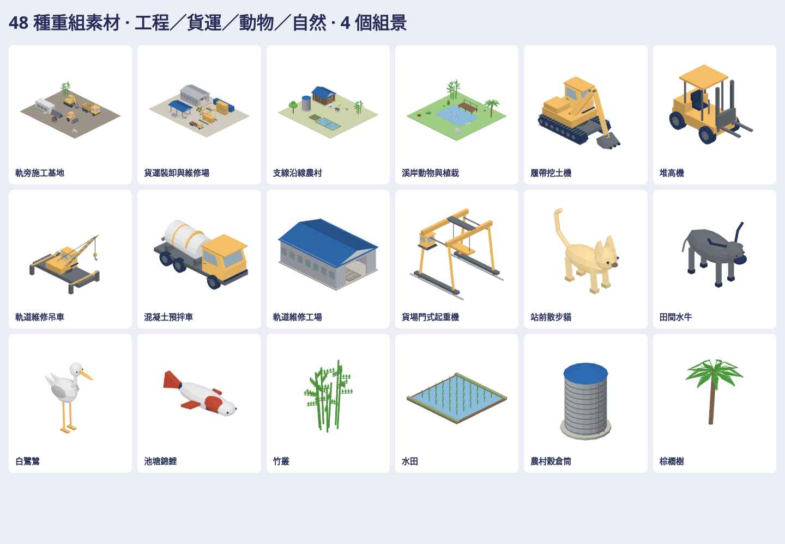

# 工程、貨運與田野素材

48種原生3D素材：工程車12、貨運機廠12、動物模型12、田野自然12。另附施工基地、貨運場、農村、溪岸4個組景；共52個native、52個GLB、364張上／下／左／右／前／後／立體透明圖。兩種貓姿勢分開列，動物模型數不等於物種數。

| 類別 | 素材 |
| --- | --- |
| 工程 | 挖土機、小型挖土機、堆高機、履帶吊車、軌道吊車、壓路機、預拌車、砂石車、維修車、平板車、灑水車、伸縮臂搬運車 |
| 貨運 | 20/40呎貨櫃、開頂櫃、貨櫃工務所、倉庫、維修工場、裝卸棚、門式起重機、電纜盤、儲液桶、管束、輪軸架 |
| 動物 | 散步貓、蜷睡貓、水牛、乳牛、羊、母雞、公雞、鴨、白鷺鷥、麻雀、錦鯉、烏龜 |
| 田野 | 竹叢、蕨、蘆葦、石群、樹樁、闊葉樹、棕櫚、菜畦、水田、穀倉筒、農具倉、木棧台 |

入口：`Map3DWorksKit.model(for:)`、`Part.mount`／`connectors`、`Map3DModelPack(worksKit:)`。按需要生成，未加入standard常駐。靜態模型不包含吊運／動物行為模擬。錦鯉水位接點在native z=.13；貨櫃堆疊接點在z=2.6。此為遊戲造型與比例，不是工程圖、機具操作或安全規格。

私有來源改造：讀取procedural_assets內Excavator、Forklift、Shipping Container、Maintenance Workshop、Cat、Cow、Crop Row、Bamboo Grove的factory；採用分件與建模做法，重組成較短的偏置駕駛室、折臂、獨立機廠配置、長身散步／蜷睡貓、水牛角、實體葉片與台灣水田。尺寸、部件配置、拓樸與顏色重新建置，無原始factory／模型／品牌貼圖原樣複製。原始SHA、逐件對照與尺寸變化保留私有庫。

大型成品：[私有素材分支](https://github.com/a91453/railway-reference-private/tree/codex/works-assets-2026-10-21/Railway/game-art-previews/docs/art/works-kit-2026-10-21)。公開只保留配方、工具、測試、本總覽與小型驗證紀錄。

重建及取用：[工具說明](../../../tools/works-kit/README.md)、[Claude指引](../../../.claude/skills/works-kit/SKILL.md)。沿用既有Swift／Metal架構，不加依賴、不改存檔或地圖選型。

VERIFIED與UNVERIFIED結果見 [verification.json](verification.json)。原生與WebGL檢查不代表真機Metal；原作的瀏覽器並排畫面、地圖擺放／碰撞／動畫仍需在採用前驗證。
