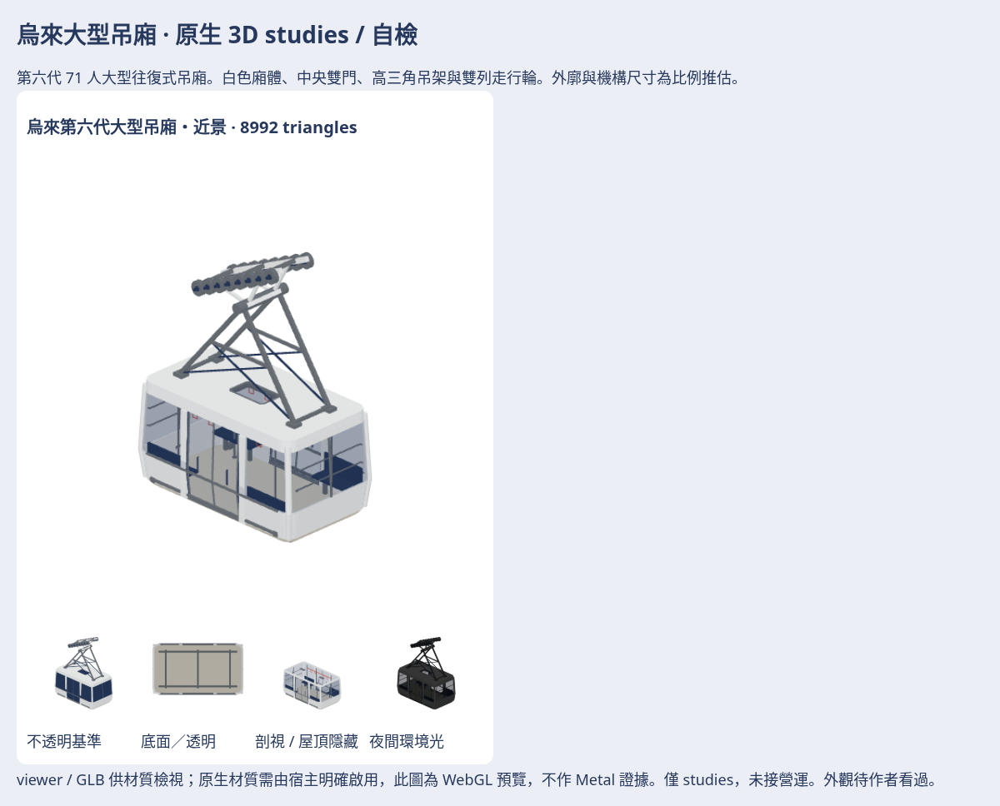

# 烏來大型纜車吊廂 · 原生3D studies

第一輪現行第六代白色71人大型往復式吊廂，近景8,992、LOD3,744三角。含封閉廂殼／普通實心底板、中央雙門、透明窗與真正屋頂天窗、側邊短座椅／護欄／握環／發光燈、高三角吊架、雙列走行輪與索線接點。容量依新北市2026年更新資料；外廓4.80×2.68×2.56m、門寬及所有機構尺寸仍是**比例推估**，完整對照見 [SOURCE](SOURCE.md)。

原生M3DM／GLB、日夜七向、診斷圖、離線viewer與來源在私庫 `game-art-previews/docs/art/ferry-2026-11/wulai-cabin-studies/`。重建與檢查命令見 [producer](../../../tools/wulai-cabin-studies/README.md)。只留最新模型／viewer，沒有history或ZIP。

自檢：側／正／俯／斜、背面／底面、近／遠景均看過。輪廓從小型八人廂改成長車廂，保留白色大面、中央雙扇玻璃門、高吊架與輪列；依車內照片補側邊座椅、端窗欄杆及屋頂開孔。沒有把透明面貼在不透明屋頂上，也沒有把玻璃底板套到烏來。

還不像／資料不足：圓角與真型材以簡化曲面／管件近似；底部設備、精確輪系、制動器內構及另一側門的細節未取得原廠圖；兩側配置與尺寸有補全推估。沒有旅客、開門／折椅／走行／擺動動畫。玻璃沒有折射與物理厚度光學。

VERIFIED（Linux Swift6.4）：WAE build、30項相關XCTest、10項實際幾何與故障反例、8項GLB封裝測試；真Swift loader全頂點／色值／glow／glass讀回與opt-in保護、完整GLB重建及SHA、42張512² RGBA透明PNG解碼與留白；Blender4.3.2獨立匯入的三角、材質、頂點色、world bounds／轉軸。Chromium自含HTML在關網context載入、28個日夜方向組合、燈旗標／透明／剖視改像素、拖曳縮放、下載SHA、390px均檢查。

UNVERIFIED：此環境封鎖file://直接開啟（已驗同份HTML關網可用，無外部請求）；本輪Metal結果以CI實跑為準；完整遊戲夜景、iOS真機效能、作者外觀接受、載重／碰撞／站台間隙與營運接入。Linux的WebGL出圖不算原生Metal。

只做素材，沒有改renderer、standard、營運模型映射、GameCore、存檔、golden／fixtures或決策號。維持雙庫draft，不合併、不auto-merge、不TestFlight；作者看過這輪後再決定是否續修。
