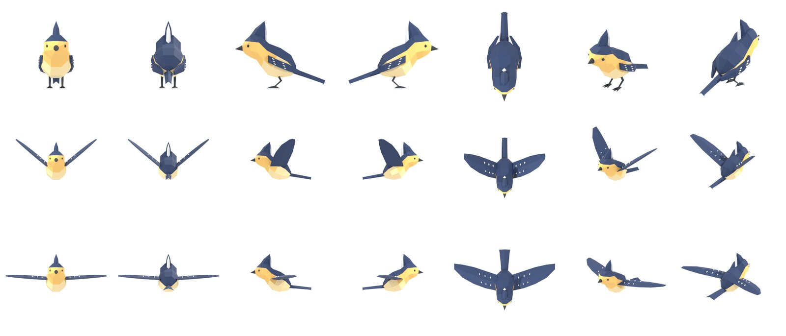

# 3D 黃山雀（決策 889）

由上到下：停在月台上、翅膀往上拍、滑翔。七個方向都看得到（正、背、左、右、俯、斜前、斜後），遊戲角度、平光、色票平塗。翅膀往下拍的姿勢沒有放進總覽。

- 做的：本地工作室，照片對照審查四輪，第 3 版通過（railway-assets-private-2 #111）。外側翅膀照協調者的定案，用藏青色票，不用照片裡比較亮的藍。
- 重檔（4 個 GLB、七向圖、遊戲大小圖、各輪紀錄、比對用照片與來源）：`a91453/railway-assets-private-2`，`game-art-previews/docs/art/yellow-tit-2026-11/`（revision-3）。照片只放那裡，不進這個 repo。
- 轉進遊戲：`tools/train-models/glb_to_swift.py --scale 6`，材質順序寫在 `Sources/GamePresentation/Map3DYellowTit.swift`。真的黃山雀約 13 cm，在遊戲鏡頭下不到一個像素，所以放大 6 倍，約鴿子大小。

## 還有哪裡不好

1. 放大 6 倍，站在月台的乘客旁邊看得出比真鳥大很多。
2. 近看是低面數，冠羽有稜角。
3. 飛行沒有前後傾，只換翅膀姿勢。
4. 降落和起飛都是直接換模型，沒有中間的動作。
5. 還沒在 iPhone 上看過。
