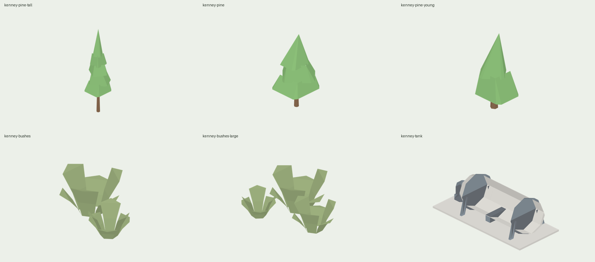

### 458. Kenney 的針葉樹、灌木叢與臥式儲槽進 3D 地圖

2026-10-28，實作 session_01YGNNumn3Z1c2uwU1rDrTk5（`claude/kenney-trees-tanks`，派工單 BN）。號碼依 #1041：決策 458；存檔版本、golden schema 不動；只改 GamePresentation（展示層）、App 讀模型檔的一行、App 的資源與 Xcode 專案、測試與 `tools/`。GameCore、存檔、GoldenScenarios、SaveFixtures、ReplayFixtures 不動。

**為什麼**：3D 地圖的山區只有地面的樹林色、沒有樹；站前廣場與沿線空地是空的；工廠空地只有磚廠自己的立式儲槽。免費素材試做（派工單 BJ，`docs/research/FREE_ASSETS_TRIAL_KENNEY_2026-10-28.md` §6）挑出 Kenney（CC0）Nature Kit 的 `tree_pineTallA`、`plant_bushLarge` 與 City Kit (Industrial) 的 `detail-tank`；試做只換了色，這次照 `.claude/skills/art-style/SKILL.md` §7 改形狀後才進遊戲。

**做了什麼**：

1. **改形與轉檔**（`tools/kenney-props/`）：`reshape.mjs` 讀試做烘好頂點色的三個 GLB（`source/`，來源與 zip 雜湊見 `SOURCE.md`），做出六件：
   - 針葉樹三款：取原件三層樹冠的三角形，換成自家六角樹幹，重疊成五層（`pineTall`，12.5 m，柳杉、杉木的人工林）、三層較寬（`pine`，7.7 m，二葉松）、兩層（`pineYoung`，5.0 m），每層縮放與轉角不同。
   - 灌木叢兩款：原件兩叢（`bushes`）、三叢（`bushesLarge`），大小、轉向不同，腳埋進土裡 0.1 m。
   - 臥式儲槽：罐身拉長 2.4 m、改白，加混凝土墊與中間鞍座（`tank`，9.8 × 4.4 × 3.3 m）。
   - 沒有面積的三角形不寫（glTF-Validator 會擋：拉長的儲槽有兩個）。`build.sh` 用 `tools/glb-to-m3dmodel/bridge.mjs` 轉成 `RailwayGameApp/Resources/Models/kenney-*.m3dmodel`，重跑逐位元相同。
2. **模型包**（`Map3DSceneryProp`，`Sources/GamePresentation/Map3DSceneryProps.swift`）：`Map3DModelPack.standard` 在 `Map3DProp` 後面加六個程式做的替身（圓錐、`addLump`、方塊），尺寸和檔案的一樣；App 讀檔後用 `pack.replacing` 換成檔案的模型（同城市公車，索引不變）。讀檔時樹冠（`Map3DPalette.crown`）與灌木（`embankment`）的頂點改成 alpha 0，由實例給顏色：針葉樹四種偏藍的深綠（`coniferGreens`），灌木三種（`bushGreens`）；其他顏色過 `Map3DLook.colour`。
3. **放在哪**（都是 `Map3DInstance.prop`，只畫在近景的 chunk）：
   - **針葉樹**（`addConifers`）：底圖 `wood` 覆蓋的每個 64 m 格，2 × 2 個雜湊點，地面海拔（`drawnGround`）400 m 以下沒有，往上線性增加，1,400 m 以上 85% 的點有樹（`coniferShare`）；不在水上、不在路邊 2 m 內、不在軌道格。45% 高的、35% 中的、20% 小的，縮放 0.8–1.25。
   - **站前灌木**（`addStationBushes`）：每座站房正面外 4 m，靠兩角各一叢大的、再往外各一叢小的；`isClear` 檢查 3.4 m 見方不碰軌道、月台、道路。
   - **沿線灌木**（`addBushesBesideTrack`）：軌道格旁邊有底圖 `grass` 的格，每格最多兩叢（各 70%），離路 3 m 以外，不在車站、地標、轉車台的格。
   - **工廠儲槽**（`addYardTanks`）：棚廠與鋸齒廠（`addFactory` 的 kind 0、1）在廠房沒占的那一側、後半，空間夠就一到兩個；地塊要 ≥ 20.8 m（避開前面的辦公室），只在近景加。
4. **省電畫質**（`.saving`）：灌木叢和小的街道設施一起不畫（`Map3DProp.modelsLeftOut`）；針葉樹與儲槽照畫。
5. **出處**：資料來源頁「3D 地圖」一節加 `kenney`（Nature Kit、City Kit (Industrial)、CC0 1.0 的連結）。

總覽是檔案本身的顏色（樹冠在遊戲裡換成實例的綠）；七向圖在素材庫 `a91453/railway-assets-private` 的 `game-art-previews/docs/art/kenney-scenery-2026-10-28/`。

**量到的**（Linux）：

- 模型包：`standard` 529 → 535 個模型，頂點 3,127,704 → 3,128,658（替身 954 個）；App 換成檔案後六件共 920 個三角形、2,760 個頂點，每份 110,400 bytes（記憶體一份、GPU 一份）。六個 `.m3dmodel` 共 52,172 bytes。
- 阿里山（約 2,200 m，`Map3DSceneryPropsTests`）的場景：7,278 棵針葉樹，一個 512 m chunk 最多 219 棵，約 23,000 個三角形；試過 3 × 3 個點，一個 chunk 491 棵、約 67,000 個三角形，A12–A14 太重，改 2 × 2。台北車站周圍（海拔幾公尺）沒有。

**五方**：

- 玩家：山線看得到一片針葉林，車站前有綠意，工廠一眼看得出來；省電畫質拿掉灌木，不拖累舊手機。
- 鐵道迷：阿里山線、南迴、宜蘭線山段兩旁的柳杉與二葉松林，高度門檻照台灣的植被帶（低海拔是闊葉與竹林，所以 400 m 以下不放）；站前植栽與沿線雜木是台灣車站常見的樣子。
- 開發：模型檔讀不到時用同尺寸的替身，畫面與邊界不變；實例畫、一個 chunk 最多約 23,000 個三角形；不加依賴，glTF-Validator 只在本機跑過（加進 CI 屬於加依賴，等規劃回覆）。
- 美術：照 §7 重組形狀，不是原件換色；樹冠與灌木由實例換綠，同一片林子不會一個顏色。
- 音樂：無。

**沒做的**：glTF-Validator 進 CI；底圖 `wood` 以外的山坡（草地、灌叢）上的樹；闊葉樹與竹林（Kenney 有，但這次只派針葉樹）。
