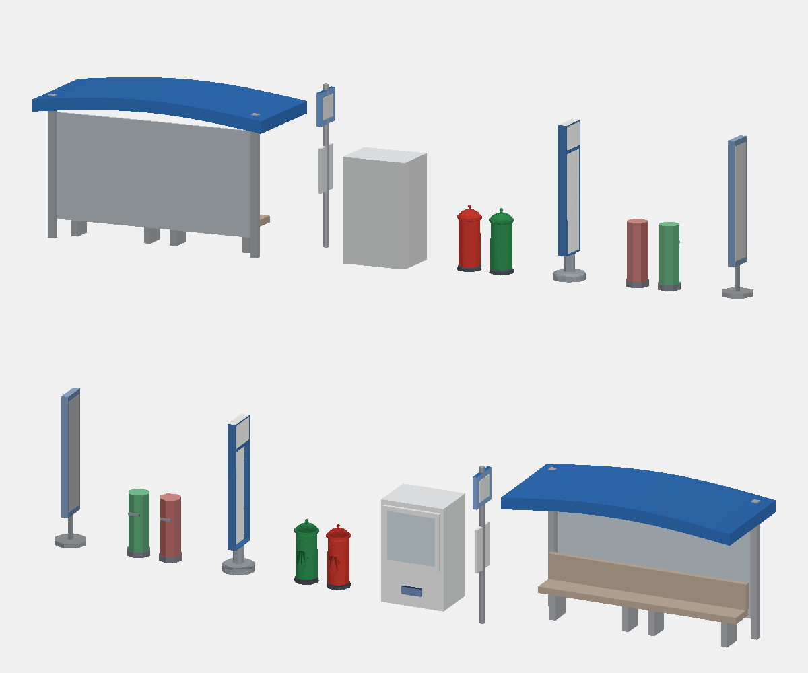

### 467. Meshy 第一批街道小物進 3D 地圖、簡化器補三件、glTF-Validator 進 CI

2026-10-28，遊戲規劃 session_01YGNNuknN8czzHmJ7zU9h3R 派工（派工單 BO），實作 session_01YGNNuqASY5sxbk5kKzVByD（`claude/meshy-batch-1`）。號碼依 #1041：決策 467；存檔版本、golden schema 不動。只改 GamePresentation（展示層）、App 的資源與 Xcode 專案、測試、`tools/` 與一個新的 Linux workflow；GameCore、存檔、GoldenScenarios、SaveFixtures、ReplayFixtures 不動。**10/31 後合**（10/29–30 修 bug）。

**為什麼**：作者在 `a91453/railway-assets-private` 的 `meshy-batch-2026-10/` 用 Meshy 生成了一批街道與鐵道小物（決策 437 已經用了其中的垃圾車與資源回收車）。派工要：照決策 458 的接法、art-style §7 的檢查，挑最常出現在畫面、三角形合理的幾件接進 3D 地圖，標明是 AI 生成；`Map3DMeshSimplifier`（決策 420）接到畫面前要補的三件；glTF-Validator 進 CI；meshoptimizer 只研究。列車不用 Meshy、不用自動簡化（有配方的列車自己做遠景版，決策 420、422、426、432、433）。

**做了什麼**：

1. **挑哪幾件**：每個公車站都會出現的東西。
   - `mailbox-green`（郵筒）：一個形狀做成紅綠一對（台灣的限時與普通郵筒並排），放在三成的公車站旁。
   - `bus-stop-pole`（站牌）：人行道太窄（2 m，`tertiary`）、放不下候車亭的站，改立一支站牌；這種路每 260 m 一站，是街上最常看到的站。
   - 沒選：`mailbox-red`（一對用一個形狀就夠）、機車（決策 446 已有原生的）、腳踏車（輻條一簡化就碎）、燈籠、夜市攤、號誌（已有程式做的）。留在「下一步」。
2. **轉檔**（`tools/meshy-props/build.mjs`，讀素材庫 `glb-hq/` 的高模）：
   - 每個三角形用 `tools/glb-to-m3dmodel` 的取樣烤出貼圖顏色，依配方分到遊戲的顏色：郵筒的綠與紅（`0x2E8B4E`、`0xC8382E`）、投信口與門（同色深一階）、底座；站牌的白面、藍框（`0x3F6FA8`，接近候車亭頂的 `Map3DPalette.canopy`）、鋼柱。原件貼圖斑駁，郵筒只算正面的深色。
   - 轉向：郵筒投信口朝 +y（馬路），站牌薄邊沿 x（牌面朝來車）。
   - 用 meshoptimizer 1.3.0 的 `simplify`（`tools/glb-to-m3dmodel/package.json` 已經釘的版本，MIT）以公尺為單位的誤差上限簡化：郵筒 433,504 → 862 個三角形（上限 6 mm 先到），一對 1,724；站牌 84,268 → 300（上限 10 mm）。
   - 新三角形的顏色由面上 21 點投票，每點取最近的原件三角形（大面先撒點）；深色部分要三分之二的點落在上面才上色，細長三角形不會畫出尖刺。
   - 檔頭 provenance 寫 `ai_generated`、Meshy 的任務編號、模型（meshy-7.1）、credits、原件 SHA-256 與配方（Meshy 條款 §2.4）。生成記錄也加進 `tools/meshy/generated.json` 與 `models.json`。重跑逐位元相同。
3. **模型包與擺放**（`Map3DSceneryProp`，決策 458 的接法）：加 `postBoxes`、`busStopPole` 兩個 case，`Map3DModelPack.standard` 多兩個程式做的替身（圓柱與方塊，同尺寸），App 讀到 `Resources/Models/meshy-*.m3dmodel` 就換成檔案的模型（App 的程式不用改，`pack(_:files:)` 走 `allCases`）。`Map3DRoadMarkings.addStreetStops`：
   - 人行道 ≥ 2.5 m 照舊放候車亭；更窄的站在路緣外 0.45 m、站前 1.5 m 立站牌。
   - 三成的站（`postBoxShare`，雜湊 salt 358）在人行道後緣、站前 3–3.4 m 放一對郵筒，投信口朝馬路。
   - 省電畫質（`.saving`）和候車亭、販賣機、灌木一起不畫。
4. **AI 生成怎麼標**：資料來源頁「3D 地圖」一節原有的 `meshy` 一條（公車、垃圾車、資源回收車）加上「人行道上的郵筒與公車站牌」，兩種語言都寫「用 AI 依描述生成的模型，經過簡化並換成遊戲的配色」，連到 meshy.ai。檔案的 provenance 也記著。Meshy 的條款 §3.2：付費方案生成的輸出屬於作者；§2.6：不拿來訓練對手模型（這裡沒有）。
5. **`Map3DMeshSimplifier` 補三件**（決策 420 的「下一步」；`Map3DMeshSimplifier.version` 2）：
   - **誤差上限**：`simplify(_:targets:areaWeighted:maxError:)` 與 `Model.simplified(to:maxError:)`。每個點另存一個不含縫的、以面積加權的二次誤差（表面本身），收縮後表面移動的均方根距離超過「包圍盒最長邊 × maxError」就不收。遊戲建議值 `recommendedMaxError` = 0.005（12 m 的公車約 6 cm）。
   - **單面板不被收掉**：開放的邊（只有一個三角形）上的點，兩條縫邊轉角超過 20° 就鎖住（`straightSeam`），只能沿直的縫滑；面板的四角留著，整片面板不會縮成一條線。
   - **背景建好、在裝置上快取**：新的 `Map3DSimplifiedCache`（folder）。`versions(of:shares:maxError:)` 先找快取，沒有就在 `Task.detached(priority: .utility)` 簡化、原子寫入。key 是模型所有頂點欄位的 FNV-1a 64、比例、上限與簡化器版本，所以模型、參數或簡化器一改就重做；檔頭 `M3DL`、格式 1，讀不懂（截斷、別的格式）就重做並覆寫。快取不是遊戲狀態，系統清掉只是重算一次。
   - App 還沒用簡化器畫東西（決策 420 的結論不變：先量，列車自己做遠景版），這三件讓之後接到畫面時有安全的版本可用。
6. **glTF-Validator 進 CI**：作者把要不要加交給五方評估，遊戲規劃 2026-10-28 在 #1041 決定加，限定範圍：
   - Khronos 的 npm `gltf-validator` 2.0.0-dev.3.10（Apache-2.0），版本與 lock 釘在 `tools/gltf-validate/`。
   - 獨立的 Linux 小 job（`.github/workflows/gltf-validate.yml`）和 Swift 並行，只在 GLB、glTF、`tools/glb-to-m3dmodel/`、`tools/kenney-props/` 或 `tools/gltf-validate/` 改動時跑，不用 macOS。
   - 查 repo 裡全部 35 個 GLB／glTF，Linux 0.6 秒（目標 1 分鐘內；超過 2 分鐘就拿掉 CI 改回本機）。有錯誤就紅；原樣保留的 5 個檔已知的錯誤寫在 `known.json`，各附理由（Kenney 的 3 棵樹的非根節點、`detail-tank.glb` 六個零長法線、轉檔器測試檔 `tiny.glb` 刻意沒寫 bounds）。別種錯誤、別的檔有錯照樣紅。
   - 這次的兩件 Meshy 原件不在這個 repo，在本機查過：`mailbox-green`、`bus-stop-pole` 都是 0 錯誤 0 警告。

總覽是檔案本身的顏色（遊戲讀檔時再過 `Map3DLook.colour`）。左到右：公車亭、販賣機（現有，程式做的）、郵筒一對、站牌（Meshy）、兩件的替身。

**量到的**（Linux x86_64）：

- 模型包：`standard` 583 → 585 個模型，頂點 3,332,082 → 3,332,580（替身 498 個）；App 換成檔案後兩件共 2,024 個三角形、6,072 個頂點，每份 242,880 bytes（記憶體一份、GPU 一份）。兩個 `.m3dmodel` 共 108,560 bytes。`Map3DModelPackSizeTests` 的數字照這個改，沒有放寬上限。
- 一個 `tertiary` 站：站牌 300 個三角形；有郵筒的站再加 1,724。主要道路的站：候車亭照舊，三成加郵筒。測試的 6 km 路：`tertiary` 至少 18 支站牌，郵筒介於站數的 1/8 與 1/2。
- 簡化器（決策 420 的低地板公車，2,212 個三角形，簡化到 25%）：
  - 舊版：954 個三角形，白色側板 203.29 → 0.42 m²；通勤車頭、特快車廂整片面板不見。
  - 新版（鎖轉角、沒有上限）：最低約 1,243（56%）；通勤車頭 1,574、特快車廂 1,686，每種顏色留 ≥ 98.6% 面積。
  - 上限：深色 `ff342e2b`（8.46 m²）沒有上限時 0，0.02 時 1.18，0.01 時 5.60，0.005 時全留（1,375 個三角形）。小零件 `ffd6c8c4`（0.44 m²）還是會不見。
- glTF-Validator：35 個檔 0.6 秒；兩件 Meshy 原件各 0.2–0.4 秒。

**meshoptimizer（MIT）研究**：

- **能不能用**：MIT，C++ 原始碼與 npm 的 WebAssembly 版；`tools/glb-to-m3dmodel` 早已釘 1.3.0（決策 458 的轉檔器讀 `EXT_meshopt_compression`）。這次只在電腦上的轉檔工具裡用，App 沒有加任何依賴。要在 App 裡用得把 C++ 原始碼加進 Swift package（新的 target、C++ interop、Linux 與 iOS 都要編），屬於加依賴，由作者決定。
- **效果**：同一台公車、以位置與顏色焊點（顏色交界是縫），上限 6 cm 時 1,154 個三角形，小零件 `d6c8c4` 留 27%；自家簡化器同上限 1,375、`d6c8c4` 0%。meshoptimizer 收得多一點，也保住一點小零件；兩者都會吃掉細小的零件。上限放到 20 cm，meshoptimizer 也讓 `d6c8c4` 全沒。
- **代價**：公車 3–5 ms（Node 的 WASM 版）；43 萬個三角形的郵筒約 1.2 秒（自家簡化器是給遊戲裡幾千個三角形的模型用的，沒有拿 43 萬的去跑）。自家簡化器決策 420 量的是整包 204 個模型三級 4.6 秒、最慢 0.135 秒。
- **結論**：電腦上的轉檔（Meshy、Kenney 這種幾萬到幾十萬面的原件）用 meshoptimizer；App 裡沿用自家簡化器（不加依賴，結果逐位元決定、跟著顏色縫走），等真的要在裝置上簡化大量模型、又嫌它慢，再問作者要不要把 meshoptimizer 加進 package。

**五方**：

- 玩家：街角的公車站有站牌、郵筒，看起來像台灣的街；省電畫質一樣拿掉，不拖舊手機。
- 鐵道迷：台灣的市區公車站多數是一支站牌，候車亭只在寬的人行道；紅綠郵筒並排是台灣街景的記號（台灣真的郵筒是方柱圓頂，這批 Meshy 原件是圓柱，算風格化，之後可重生成）。
- 開發：照決策 458 的接法，App 不改程式；讀不到檔用同尺寸替身；兩件 2,024 個三角形，模型包只多 498 個頂點；validator 0.6 秒、只在模型改動時跑；不加 App 依賴。
- 美術：照 §7 換成遊戲色票、平塗、和現有公車亭與販賣機並排看過；投信口與門用同色深一階，不畫成黑洞與尖刺；Meshy 原件的斑駁貼圖不帶進來。
- 音樂：無。

**下一步**：

1. 這批其他的街道小物（燈籠、夜市攤、腳踏車、消防栓、垃圾桶等）照 `tools/meshy-props/` 加配方；腳踏車要先想好細輻條怎麼簡化（可能只留輪圈）。
2. 郵筒的形狀：台灣郵筒是方柱圓頂，可用 Meshy 重生成（作者的帳號）再跑一次工具。
3. 簡化器接到畫面：用 `Map3DSimplifiedCache` 給非列車的模型（建築小物、站房）建遠景級，照 #1271 的設備級選等級；先量 A12–A14 的建包時間與記憶體。
4. 小零件保護：面積小、顏色獨特的零件（`d6c8c4` 這種）在任何上限下都會被收掉，要的話加「每種顏色至少留一個三角形」的規則。
