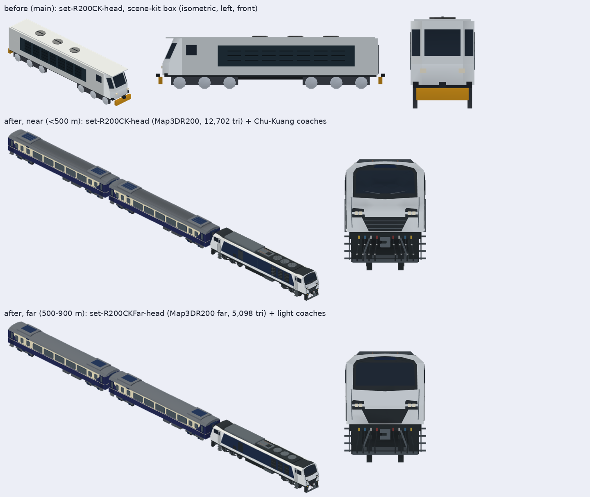

### 529. R200 莒光號的機車改用 #1589 的原生 R216

2026-11-01，派工單 R200IN（session_01YGNNumMoJMjafUzBC43vWz，遊戲規劃第 39 任 session_01YGNNupwLVxuPiWcrdA6NPs 派），分支 `r200-native-in`。作者：「幫我接入 R200」。GameCore、存檔版本、golden schema、SaveFixtures、ReplayFixtures 都不動。

## 原因

#1589（Codex，已合併）做了臺鐵 R200／R216 的原生近景與遠景（`Map3DR200`，近 12,702、遠 5,098 個三角形），但只放在 `Map3DModelPack.studies`，遊戲裡的 R200 莒光號（`TrainType.r200ChuKuang` → `R200CK`，決策 252）還是 scene kit 的舊方塊配方（`Map3DTrainLocomotive.r200`，1,174 個三角形，16.4 m，一端駕駛室）。

## 做法

- `Map3DTrainSet.r200Hauled`（`Map3DTrainSets.swift`）：照 `e500Hauled`（決策 425）的做法，`R200CK` 的機車換成 `Map3DR200.model()`，`R200CKFar` 換成 `Map3DR200.model(far: true)`；客車（決策 430 的莒光號自動門客車與它的遠景版）、查表與退回方塊的規則都不變。
- `ownLengths: true`：機車照它自己的 20.01 m（連結器到連結器），不再拉成客車長。
- R216 兩端都有駕駛室，頭燈鏡片兩端都有；用現成的 `Map3DTrainSet.litLenses(_:front: true)` 只把前端（+X，三風扇散熱那端，30 % 內）的頭燈標成發光，決策 449 再每幀決定亮頭燈或尾燈。`Map3DR200` 的配方不改，所以 studies 裡兩個 `tra-r200-r216-locomotive*` 的雜湊不變。
- 舊的 `Map3DTrainLocomotive.r200` 與只有它用的 `fans(at:colour:)` 刪掉；別的機車（R100、R135、E200、E500、E1000、CT273）不動。

## 數字

| | 改前 | 改後 |
| --- | --: | --: |
| `set-R200CK-head` 三角形 | 1,174 | 12,702 |
| `set-R200CKFar-head` 三角形 | 1,174 | 5,098 |
| 標準模型包頂點 | 4,311,516 | 4,357,932（+46,416，一份約 +1.9 MB） |
| 模型包記憶體（`testWhatTheMapKeepsInMemory`） | 約 172.5 MB | 174.3 MB |

`hashes.lock.json` 只改了 `set-R200CK-head`、`set-R200CKFar-head` 與它們的窗模型 `light-set-R200CK-head`、`light-set-R200CKFar-head` 四行；`check.mjs --new-set R200CK` 通過（客車的遠景比例照舊是 grandfathered）。近景 12,702 在一節 20,000 內；遠景 5,098 少於近景一半。

## 對照圖

`tools/train-models/render.mjs` 的日光預覽（WebGL，遊戲的模型光，不是 Metal）：上排 main 的舊 R200；中排近景（500 m 內）的 R200 接兩節莒光號客車與正面；下排遠景（500–900 m）的 R200 接兩節遠景客車與正面。編組用 `assemble.mjs` 擺（頭車 0、客車 −20.005 m、−40.005 m）。完整七向與 viewer 是同一個模型，在 `a91453/railway-assets-private` #37 的 `game-art-previews/docs/art/tra-r200/revision-2/`。

## 五個角度

- 玩家：R200 莒光號從方塊車變成看得出是 R200 的白藍雙駕駛室機車，近看與遠看都是同一台。
- 鐵道迷：R216 的一般白／深藍塗裝、Co′Co′ 12 輪、三風扇、兩端駕駛室，比舊的一端駕駛室更接近真車（來源與限制在 `docs/art/tra-r200/README.md`）。
- 開發：只換一個 set 的頭車，照 E500 已驗過的路；模型包多約 1.9 MB，實機幀數 UNVERIFIED（決策 417）。
- 美術：霧面平塗、一個三角形一個顏色，與其他原生車一致；遠景同框、同色。
- 音樂：無。

## 下一步

- 真機外觀與幀數等 TestFlight（UNVERIFIED）。
- R216 的正式端號、反側與車底照仍是 #1589 README 列的缺口。
