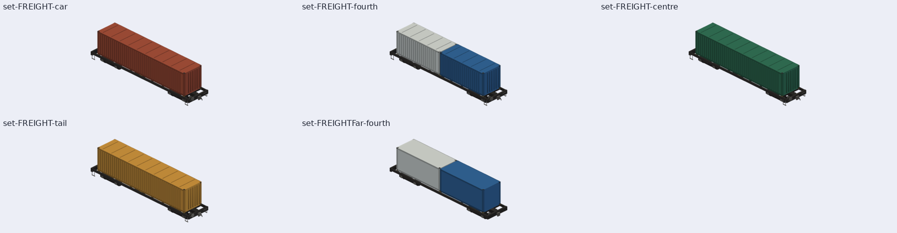

### 539. 貨運線的列車畫成 R200 牽引貨櫃平車；R200 莒光號不再新買

2026-11-01，派工單 R200FRT（session_01YGNNuonXtGdPvnYAFgUqs9，遊戲規劃第 41 任 session_01YGNNunAdcksLhSB1H1495m 派），分支 `claude/r200-freight`。作者：「實際 R200 不載客，所以應該不用牽引莒光號，而是當作貨運列車的預設才對」。GameCore、存檔版本、golden schema、SaveFixtures、ReplayFixtures 都不動。

## R200 的真實用途

- 台鐵說 R200 配置在花蓮與彰化機務段，負責東部與西部幹線的貨運，另外承擔軍運、救災與蘇花改土方運送（[Taiwan News 5892894](https://www.taiwannews.com.tw/news/5892894)、[公視 679672](https://news.pts.org.tw/article/679672)）。
- 2020 年環島電氣化完成後，客運不再用柴電機車牽引。2024-06 R200 在花蓮「模擬拖拉普悠瑪」是試車，不是載客營運（同上公視、[FTV 2024-06-19](https://english.ftvnews.com.tw/news/2024619W04EA)）。
- 所以決策 252 的「莒光號（R200 柴電機車）」不寫實；R100 莒光號（R100 曾牽引客車）與藍皮解憂號照舊。

## 做法

1. **貨運線的車在 3D 畫成 R200 ＋ 貨櫃平車**（`Map3DTrains.frame`）：`ServiceLine.isFreight` 的列車（`TrainLook.freight`）不論型別，`trainType` 用 `Map3DTrainSet.freightKey`（`"FREIGHT"`），不再只畫灰方塊。900 m 外照舊是方塊，顏色照舊是貨運灰。
   - 編組 `Map3DTrainSet.freight(far:)`（`Map3DTrainSets.swift`）：車頭是 R200（決策 529 的 `Map3DR200`，前端燈亮），後面是 `Map3DContainerWagon`（新檔），`ownLengths`，貨物照 `cycle [.middle, .fourth, .centre]` 從兩端往中間輪：40 呎鐵鏽紅、20 呎藍加淺灰兩只、40 呎深綠；最後一節是 40 呎赭黃、尾端有紅色尾燈。
   - 車頭**借用** R200 莒光號的模型（新的 `Map3DTrainSet.headOf`：`headName` 指向 `set-R200CK-head`／`set-R200CKFar-head`，`models()` 不再放一份），模型包裡 R200 只有一份；`Map3DModelPack.farModel` 改用 `Map3DTrainSet.unit(of:)` 認得借來的車頭，遠景照樣一節換一節。
   - 貨櫃平車的鋼料用暖灰：冷灰的明暗會被 `Map3DTrainLights.isGlass` 認成車窗玻璃，夜裡會亮（測試釘住沒有玻璃色）。
2. **R200 莒光號不再出現在新買車的選單**：`GameWorld.offeredTrainTypes`（GamePresentation，`Scenarios.swift`）濾掉 `TrainType.withdrawnFromSale`（`[.r200ChuKuang]`），展示間、線路買車、型別選單都跟著。GameCore 的 `TrainType.offered`、`TrainTypeCatalog` 的列不動，舊存檔的 R200CK 照讀、照跑、外觀不變；已是 R200CK 的列車，它的型別選單把自己的型別列在最後（`trainTypeMenuChoices(for:)`）。關卡自己列的型別（`scenario.trainTypes`）不受影響，目前沒有關卡列 R200CK。
3. **汽笛**：`TrainHorn.of(_:in:)`，貨運線的列車吹柴油機車的三音汽笛（它畫的是 R200），其餘照 `of(_:)`；`GameSession` 的按鈕與自動鳴笛都改用它。
4. **2D 不加機車頭記號**：貨運灰照舊（理由見下）。

## 貨櫃平車的來源（gap）

參考庫沒有台鐵貨車：`Railway/taiwan-rail-reference-clean/source/rail-3d/assets/garage-blender-v1/` 的 62 款都是客車、動車組與機車，`Railway/world-rail-reference-clean/source/data/` 的 12 座城市也只有客運。所以平車是本專案自己做的：

- 貨櫃照 ISO 668：40 呎 12.192 × 2.438 × 2.591 m，20 呎 6.058 m。
- 平車尺寸是估計（沒有台鐵貨櫃平車的公開圖面）：連結器到連結器 14.2 m、櫃底離軌面 1.12 m、兩軸轉向架中心距 9.5 m、軸距 1.9 m、車輪 860 mm、軌距 1,067 mm。骨架式車底（中樑、側樑、端樑、枕樑、橫樑）、貨櫃角座、連結器、風管、手煞車輪、踏階與扶手、制動缸與風缸。
- 沒有標誌、字樣或公司塗裝。

## 數字

| | 三角形（近／遠） |
| --- | --: |
| `set-FREIGHT-car`（40 呎） | 3,260／992 |
| `set-FREIGHT-fourth`（20 呎兩只） | 3,668／1,256 |
| `set-FREIGHT-centre`（40 呎） | 3,260／992 |
| `set-FREIGHT-tail` | 3,284／1,016 |
| R200（借用 `set-R200CK-head`） | 12,702／5,098 |

- 一節都在 20,000 內，遠景都少於近景一半、同框（長、高）、顏色是近景的子集。
- 標準模型包 674 → 682 個模型，頂點 4,445,868 → 4,499,052（+53,184，一份約 +2.1 MB）；`testWhatTheMapKeepsInMemory` 的模型 180.0 MB。
- `hashes.lock.json` 只多 8 行（`set-FREIGHT*`），別的行沒變；`check.mjs --new-set FREIGHT` 通過。

## 五方

- 玩家：貨運線一眼看得出是貨物列車（柴電機車拉貨櫃），不再是一串灰方塊；買車選單不再出現不存在的「R200 莒光號」，舊存檔的車照常。
- 鐵道迷：R200 的真實任務是貨運（台鐵公告、公視、Taiwan News），電氣化後客運不用柴電機車；貨櫃尺寸照 ISO 668，平車尺寸是估計，已列為 gap。
- 開發者：只動 GamePresentation，GameCore、存檔、golden、replay 不動；R200 模型借用不複製，記憶體只多 2.1 MB 一份；不論玩家買哪個型別都同一組編組，規則簡單、測試好釘。
- 美術：照畫風霧面平塗、一個三角形一個顏色；三種貨櫃顏色交錯，避免一長串同色；平車用暖灰鋼，夜裡不會誤亮成車窗。
- 音樂：貨運列車改吹柴油三音汽笛，聲音和畫面的 R200 一致；沒有新的音檔。

### 2D 要不要加機車頭記號

不加。2D 的列車是線色（貨運灰）的小方塊，加一個頭的記號要動 `TrainMotion`／2D 繪圖，畫面又小，玩家從灰色就分得出貨運；3D 才是看車的地方。

## 對照圖

完整七向（日、夜）在 `a91453/railway-assets-private` 的 `game-art-previews/docs/art/freight-r200-2026-11-01/revision-1/`。

## 驗證

- VERIFIED（Linux，Swift 6.4）：`swift build --build-tests -Xswiftc -warnings-as-errors`；`Map3DFreightTrainTests`（新）、`Map3DTrainSetTests`、`Map3DModelPackSizeTests`、`Map3DChuKuangIntegrationTests`、`TrainHornTests`、`TrainTypeNameTests`、`MenuChoicesTests`、`LiuMingchuanChallengeTests`、`BranchLineChallengeTests`；`tools/train-models` 的 `check.mjs` 與 `render.mjs`。
- UNVERIFIED：真機 Metal 的樣子、幀數；Linux 的 WebGL 預覽不是 Metal。

## 下一步

- 真機看貨運列車的近景、遠景與夜裡的頭尾燈。
- 台鐵實際的貨車以水泥車（漏斗車）、石碴車為多；要更多樣，可加水泥車、篷車一起輪替，那時要先找照片與尺寸。
