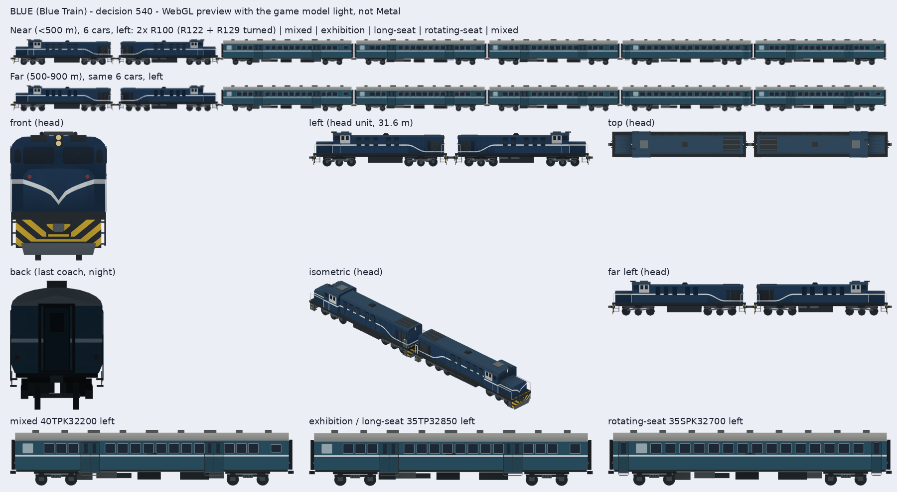

### 540. 藍皮解憂號改用雙機藍色 R100 與 #1671 的修復客車

2026-11-01，派工單 BLUEIN（session_01YGNNuknnBHuUGoBrA3XVGE，遊戲規劃第 41 任 session_01YGNNunAdcksLhSB1H1495m 派），分支 `claude/blue-r100-breezy`。只動 GamePresentation、測試、`tools/train-models/hashes.lock.json` 與文件；GameCore、存檔版本、golden schema、golden 值、SaveFixtures、ReplayFixtures 都不動。

## 原因

#1671（Codex，已合併）做了原生 R100（`Map3DR100`，橘色 R122 與藍色 R123）和全新的藍皮客車 `Map3DBreezyBlueCoaches`（40TPK32200 混合車、35TP32850 策展／長椅車、35SPK32700 旋轉椅車），但只把橘色接到莒光號 `R100CK`；藍皮解憂號（`TrainType.blueTrain` → `BLUE`，決策 286）還是 scene kit 的 R135 方塊機車加舊的藍色客車，而且沒有遠景版。

## 來源與編組選擇

證據都在 `docs/art/tra-r100/`（`blue-sources.json`、`IDENTITY.md`、README）與 `tools/tra-r100/formation.json`：

- 機車：2026-05-22 的乘車記錄（4travel 12055095）拍到 R122 與 R129 兩台藍色 R100 重連牽引，R122 短罩端（駕駛室）朝外、R129 短罩端朝客車；R123 的 2023-01-22 正式營運照片是藍色塗裝的代表。兩台都用 R123 的藍色幾何，R122／R129 的改造差異沒有獨立證據（UNVERIFIED）。
- 客車：同一筆記錄的五節角色順序是 **混合、策展、長椅、旋轉椅、混合**；臺鐵官方頁面只給四種角色，不給節數與順序。各節車號（只有 TP32859 出現在照片，位置未定）與方向都 UNVERIFIED，不捏造，每節都朝前。
- 所以選 **雙機五客**（formation.json 的 `breezy-blue-five-coach-role-study-unverified`），不是單機：單機沒有日期可考的實車照片。

## 做法

- `Map3DTrainSet.breezyBlue(far:)`（`Map3DTrainSets.swift`）取代 `hauled("BLUE", locomotive: .r135, …)`：
  - **頭車**：兩台 `Map3DR100.model(livery: .breezyBlue)` 背對背合成一節 31.6 m 的頭車單元（前一台 +X 朝前、後一台轉 180°，與 formation.json 相同的 15.8 m 間距），`litLenses(_:front: true)` 只把最前端 30 % 內的頭燈鏡片標成發光（決策 529 的做法），決策 449 每幀決定哪端亮頭燈或尾燈。遊戲的一列「節數」仍由玩家決定，雙機算第 1 節。
  - **客車角色怎麼依節數排**：新增 `Map3DTrainSet.cycleFromFront`（`Map3DModelPack.modelIndex(of:carIndex:count:)`），中間車從頭車後面起照 `cycle` 依序循環、不做後半鏡像：混合、策展、長椅、旋轉椅，再從混合開始；**最後一節固定是混合車**，背面兩盞紅色標識燈（配方自己的 `0x9D413A` 鏡片）換成 `Map3DPalette.lantern` 並發光（`breezyBlueTail`）。所以 6 節＝雙機＋回報的五客；2 節＝雙機＋混合；9 節＝雙機＋混合、策展、長椅、旋轉椅、混合、策展、長椅、混合。
  - 策展車與長椅車都是 35TP32850，#1671 的外觀完全相同（雜湊相同，沒有做車內），所以共用一個模型（`set-BLUE-panto`），`cycle` 是 `[.middle, .pantograph, .pantograph, .fourth]`；`set-BLUE-centre` 不存在。省下 4 個模型、約 2.5 MB。
  - `ownLengths: true`（頭車 31.6 m、客車 20 m，不再拉成 19.4 m）；`BLUEFar` 是同一編組的遠景版（`Map3DR100` 與客車的 `far: true`），`BLUE` 加進 `nearOnly`（500 m 內近景、500–900 m 遠景）。
- 舊的 `Map3DTrainLocomotive.r135` 只有 `BLUE` 用，刪掉；`hoodUnit` 只給 R135 的 `chevron` 參數與 V 字一起刪（R100、CT273 的代用機車本來就不畫它，雜湊不變）。蒸汽列車 `STEAM` 仍用舊的藍色客車（`TrainLivery.blueTrain`），不動。
- studies 裡 #1671 的單元與配置照舊（工具與雜湊鎖讀）。

## 數字

| | 改前 | 改後 |
| --- | --: | --: |
| `set-BLUE-head` 三角形 | 1,320（R135） | 14,636（雙機） |
| 客車近景 | 1,528（舊藍客車） | 混合 13,194／策展・長椅 13,278／旋轉椅 12,234 |
| 遠景（`BLUEFar`） | 沒有 | 頭車 6,932；客車 5,478／5,370／4,950 |
| 6 節一列近景 | — | 79,814（12 節約 16 萬，預算 240,000） |
| 標準模型包 | 674 個模型、4,445,868 頂點 | 688 個、4,741,050（+295,182，一份約 +11.8 MB） |
| 模型包記憶體（`testWhatTheMapKeepsInMemory`） | 約 177.8 MB | 189.6 MB |

`check.mjs --new-set BLUE` 通過（每節 ≤ 20,000、遠景少於近景一半且同框）。`hashes.lock.json` 只改／加 `set-BLUE*`、`set-BLUEFar*` 與它們的窗模型 `light-set-BLUE*` 共 20 行，別的模型雜湊都沒動。

## 對照圖

`tools/train-models/render.mjs` 的日光預覽（WebGL，遊戲的模型光，不是 Metal）。上兩排：近景與遠景的 6 節編組（左側）；下面：頭車正面、左側、俯視、等角、遠景左側，最後一節夜間背面，三種客車左側。完整七向（日／夜）在 `a91453/railway-assets-private` #42 的 `game-art-previews/docs/art/tra-r100-blue-operation/revision-1/`（近景日、遠景日、近景夜各七向）。

## 五個角度

- 玩家：藍皮解憂號從方塊機車變成看得出是兩台 R100 重連拉五節藍皮客車，遠看也是同一列；買車與節數都不變。
- 鐵道迷：雙機、R129 反向、客車角色順序都照 2026-05-22 的實車記錄，三種車型的門窗、台車不同；客車車號與方向未證，照實寫 UNVERIFIED，不猜。
- 開發者：用現成的 `ownLengths`／`cycle`，只加一個 `cycleFromFront` 旗標，舊 R135 刪除；模型包多 11.8 MB（已共用相同的 35TP32850 省下 2.5 MB），實機幀數 UNVERIFIED（決策 417）。
- 美術：霧面平塗、一個三角形一個顏色，與其他原生車一致；遠景同框、同色，標識燈只在最後一節的背面亮。
- 音樂：無（`BLUE` 本來就用柴油汽笛，`TrainHorn` 不動）。

## 下一步

- 等遊戲規劃看總覽圖後才轉 ready（決策 482 修訂最高級）；真機外觀、幀數、夜燈 UNVERIFIED，等 TestFlight。
- 客車實號、各節方向、R122／R129 的改造差異仍是 `docs/art/tra-r100/blue-sources.json` 的缺口；有證據後只改配置，不改配方。
- WhatsNew 由遊戲規劃統一寫。
