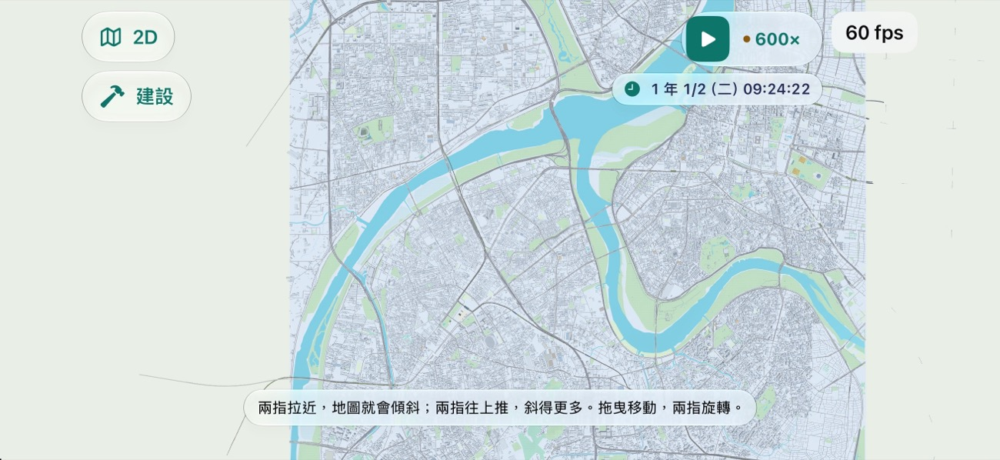
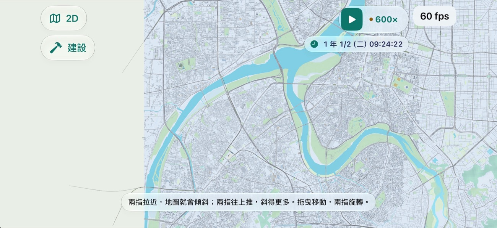
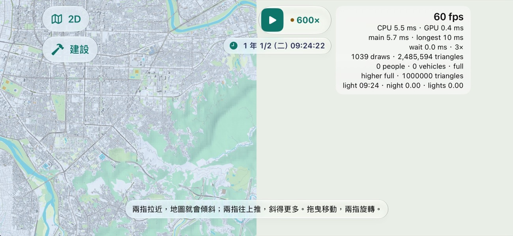

### 714. 3D 最遠視野：鏡頭看得到的地方都建，鏡頭的目標不離開地圖

2026-11-13，派工單 MAP3D-FAR（Mac 本機，遊戲規劃第 64 任派），分支 `claude/map3d-far`。接 `docs/research/DEVICE_C_2026-11-13.md` 3.2、3.3（實機 iPhone 17 Pro、0.6.0 (128)）。`Sources/GameCore/`、存檔版本、golden、SaveFixtures、ReplayFixtures：不動。

## 1. 症狀與原因

實機量到兩件，其實是兩個不同的缺口，**都不是 #2105（決策 711）造成的**：`Map3DStreaming.around` 與 `isOnMap` 在 `cfc051d`（#2105 之前）一字不差，#2105 只加了卸載。

1. **不拖，最遠視野也只有中間一條有地面。** 串流（決策 358）只要兩種區塊：鏡頭目標四周 3 km（`around`），與移動方向前方的一條。場景本體是開 3D 處四周各 6 km（12 km 見方）。但鏡頭拉到最遠（12 km）、手機橫拿、正上方看，畫面橫向看得到約 23 km、縱向約 11 km。所以場景本體以外的地方永遠不會建，兩側是底色。純邏輯重演（`Map3DFarDragReportTests`，「整個臺灣」存檔）：看得到 544 塊，只有 352 塊。
2. **快拖三次後整片空，22 秒後仍然空。** 3D 的鏡頭沒有被限制在地圖內。存檔 B 的地圖只有 16.4 km 見方；最遠視野拖半個螢幕約 11 km，三次就把鏡頭目標拖出地圖。地圖外沒有任何區塊可建，場景本體又在畫面外，所以什麼都沒有，也不會回來。模擬器重現：拖三次後剩目標四周 3 km 的一塊「孤島」（還被地圖東緣切掉一半），再拖一次整片空（圖在 `docs/research/map3d-far-2026-11-13/`）。
   - 在「整個臺灣」那種大地圖上拖很遠不會整片空，但也只會補回目標四周 3 km 的一圈：看得到 544 塊、只有 130 塊。

派工單原本以為「約 10 秒會補回來」：那是大地圖上那 3 km 的一圈。

## 2. 改了什麼

- **鏡頭看得到的區塊也建**（`Map3DStreaming.seen(by:slack:)`、`Window.step(... seeing:room:)`）：目標自己要的（四周 3 km、前方）都有了之後，接著建「地圖上、鏡頭看得到、離目標不超過鏡頭距離 1.1 倍」的區塊，由近到遠；還看得到的（再多 1 km 的邊）不卸。鏡頭距離 2.7 km 以內看得到的本來就在 3 km 內，所以近景完全不變。離開開 3D 處 2 km 以外建的區塊照決策 368 是沒有完整城市的那種，比較輕。
- **鏡頭的目標留在地圖上**（`Map3DCamera.held(over:)`、`Map3DStreaming.ground`）：沒有跟著車、也不在飛行途中時，每格把目標夾回地圖的範圍。拖到地圖邊就停，畫面至少有一半是地圖。
- **守住決策 711 的上限**：
  - 每格三角形預算（`Map3DSceneBudget`）沒有動：多出來的區塊照舊由近到遠分，放不下的只畫地面、路、軌道。模擬器存檔 B 最遠視野拖到地圖邊：2,485,594 個三角形、1,039 次繪製（改之前同一個存檔的最遠視野是 236–249 萬）。
  - 區塊緩衝超過上限（400／700／1,000 MB）時，不再為「看得到」建新的（`room: false`），已經在的留著；目標四周 3 km 照建。
  - 卸載的半徑從「鏡頭距離」改成「鏡頭距離的 1.1 倍」（`Map3DStreaming.sight(of:)`），和上面建的範圍同一個數字，所以卸掉的不會馬上又被建回來（測試 `testSheddingLeavesWhatTheViewBuilds`）。
  - 模擬器（iPhone 17 Pro 的模擬器、Debug、裝置分級指定高階）的 app 記憶體：存檔 B 最遠視野拖到地圖邊 1,055 MB（MAP3D-CAP 量的同一存檔是 1,057 MB）；「整個臺灣」存檔最遠視野連拖三次到海邊 824 MB。

## 3. 玩家看到的

| | 改之前（main `1c16769`） | 改之後 |
| --- | --- | --- |
| 存檔 B 拉到最遠 |  |  |
| 存檔 B 再同方向快拖四次，22 秒後 |  |  |

- 存檔 B 的地圖只有 16.4 km，最遠視野比地圖寬，所以地圖外仍是底色（左圖改之後左邊那一塊、拖到邊時的右半）；地圖內看得到的都有地面、路、軌道。
- 改之前拖三次的「孤島」：`B-dragged3-before.jpg`。
- 「整個臺灣」存檔：拉到最遠，3 秒時只剩三個角沒到，之後整個畫面都有（`A-far-after.jpg`）；連拖三次（約 35 km，到西海岸外）後 6 秒約一半（`A-dragged-after-6s.jpg`）、12 秒剩四個角（`A-dragged-after-12s.jpg`）、22 秒全滿。這是模擬器的 Debug 版；實機的時間沒有量。
- 預算擋住的地方（離目標遠的區塊）只有地面、路、軌道，沒有建築：決策 711 本來就這樣。

## 4. 五個角度

- 玩家：拉遠看整張地圖時不再是中間一條；怎麼拖都不會把地圖弄丟。
- 鐵道迷：遠處的區塊只是補上地面、路與軌道，位置與資料來源不變；買下來的路線在最遠視野看得到全線經過的地方。
- 開發者：兩個都是純函式，在 GamePresentation、Linux 測得到；Metal 那邊只多傳一個鏡頭與一個夾回地圖。上限沿用決策 711 的。
- 美術：最遠視野從「一條地圖加兩片底色」變成整面地圖；地圖比視野小的存檔，邊界外仍是底色，沒有另外畫東西。
- 音樂：無。

## 5. 查了什麼

- 參考庫：`OpenWorld/reference_snapshot/play/src/engine/world-stream.js`（決策 358 已用：玩家四周一個半徑）；`Railway/tw3d-reference-clean` 的 `tile-world.js` 依距離分級。都是「目標四周一個半徑」，沒有照視野算的，沒有可搬的程式。
- 外面的專案：Cesium 與 MapLibre 的做法是「畫面上看得到哪些 tile 就載哪些」（視錐挑 tile）。取了這個想法，程式是這個專案自己寫的（用已有的 `Map3DCamera.sees`）。

## 6. 沒選的

- **把 `around` 從 3 km 加大到 13 km**：一個圓有近兩千塊，畫面是 23×11 km 的長方形，只看得到五百多塊；多建三倍、記憶體白花。
- **把場景本體加大**：開 3D 要等更久（存檔 B 的 12 km 場景已經要好幾秒），而且拖遠了一樣缺。
- **鏡頭夾到「畫面不超出地圖」**：16 km 的地圖比最遠視野窄，做不到；要做就得限制能拉多遠，改到別的存檔的手感。
- **地圖外畫一片示意的地面**：沒有資料的地方畫東西，玩家會以為那裡能蓋。底色照舊。
- **快拖時也建**：目標每秒超過 1 km 時照舊不建（決策 358：建的比經過的慢），放手後速度的估計約 2 秒內降下來才開始補。

## 7. 已知限制、下一步

- **實機沒有驗**（這個 PR 只在模擬器看過）。要看的：存檔 B 最遠視野兩側有沒有補上、拖到地圖邊會不會停、補滿要幾秒、記憶體有沒有比 1,674 MB 明顯多。
- 傾斜著看很遠時，離目標超過鏡頭距離 1.1 倍的地方仍然不建（本來就不建）。
- 還沒建的區塊不知道地面多高，用「目標上下各 600 m」估它看不看得到；高山上斜著看，邊上可能多建或少建幾塊。
- 預算邊界沒有遲滯（決策 711 第 7 節）：現在最遠視野的區塊變多，更常碰到預算，邊上的區塊在「簡化／只剩地面」之間換的機會也多了。
- 最遠視野實機 GPU 一格 53–58 ms 是另一件（MAP3D-FAR 第二件），這裡沒有動；視野裡的區塊變多之後，那個數字要重量。
